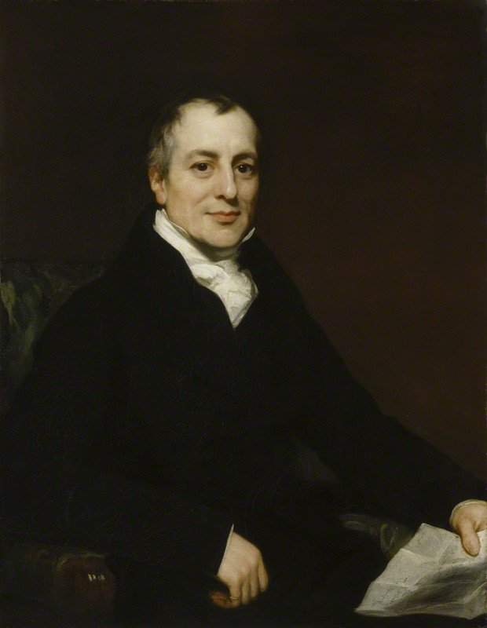
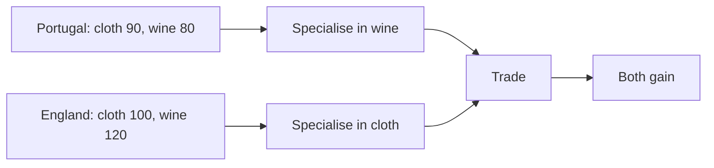

# David Ricardo (1772–1823)

**Prerequisites:** [Classical economics](../02-classical-economics.md), [Comparative advantage](../../01-foundations/07-comparative-advantage.md).

*David Ricardo, portrait by Thomas Phillips. Credit: Thomas Phillips. License: Public domain. Source: [File:Portrait of David Ricardo by Thomas Phillips.jpg](https://commons.wikimedia.org/wiki/File:Portrait_of_David_Ricardo_by_Thomas_Phillips.jpg).*

David Ricardo was a stockbroker turned economist and member of Parliament who gave classical economics its most rigorous form. His *On the Principles of Political Economy and Taxation* (1817) introduced the theory of comparative advantage and the theory of differential rent, and his abstract, model-based method set a pattern for economic theory ever since.

## Life

Ricardo was born in London in 1772, the third of many children of a Sephardic Jewish family that had moved from the Dutch Republic. His father was a stockbroker, and David joined him in business at 14. At 21 he married Priscilla Anne Wilkinson, a Quaker, and broke with his family over the marriage, becoming a Unitarian. He went into business on his own and became very wealthy through trading government securities, including a famously profitable position at the time of the Battle of Waterloo (1815). The details of the Waterloo episode have often been exaggerated in popular retellings.

In 1799, he read Smith's *Wealth of Nations* while on holiday in Bath and became fascinated by economics. He became a friend and intellectual sparring partner of Thomas Malthus, with whom he carried on a long and cordial correspondence despite deep disagreements, and of James Mill, who encouraged him to write. He retired from business, bought an estate at Gatcombe Park in Gloucestershire, and from 1819 sat in Parliament for the borough of Portarlington in Ireland, speaking for free trade and against the Corn Laws. He died suddenly in 1823, aged 51.

## Main contributions

### Monetary economics

Ricardo first became known through pamphlets on the "bullion controversy". In *The High Price of Bullion* (1810), he argued that British inflation during the Napoleonic Wars was caused by the Bank of England's over-issue of paper money after convertibility into gold was suspended in 1797. He favoured a return to the gold standard.

### Differential rent

Rent arises because land differs in fertility. As population grows, less fertile land comes into cultivation; the better land then earns a rent equal to its productivity advantage over the worst land in use. Rent is a result of high grain prices, not their cause (see [land and rent](../../06-factor-markets/08-land-and-rent.md)).

### Comparative advantage

Ricardo's example of England and Portugal trading cloth and wine showed that a country benefits from trade even if it is more efficient at producing everything, as long as relative costs differ. In his example, Portugal needed 90 men's labour for a year to produce a quantity of cloth and 80 for a quantity of wine; England needed 100 and 120. Portugal is better at both, but relatively better at wine; England should specialise in cloth (see [comparative advantage](../../01-foundations/07-comparative-advantage.md)).

### Distribution and growth

Ricardo's model divided output among landlords (rent), workers (wages) and capitalists (profit). As population grew, rents would rise and profits would fall, slowing accumulation toward a **stationary state**. Free trade in grain could postpone this by lowering food costs. He concluded that landlords' interests were opposed to those of the rest of society.

### Other ideas

- **Ricardian equivalence.** Ricardo discussed whether financing government spending by debt or taxes makes a difference, concluding that in theory it might not (because people would anticipate future taxes) but in practice it did. Robert Barro revived the idea in 1974.
- **"On Machinery."** In the third edition of the *Principles* (1821), Ricardo added a chapter admitting that the introduction of machinery could, at least temporarily, harm workers, an unusual public change of mind.
- **Labour theory of value.** Ricardo held that relative prices are largely determined by the labour required to produce goods, while recognising exceptions due to capital and time.

## Method and legacy

Ricardo reasoned from simplified assumptions to strong conclusions, an approach Joseph Schumpeter later criticised as the "Ricardian vice": applying abstract models directly to policy. Yet comparative advantage remains one of the most important and counter-intuitive ideas in economics; Paul Samuelson cited it as an example of a proposition that is both true and not trivial. Marx built on Ricardo's labour theory of value, and Piero Sraffa's edition of Ricardo's works (1951–1973) was a landmark of scholarship.

## Key ideas

- A wealthy stockbroker who turned to economics after reading Smith.
- Developed differential rent and comparative advantage.
- Modelled distribution among rent, wages and profit, predicting a stationary state absent free trade.
- His abstract method shaped economic theory; Schumpeter warned of the "Ricardian vice".

## Where this leads

- Next thinker: [John Stuart Mill](03-john-stuart-mill.md).
- Related: [Adam Smith](01-adam-smith.md), [gains from trade](../../01-foundations/08-gains-from-trade.md).
- Glossary: [comparative advantage](../../glossary/comparative-advantage.md), [economic rent](../../glossary/economic-rent.md), [Ricardian equivalence](../../glossary/ricardian-equivalence.md).
