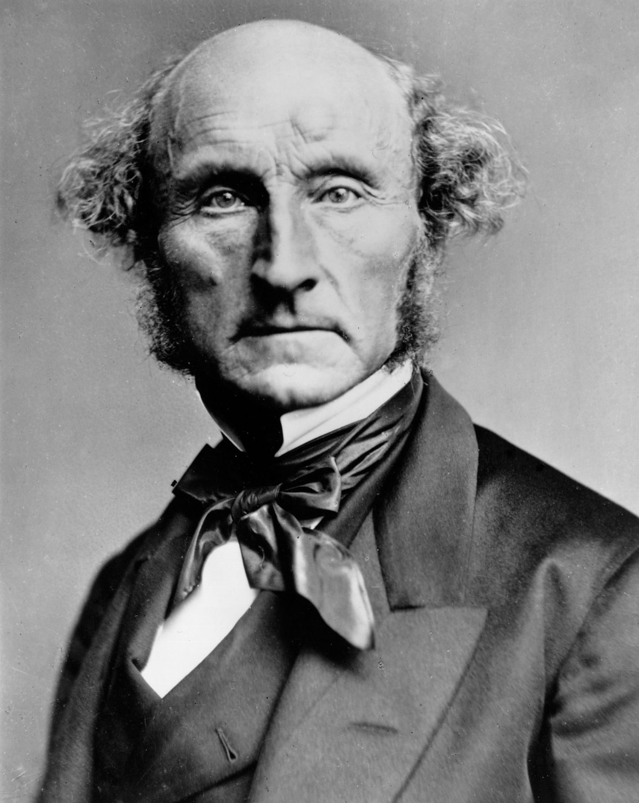
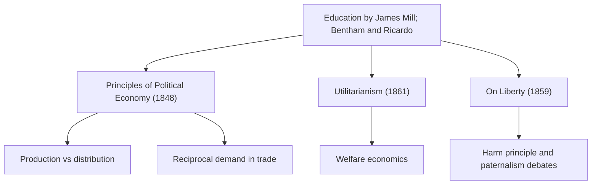

# John Stuart Mill (1806–1873)

**Prerequisites:** [[classical-economics|Classical economics]], [[efficiency-versus-equity|Efficiency versus equity]].

*John Stuart Mill, photographed by the London Stereoscopic Company, about 1870. Credit: London Stereoscopic Company. License: Public domain. Source: [File:John Stuart Mill by London Stereoscopic Company, c1870.jpg](https://commons.wikimedia.org/wiki/File:John_Stuart_Mill_by_London_Stereoscopic_Company,_c1870.jpg).*

John Stuart Mill was the most influential English-speaking philosopher of the 19th century and the last great classical economist. His *Principles of Political Economy* (1848) was the standard economics text for half a century. He also wrote foundational works of liberal political philosophy (*On Liberty*, 1859), ethics (*Utilitarianism*, 1861) and feminism (*The Subjection of Women*, 1869).

## Life and education

Mill was born in London in 1806, the eldest son of the philosopher and historian James Mill, a close associate of Jeremy Bentham and David Ricardo. His father gave him an extraordinarily intense education: he began learning Greek at three and Latin at eight, and by his early teens had studied logic and Ricardo's political economy. In his *Autobiography* (1873), Mill described a "mental crisis" at around age 20, when he realised that achieving all the reforms he worked for would not make him happy. Poetry, especially Wordsworth's, helped him recover and convinced him that cultivating feelings mattered as much as reasoning.

Mill worked for the East India Company from 1823 until it lost its administrative role in 1858. In 1851 he married Harriet Taylor after a long friendship; he credited her with major influence on his work, especially *On Liberty* and his views on women and socialism. He served as Member of Parliament for Westminster from 1865 to 1868, where he proposed an amendment to give women the vote. He died in Avignon, France, in 1873.

## Economics

### Principles of Political Economy (1848)

Mill synthesised classical economics in a clear and humane form. Key points:

- **Production versus distribution.** The laws of production "partake of the character of physical truths", but distribution "is a matter of human institution solely". Society can choose how wealth is distributed, within the constraints of incentives.
- **International trade.** Mill developed the theory of **reciprocal demand**, explaining how the terms of trade between countries are determined by each country's demand for the other's goods, completing Ricardo's comparative advantage theory.
- **Wages-fund doctrine.** Mill initially accepted that the total amount available for wages was fixed in the short run, but publicly abandoned the doctrine in 1869, a notable intellectual retreat.
- **The stationary state.** Unlike most economists, Mill welcomed the prospect of an economy that stopped growing, provided population was controlled and wealth fairly distributed. People could then focus on "mental culture, and moral and social progress".
- **Cooperatives and socialism.** In later editions, he expressed sympathy for worker cooperatives and some socialist ideals, while remaining committed to competition and individual liberty.
- **Infant industries.** Mill accepted temporary protection for new industries in young countries as a possible exception to free trade.

### Method and "economic man"

In his 1836 essay "On the Definition of Political Economy", Mill argued that economics studies people only as beings who desire wealth, abstracting from other motives. This is an early statement of what later became called **homo economicus**, though Mill presented it as a deliberate simplification, not a full account of human nature (see [[the-rationality-assumption|the rationality assumption]]).

## Philosophy relevant to economics

- **Utilitarianism.** Mill refined Bentham's utilitarianism, arguing that some pleasures (intellectual, moral) are higher than others: "It is better to be a human being dissatisfied than a pig satisfied." Utilitarian thinking underlies welfare economics and cost-benefit analysis.
- **The harm principle.** In *On Liberty*, "the only purpose for which power can be rightfully exercised over any member of a civilized community, against his will, is to prevent harm to others." The principle bears on debates about paternalism and nudges (see [[nudges-and-choice-architecture|nudges]]).

## Legacy

Mill bridged classical economics and liberal political thought. The marginal revolution of the 1870s overturned his value theory, but his ideas about distribution, liberty, the stationary state and women's equality remain influential.

## Key ideas

- Intensively educated by his father; the last major classical economist.
- Distinguished laws of production (fixed) from distribution (chosen by society).
- Developed reciprocal demand in trade theory and abandoned the wages-fund doctrine.
- His utilitarianism and harm principle shape welfare economics and debates over paternalism.

## Where this leads

- Next thinker: [[karl-marx|Karl Marx]].
- Related: [[efficiency-versus-equity|efficiency versus equity]], [[path:philosophy/concepts/ethics/eudaimonia.md|eudaimonia]] (happiness and flourishing).
- Glossary: [[g:utilitarianism|utilitarianism]], [[g:harm-principle|harm principle]], [[g:homo-economicus|homo economicus]].
