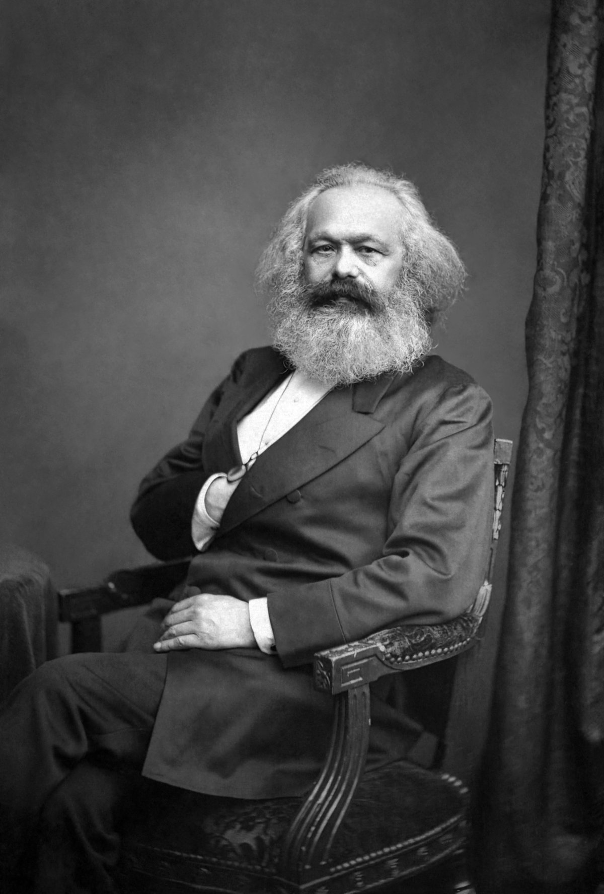
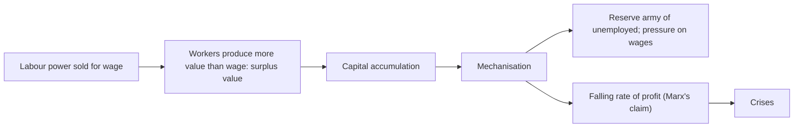

# Karl Marx (1818–1883)

**Prerequisites:** [Classical economics](../02-classical-economics.md), [Schools of thought](../05-schools-of-thought.md).

*Karl Marx, photographed by John Jabez Edwin Mayall in 1875. Credit: John Jabez Edwin Mayall. License: Public domain. Source: [File:Karl Marx by John Jabez Edwin Mayall 1875 - Restored.png](https://commons.wikimedia.org/wiki/File:Karl_Marx_by_John_Jabez_Edwin_Mayall_1875_-_Restored.png).*

Karl Marx was a German philosopher, economist, historian and revolutionary whose critique of capitalism became one of the most influential bodies of thought in history. His economics built on the classical labour theory of value to argue that capitalism rests on the exploitation of labour and is prone to crises. His ideas inspired socialist and communist movements worldwide, including regimes that claimed his name and whose record remains intensely debated.

## Life

Marx was born in 1818 in Trier, in the Prussian Rhineland. He studied law and then philosophy at Bonn and Berlin, where he was influenced by Hegel and the "Young Hegelians", and received a doctorate from the University of Jena in 1841. Barred from an academic career by his radical views, he became a journalist, editing the *Rheinische Zeitung* until it was suppressed in 1843. In Paris he began his lifelong collaboration with Friedrich Engels, son of a textile manufacturer. Together they wrote *The Communist Manifesto* (1848).

After the failed revolutions of 1848, Marx settled in London in 1849, where he lived for the rest of his life, often in poverty and supported financially by Engels. He spent years researching in the British Museum reading room. He published *Capital*, volume 1, in 1867. He died in London in 1883 and is buried in Highgate Cemetery. Engels edited and published volumes 2 (1885) and 3 (1894) from Marx's manuscripts.

## Economic ideas

### Commodities and value

Marx began *Capital* with the commodity, distinguishing its **use value** from its **exchange value** (a distinction going back to Aristotle). He argued that the exchange value of commodities is determined by the **socially necessary labour time** required to produce them.

### Surplus value and exploitation

Workers sell their **labour power** (capacity to work) to capitalists for a wage equal to the value of the goods they need to live. But in a working day they produce more value than their wage. The difference is **surplus value**, the source of profit, interest and rent.

**Example (in Marx's terms).** A worker works a 10-hour day. The goods needed to sustain the worker for a day embody 6 hours of labour, so the daily wage equals 6 hours' worth of value. The remaining 4 hours produce surplus value appropriated by the capitalist. The **rate of surplus value** (rate of exploitation) is 4/6 ≈ 67 percent.

### Dynamics of capitalism

- **Accumulation.** Competition forces capitalists to reinvest profits and adopt labour-saving machinery.
- **Falling rate of profit.** Because only labour creates surplus value, replacing workers with machines tends to lower the rate of profit over time, Marx argued, though he discussed counteracting tendencies.
- **Reserve army of labour.** Mechanisation creates unemployment, which holds down wages.
- **Crises.** Capitalism is prone to recurring crises of overproduction and disproportion.
- **Concentration.** Capital becomes concentrated in fewer, larger firms.

### Historical materialism

Marx argued that the economic structure of society, its "relations of production", shapes its laws, politics and ideas. History proceeds through stages (ancient, feudal, capitalist), driven by class struggle, and he expected capitalism to give way to socialism.

## Criticisms

- **The transformation problem.** In volume 3, Marx tried to show how labour values translate into actual prices of production. Critics, beginning with Eugen von Böhm-Bawerk (*Karl Marx and the Close of His System*, 1896), argued that the transformation fails; the debate continues among Marxian economists.
- **Marginalism** replaced the labour theory of value in mainstream economics: value depends on marginal utility and scarcity, not labour alone.
- **Predictions.** Real wages in capitalist economies rose substantially, contrary to expectations of increasing misery; revolutions occurred mainly in agrarian societies rather than advanced industrial ones.
- **Planned economies** claiming Marxist inspiration suffered from inefficiency, shortages and political repression, including famines associated with collectivisation in the Soviet Union and China.

## Legacy

Marx's influence extends well beyond economics, to sociology, history, philosophy and politics. Even critics credit him with insights into technological change, the dynamism and instability of capitalism, globalisation, and the relationship between economic power and politics. Schumpeter, no Marxist, devoted the opening of *Capitalism, Socialism and Democracy* (1942) to a respectful analysis of Marx.

## Key ideas

- Built on classical labour value theory to argue that profit arises from surplus value extracted from workers.
- Analysed accumulation, mechanisation, unemployment, crises and concentration as features of capitalism.
- Historical materialism holds that economic structures shape society and history.
- Criticised for the transformation problem, failed predictions and the record of planned economies; influential across the social sciences.

## Where this leads

- Next thinker: [William Stanley Jevons](05-william-stanley-jevons.md).
- Related: [schools of thought](../05-schools-of-thought.md), [income inequality](../../06-factor-markets/09-income-inequality.md).
- Glossary: [surplus value](../../glossary/surplus-value.md), [labour theory of value](../../glossary/labour-theory-of-value.md), [Marxian economics](../../glossary/marxian-economics.md).
