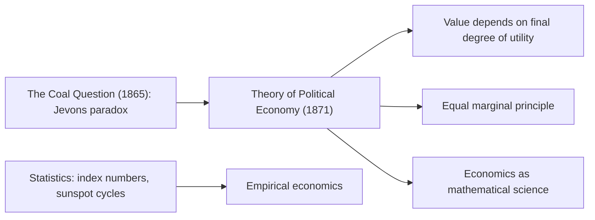

# William Stanley Jevons (1835–1882)

**Prerequisites:** [The marginal revolution](../03-the-marginal-revolution.md), [Marginal utility](../../03-consumer-theory/02-marginal-utility.md).

*William Stanley Jevons in 1858, during his years in Sydney. Credit: Unknown author. License: Public domain. Source: [File:William Stanley Jevons 1858.jpg](https://commons.wikimedia.org/wiki/File:William_Stanley_Jevons_1858.jpg).*

William Stanley Jevons was an English economist, logician and statistician, and one of the three founders of the marginal revolution. His *The Theory of Political Economy* (1871) argued that value depends on utility at the margin and that economics must be a mathematical science. He was also a pioneer of index numbers, energy economics and the statistical study of business cycles.

## Life

Jevons was born in Liverpool in 1835, the son of an iron merchant. He studied chemistry and mathematics at University College London, but left before graduating in 1854 to take a job as assayer at the new Royal Mint in Sydney, Australia. In Sydney he studied meteorology, photography and the colony's economy, and became interested in political economy. He returned to London in 1859 to complete his studies, then taught at Owens College, Manchester (1863–1876) and University College London (1876–1880). He drowned while swimming near Hastings in 1882, aged 46.

## The Coal Question (1865)

Jevons first became famous for *The Coal Question*, which argued that Britain's industrial supremacy depended on cheap coal, and that coal reserves would become more expensive to exploit as the best seams were exhausted. The book impressed William Gladstone and was debated in Parliament.

It contains what is now called the **Jevons paradox**: improvements in the efficiency with which a resource is used can **increase** total consumption of it. More efficient steam engines made coal-powered work cheaper, which expanded the uses of coal so much that total coal consumption rose. "It is wholly a confusion of ideas to suppose that the economical use of fuel is equivalent to a diminished consumption. The very contrary is the truth." Modern energy economists debate the size of this **rebound effect**; most find that efficiency gains usually reduce consumption by less than the engineering savings, with full "backfire" occurring only in some cases.

## The Theory of Political Economy (1871)

Jevons opened with a radical claim: "value depends entirely upon utility". He rejected the classical labour theory of value; labour affects value only indirectly, by changing supply and therefore the marginal utility of the good.

- **Final degree of utility.** His term for marginal utility: the utility of the last increment of a good consumed. It diminishes as consumption increases.
- **Equal marginal principle.** A person allocates a good between uses so that its final degree of utility is equal in each.
- **Exchange.** In trade, the ratio of exchange equals the ratio of the final degrees of utility of the goods for each trader.
- **Labour supply.** People work until the marginal pain of labour equals the marginal utility of what it earns.

### A Jevonian example

A person has 10 hours to divide between two crops (or uses). If the marginal utility of an hour on crop A is 12 at 4 hours and 8 at 6 hours, while for crop B it is 8 at 4 hours and 5 at 6 hours, then allocating 6 hours to A and 4 to B equalises marginal utility at 8 in each use. Any other split could be improved by moving an hour toward the use with higher marginal utility.

Jevons drew on Bentham's utilitarianism, describing economics as "the mechanics of utility and self-interest" and writing of a "calculus of pleasure and pain". He acknowledged precursors, including Gossen, whose 1854 work he discovered after publishing his own.

## Statistics and logic

- **Index numbers.** In *A Serious Fall in the Value of Gold* (1863), Jevons used a price index based on the geometric mean to measure how the gold discoveries in California and Australia had changed the value of money, an early use of index numbers.
- **Business cycles.** He proposed that sunspot cycles affected harvests and through them trade cycles. The theory was not supported, but his attempt to link economic fluctuations to measurable data was ahead of its time.
- **Logic.** In *The Principles of Science* (1874), he wrote on logic and scientific method, and built a "logic piano", a mechanical device for solving logical problems, an early precursor of computing machines.

## Legacy

Jevons established the mathematical, utility-based approach that, through Edgeworth, Marshall and Wicksteed, became English neoclassical economics. His empirical and statistical work prefigured econometrics, and the Jevons paradox remains central to debates on energy efficiency and climate policy.

## Key ideas

- Co-founder of the marginal revolution: value depends on the final degree (marginal) of utility.
- Insisted economics must be mathematical; drew on Bentham's calculus of pleasure and pain.
- The Jevons paradox: efficiency can increase total resource use.
- Pioneer of index numbers and empirical business cycle research.

## Where this leads

- Next thinker: [Carl Menger](06-carl-menger.md).
- Related: [marginal utility](../../03-consumer-theory/02-marginal-utility.md), [pollution](../../07-market-failure/03-negative-externalities-and-pollution.md).
- Glossary: [Jevons paradox](../../glossary/jevons-paradox.md), [marginal utility](../../glossary/marginal-utility.md), [marginal revolution](../../glossary/marginal-revolution.md).
