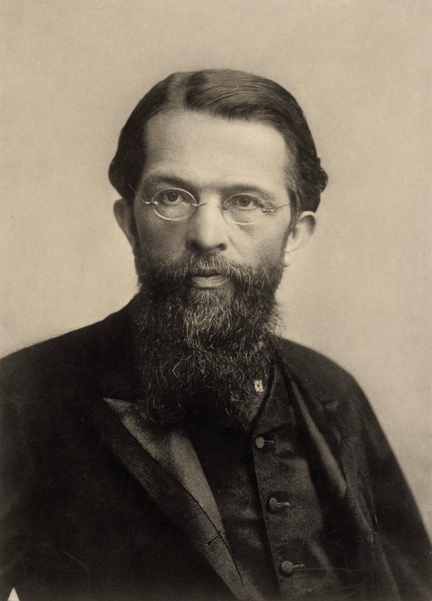
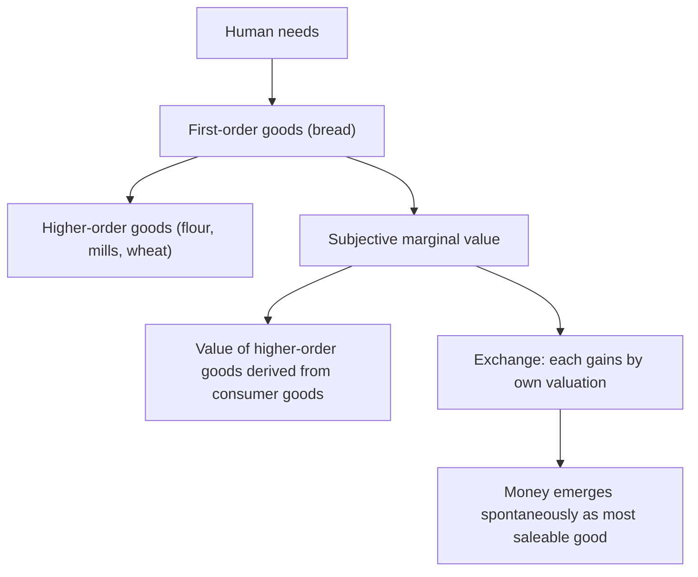

# Carl Menger (1840–1921)

**Prerequisites:** [The marginal revolution](../03-the-marginal-revolution.md), [Schools of thought](../05-schools-of-thought.md).

*Carl Menger, collotype portrait (Austrian National Library). Credit: Unknown author. License: Public domain. Source: [File:Carl Menger Portrait ONB cropped.png](https://commons.wikimedia.org/wiki/File:Carl_Menger_Portrait_ONB_cropped.png).*

Carl Menger was an Austrian economist whose *Principles of Economics* (*Grundsätze der Volkswirtschaftslehre*, 1871) independently launched the marginal revolution and founded the **Austrian school** of economics. Unlike Jevons and Walras, he avoided mathematics, emphasising instead the causal chain from human needs to the value of goods, the role of time and uncertainty, and the spontaneous emergence of institutions such as money.

## Life

Menger was born in 1840 in Neu-Sandez, Galicia (now Nowy Sącz, Poland), then part of the Austrian Empire. He studied law and political science at the universities of Vienna and Prague and received a doctorate in law from the University of Kraków in 1867. Working as a journalist covering markets for an official Viennese newspaper, he noticed that traders' price-setting did not match classical theories, and set out to explain it. The *Grundsätze* appeared in 1871. He became a professor at the University of Vienna in 1873 and in 1876 was appointed tutor to Crown Prince Rudolf of Austria, travelling with him across Europe. He retired from teaching in 1903 and died in Vienna in 1921.

## Principles of Economics (1871)

### Goods and needs

Menger started from human needs. Something becomes a **good** when it can satisfy a need, people know this, and they can command it. Goods are ranked by **order**: bread is a first-order good (consumed directly); flour and the baker's labour are second-order goods; wheat and mills are higher-order goods. The value of higher-order goods is **derived** from the value of the consumer goods they help produce, the reverse of the classical view that costs determine value (see [derived demand](../../06-factor-markets/01-derived-demand.md)).

### Subjective, marginal value

Value is not inherent in goods but is a judgement people make about the importance of goods for satisfying their needs. Menger illustrated diminishing marginal value with a famous table of declining satisfactions, and with an isolated farmer who allocates his grain among uses of falling importance. His follower Böhm-Bawerk later made the example memorable with five sacks of grain: the first sack keeps the farmer alive, the second strengthens his health, the third feeds poultry, the fourth makes spirits, and the fifth feeds parrots. If he loses one sack, he gives up the least important use, feeding the parrots. The value of any one sack equals the importance of that least important use, its marginal value.

### Exchange and price

People trade when each values what they receive more than what they give up. Menger analysed isolated exchange, monopoly and competition, showing how prices emerge within ranges set by the valuations of buyers and sellers.

## The origin of money

In an 1892 article, "On the Origin of Money", Menger argued that money was not invented by government decree but emerged spontaneously. In barter, people accept goods that are easier to trade on (more **saleable**), even if they do not need them. Over time, the most saleable commodities, such as precious metals, become general media of exchange. Money is an example of an institution that is, in the Scottish philosopher Adam Ferguson's phrase, "the result of human action, but not the execution of any human design", a theme Hayek later developed as **spontaneous order**. See [money and value](../../../finance/01-foundations/01-money-and-value.md).

## The Methodenstreit

Menger's *Investigations into the Method of the Social Sciences* (1883) defended abstract, theoretical economics against the **German Historical School** led by Gustav von Schmoller, which argued that economics should proceed by collecting detailed historical data. The resulting "battle of methods" (*Methodenstreit*) was bitter and long. Menger accepted the value of history but insisted that general theoretical laws were possible and necessary. The debate gave the "Austrian school" its name, initially used dismissively by its opponents.

## Legacy

Menger's students and followers, Eugen von Böhm-Bawerk and Friedrich von Wieser, developed capital theory, opportunity cost and imputation. Through Ludwig von Mises and [Friedrich Hayek](11-friedrich-hayek.md), his ideas about subjective value, process, knowledge and spontaneous order became the core of the Austrian tradition. His approach to marginal value is also part of mainstream economics.

## Key ideas

- Independently founded marginalism, using verbal causal analysis rather than mathematics.
- Value is subjective and marginal; the value of production goods is derived from consumer goods.
- Money emerged spontaneously from barter as the most saleable good.
- Defended theory in the Methodenstreit and founded the Austrian school.

## Where this leads

- Next thinker: [Léon Walras](07-leon-walras.md).
- Related: [Friedrich Hayek](11-friedrich-hayek.md), [capital and interest](../../06-factor-markets/07-capital-and-interest.md).
- Glossary: [Austrian school](../../glossary/austrian-school.md), [spontaneous order](../../glossary/spontaneous-order.md), [subjective value](../../glossary/subjective-value.md).
