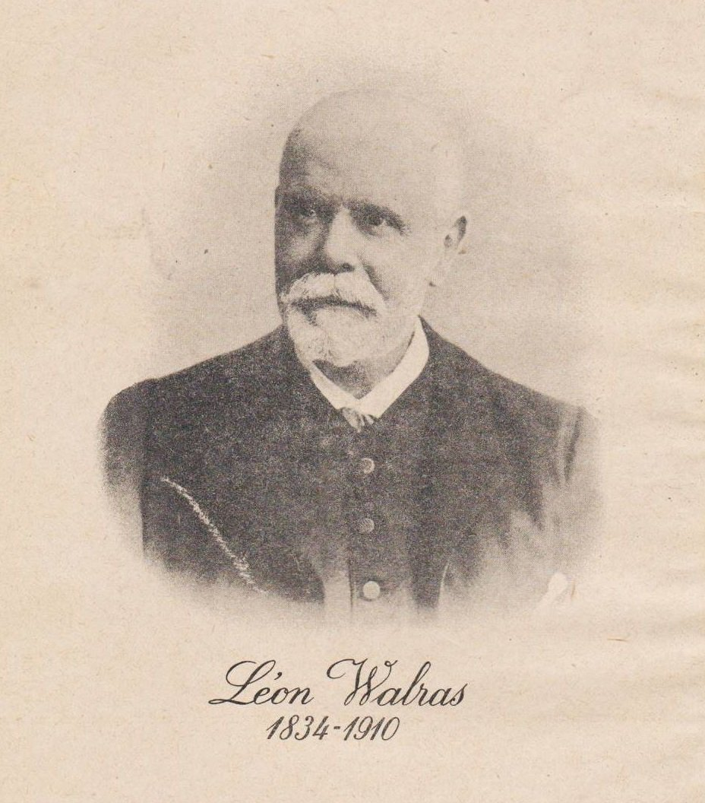

# Léon Walras (1834–1910)

**Prerequisites:** [[general-equilibrium|General equilibrium]], [[the-marginal-revolution|The marginal revolution]].

*Léon Walras, founder of general equilibrium theory. Credit: Unknown author. License: Public domain. Source: [File:Léon Walras.jpg](https://commons.wikimedia.org/wiki/File:Léon_Walras.jpg).*

Léon Walras was a French economist, working in Switzerland, who was one of the three founders of the marginal revolution and the creator of **general equilibrium theory**: the idea that all markets in an economy are interconnected and that prices are determined simultaneously. Joseph Schumpeter called him "the greatest of all economists" for this achievement, and his framework underlies much of modern economic theory.

## Life

Marie-Esprit-Léon Walras was born in Évreux, Normandy, in 1834. His father, Auguste Walras, was an economist who taught that value derives from scarcity (*rareté*) and urged his son to make economics a mathematical science. Léon twice failed the entrance examination for the École Polytechnique, studied at the École des Mines without completing the course, and tried his hand at fiction, journalism, railway clerking and managing a cooperative bank, which failed.

His break came in 1860, when he presented ideas on taxation at an international congress in Lausanne. In 1870 he was appointed to the newly created chair of political economy at the Academy (later University) of Lausanne, a post he held until 1892, when he was succeeded by [[vilfredo-pareto|Vilfredo Pareto]]. Walras and Pareto together are known as the **Lausanne school**. He died at Clarens, near Montreux, in 1910.

## Elements of Pure Economics (1874–1877)

Walras's masterpiece, *Éléments d'économie politique pure*, built a theory of an entire economy step by step:

1. **Exchange of two goods**, deriving demand curves from *rareté* (his term for marginal utility).
2. **Exchange of many goods**, with all relative prices determined together.
3. **Production**, adding factors (land, labour, capital) and firms that earn zero profit in equilibrium.
4. **Capital formation and credit.**
5. **Money.**

At each stage, equilibrium requires that supply equal demand in every market. Walras counted the equations and the unknown prices and quantities and found them equal, which he took as evidence that a solution existed (proof came only with Arrow and Debreu in 1954).

### Walras's law

If every agent spends exactly their income, the total value of excess demands across all markets is zero. So if all markets but one clear, the last one must also clear. Only relative prices are determined; one good, the **numéraire**, can be given a price of 1.

### Tâtonnement

To explain how equilibrium might be reached, Walras imagined an auctioneer who calls out prices, collects bids, raises prices of goods in excess demand and lowers prices of goods in excess supply, with no trading until equilibrium is found. This "groping" process (*tâtonnement*) is a thought experiment rather than a description of real markets. Later work showed that it need not converge in all cases.

### Worked illustration

Imagine three goods: bread, wine and cloth, with cloth as numéraire. Walras would write three excess-demand equations, one per market, as functions of the two unknown relative prices. By Walras's law, only two are independent, so two equations determine two prices. If at the auctioneer's first call there is excess demand for bread and excess supply of wine, the auctioneer raises the price of bread and lowers that of wine, and repeats until both excess demands are zero.

## Social economics

Walras considered himself a social reformer. In *Studies in Social Economics* (1896) and *Studies in Applied Economics* (1898), he argued that the state should own land and use its rent to fund public spending, abolishing taxes on labour and capital, an idea related to Henry George's (see [[land-and-rent|land and rent]]). He called himself a "scientific socialist", while strongly supporting free competition in markets for goods.

## Legacy

Walras was little appreciated in his lifetime, especially in France. His influence grew through Pareto, through Knut Wicksell, Gustav Cassel, and above all John Hicks's *Value and Capital* (1939), Samuelson, and Arrow and Debreu's existence proofs. Modern general equilibrium theory, computable general equilibrium models and dynamic macroeconomic models are all Walrasian descendants. Critics, particularly in the Austrian and post-Keynesian traditions, argue that his focus on equilibrium neglects how markets actually adjust.

## Key ideas

- Founder of general equilibrium theory: all prices determined simultaneously in a system of equations.
- Co-founder of marginalism (rareté).
- Walras's law and the numéraire; tâtonnement as a model of price adjustment.
- Founder of the Lausanne school with Pareto; advocated land nationalisation alongside free competition.

## Where this leads

- Next thinker: [[alfred-marshall|Alfred Marshall]].
- Related: [[general-equilibrium|general equilibrium]], [[the-welfare-theorems|the welfare theorems]].
- Glossary: [[g:walras-law|Walras's law]], [[g:tatonnement|tâtonnement]], [[g:general-equilibrium|general equilibrium]].
