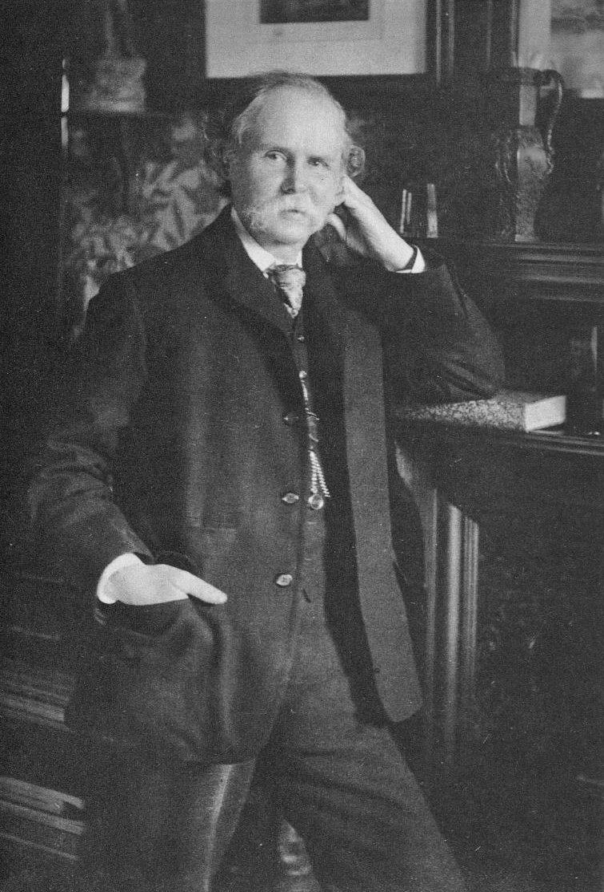
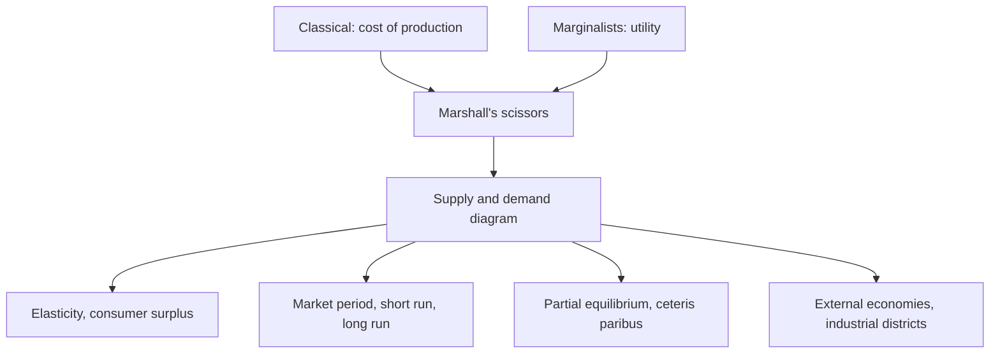

# Alfred Marshall (1842–1924)

**Prerequisites:** [The marginal revolution](../03-the-marginal-revolution.md), [Market equilibrium](../../02-supply-and-demand/05-market-equilibrium.md), [Price elasticity of demand](../../02-supply-and-demand/07-price-elasticity-of-demand.md).

*Alfred Marshall in his Cambridge home, Balliol Croft, around the time of his Principles of Economics. Credit: Elliott and Fry (London W., 55 Baker Street). License: Public domain. Source: [File:Alfred Marshall 1891.jpg](https://commons.wikimedia.org/wiki/File:Alfred_Marshall_1891.jpg).*

Alfred Marshall was the leading British economist of the late 19th and early 20th centuries. His *Principles of Economics* (1890) synthesised classical cost-of-production theory with the new marginal utility theory into the supply-and-demand framework that still forms the core of introductory economics. He introduced or popularised price elasticity, consumer surplus, the short run and long run, and partial equilibrium analysis, and founded the Cambridge school of economics.

## Life

Marshall was born in Bermondsey, London, in 1842. His father, a Bank of England clerk, wanted him to become a clergyman, but Alfred studied mathematics at St John's College, Cambridge, graduating second wrangler in 1865. He turned from mathematics to philosophy and then to economics, motivated by concern about poverty: he later recalled visiting the poorest quarters of cities and deciding to study political economy to understand how to improve people's lives.

In 1877 he married Mary Paley, one of the first women to study economics at Cambridge, with whom he wrote *The Economics of Industry* (1879). Because Cambridge fellows then had to be unmarried, he left to become principal of University College, Bristol, then moved to Oxford, before returning to Cambridge as Professor of Political Economy (1885–1908). He campaigned successfully for a separate Economics Tripos (degree), established in 1903. His students included John Maynard Keynes and Arthur Cecil Pigou, who succeeded him. He died in Cambridge in 1924.

## Principles of Economics (1890)

### Supply and demand: the scissors

Marshall argued that classical economists had overemphasised costs (supply) and the marginalists utility (demand). Both matter: "We might as reasonably dispute whether it is the upper or the under blade of a pair of scissors that cuts a piece of paper, as whether value is governed by utility or cost of production." Demand reflects marginal utility; supply reflects marginal cost (see [market equilibrium](../../02-supply-and-demand/05-market-equilibrium.md)).

The convention of drawing price on the vertical axis and quantity on the horizontal, still used today, comes from Marshall, who treated price as depending on quantity.

### Time periods

Marshall distinguished the **market period** (supply fixed), the **short run** (firms can vary output with existing plant), and the **long run** (plant and the number of firms can change). Supply becomes more elastic as the period lengthens; cost of production matters more in the long run, demand more in the short run (see [long-run costs](../../04-producer-theory/07-long-run-costs.md)).

### Elasticity and consumer surplus

He formalised **price elasticity of demand** (see [price elasticity](../../02-supply-and-demand/07-price-elasticity-of-demand.md)) and **consumer surplus**, the difference between what consumers would pay and what they do pay (see [consumer surplus](../../02-supply-and-demand/09-consumer-surplus.md)), building on Dupuit.

### Partial equilibrium and ceteris paribus

To keep analysis manageable, Marshall studied one market at a time, holding other things constant (*ceteris paribus*), impounding them in a "pound" for later analysis. This **partial equilibrium** method complements Walras's general equilibrium approach.

### Industrial organisation

Marshall described **external economies**, benefits firms gain from the growth of their industry or district, such as shared skills and suppliers, where "the mysteries of the trade become no mysteries; but are as it were in the air" (see [positive externalities](../../07-market-failure/04-positive-externalities.md)). His concept of the "representative firm" and his biological analogies (firms as trees in a forest) reflected his view of the economy as evolving.

## Method and style

Marshall was a capable mathematician but relegated mathematics to footnotes and appendices, wanting economics to be accessible to business people. He advised: use mathematics as a shorthand, translate it into English, illustrate with real examples, "burn the mathematics", and if you cannot find good real-life examples, burn the English too. His motto, "*Natura non facit saltum*" (nature does not make leaps), reflected his emphasis on continuity and gradual change.

## Legacy

The *Principles* went through eight editions and dominated English-language economics for a generation. Pigou's welfare economics, Keynes's early work, and the Chicago school's price theory all descend from Marshall. Every student who draws a supply-and-demand diagram is using his framework.

## Key ideas

- Synthesised cost and utility into supply and demand (the scissors).
- Introduced time periods, price elasticity, consumer surplus and partial equilibrium.
- Described external economies and industrial districts.
- Founded the Cambridge school; taught Keynes and Pigou.

## Where this leads

- Next thinker: [Vilfredo Pareto](09-vilfredo-pareto.md).
- Related: [demand](../../02-supply-and-demand/01-demand.md), [supply](../../02-supply-and-demand/03-supply.md), [comparative statics](../../02-supply-and-demand/06-comparative-statics.md).
- Glossary: [partial equilibrium](../../glossary/partial-equilibrium.md), [ceteris paribus](../../glossary/ceteris-paribus.md), [consumer surplus](../../glossary/consumer-surplus.md), [agglomeration economies](../../glossary/agglomeration-economies.md).
