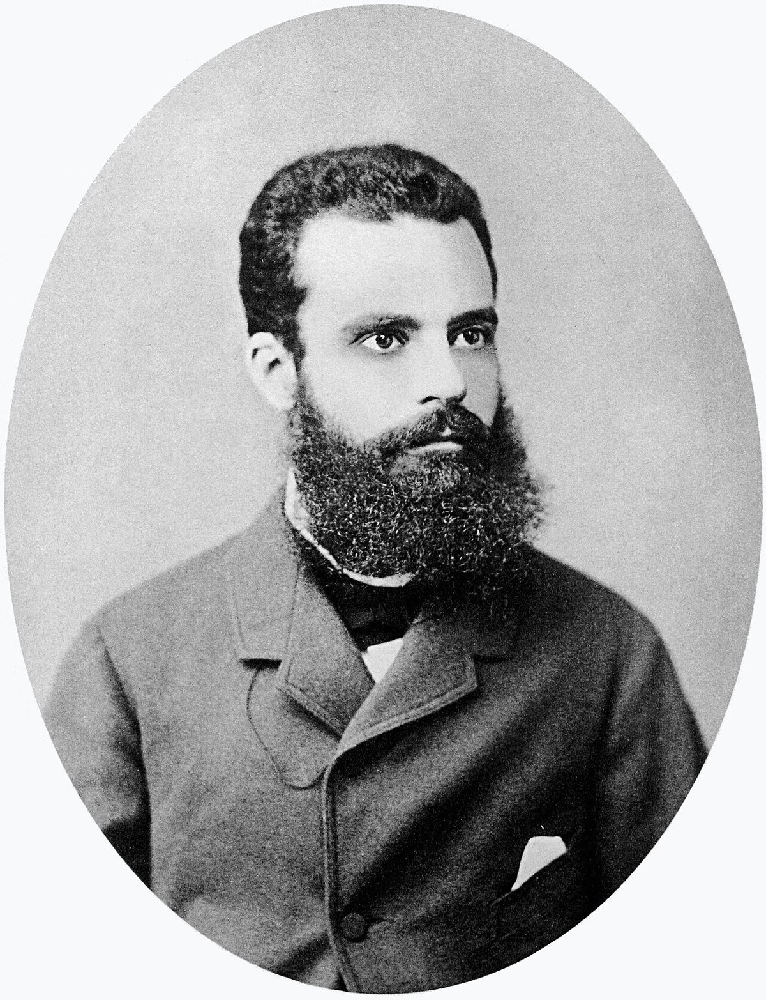
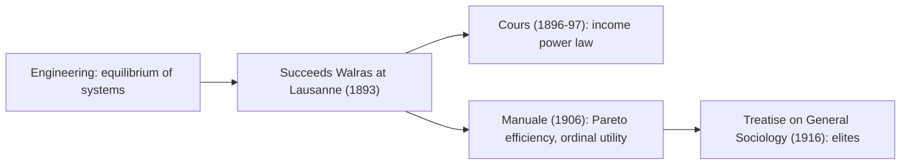

# Vilfredo Pareto (1848–1923)

**Prerequisites:** [Efficiency and Pareto optimality](../../08-welfare-economics/01-efficiency-and-pareto-optimality.md), [Indifference curves](../../03-consumer-theory/03-indifference-curves.md).

*Vilfredo Pareto in the 1870s, when he was working as a railway engineer. Credit: Unknown author. License: Public domain. Source: [File:Vilfredo Pareto 1870s.jpg](https://commons.wikimedia.org/wiki/File:Vilfredo_Pareto_1870s.jpg).*

Vilfredo Pareto was an Italian engineer, economist and sociologist who succeeded Léon Walras at Lausanne. He gave economics the concept of **Pareto efficiency**, helped replace measurable utility with **ordinal** preferences and indifference curves, and discovered the statistical regularity in income distributions known as **Pareto's law**, from which the popular "80/20 rule" was later derived.

## Life

Pareto was born in Paris in 1848 to an Italian father, an exiled supporter of Giuseppe Mazzini, and a French mother. The family returned to Italy, and Pareto studied mathematics and engineering at the Polytechnic University of Turin, graduating in 1870 with a thesis on the equilibrium of elastic solids, a theme that foreshadowed his later economics. He worked for two decades as a civil engineer and manager in the Italian railway and iron industries, rising to director of an iron works company.

An ardent liberal and free-trader, he campaigned against protectionism and government corruption in Italy and ran unsuccessfully for parliament. Through the economist Maffeo Pantaleoni, he discovered Walras's work. In 1893 he succeeded Walras in the chair of political economy at the University of Lausanne. An inheritance in 1898 made him financially independent. In later life he turned to sociology and became disillusioned with liberal democracy. He died in Céligny, Switzerland, in 1923.

## Economic contributions

### Pareto efficiency

In the *Manual of Political Economy* (*Manuale di economia politica*, 1906), Pareto defined a position of maximum "ophelimity" (his word for economic satisfaction) for a collectivity as one from which it is impossible to move without making at least one person worse off. This is now called **Pareto efficiency** or **Pareto optimality** (see [efficiency and Pareto optimality](../../08-welfare-economics/01-efficiency-and-pareto-optimality.md)). It allows welfare comparisons without adding up or comparing utilities across people, and it is the efficiency standard in the [welfare theorems](../../08-welfare-economics/03-the-welfare-theorems.md).

### Ordinal utility

Pareto argued that economics does not need to measure utility. All that matters is that people can rank bundles; indifference curves, which Edgeworth had introduced in 1881, can be derived from observed choices without assuming utility is a measurable quantity. This "ordinalist" view was developed by Eugen Slutsky (1915) and by Hicks and Allen (1934), and became standard (see [preferences and utility](../../03-consumer-theory/01-preferences-and-utility.md)). Pareto also drew the Edgeworth box in the form now used.

### Pareto's law of income distribution

In *Cours d'économie politique* (1896–97), Pareto studied tax and income data from several countries and periods and found a striking regularity: the number of people with income above a level x falls off roughly in proportion to x raised to a negative power, N(x) ≈ A × x^(−α). Plotted on logarithmic scales, the relationship is close to a straight line. This is the **Pareto distribution**, a "power law" now used to describe city sizes, firm sizes, wealth, and many natural phenomena.

**Worked example.** With α = 1.5, if 1,000 people earn above 100,000 dollars, then the number earning above 400,000 is 1,000 × 4^(−1.5) = 1,000 / 8 = **125**, and above 1.6 million, 1,000 × 16^(−1.5) = 1,000 / 64 ≈ **16**.

The **80/20 rule** (the idea that roughly 80 percent of effects come from 20 percent of causes) was named the "Pareto principle" by the quality-management consultant Joseph Juran in the mid-20th century, inspired by Pareto's observation that about 80 percent of Italy's land was owned by about 20 percent of the population. It is a rule of thumb, not a law.

## Sociology

Pareto's *Treatise on General Sociology* (*Trattato di sociologia generale*, 1916) analysed non-logical action and argued that history is shaped by the **circulation of elites**: ruling groups rise, decay and are replaced ("history is a graveyard of aristocracies"). Mussolini's Fascist regime honoured Pareto shortly before his death, and he expressed some initial sympathy for it while urging it to preserve liberties. His relationship to Fascism remains debated by historians.

## Legacy

Pareto's efficiency criterion is perhaps the most widely used concept in welfare economics. His ordinalism shaped consumer theory, and Pareto distributions are central to modern research on inequality and on the behaviour of top incomes and wealth.

## Key ideas

- Defined Pareto efficiency: no one can be made better off without making someone worse off.
- Championed ordinal utility and indifference curves over measurable utility.
- Discovered the power-law Pareto distribution of incomes; inspired the 80/20 rule.
- Succeeded Walras at Lausanne; later wrote on elites in sociology.

## Where this leads

- Next thinker: [Arthur Cecil Pigou](10-arthur-cecil-pigou.md).
- Related: [income inequality](../../06-factor-markets/09-income-inequality.md), [general equilibrium](../../08-welfare-economics/02-general-equilibrium.md).
- Glossary: [Pareto efficiency](../../glossary/pareto-efficiency.md), [Pareto distribution](../../glossary/pareto-distribution.md), [ordinal utility](../../glossary/ordinal-utility.md).
