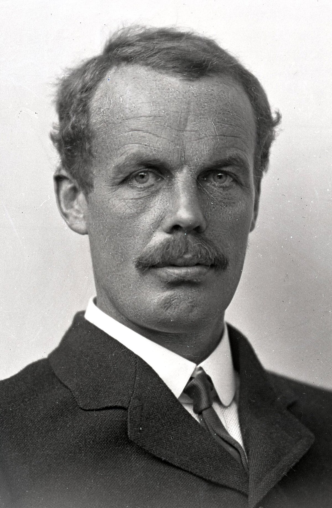
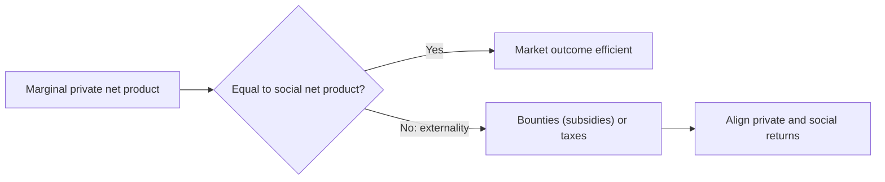

# Arthur Cecil Pigou (1877–1959)

**Prerequisites:** [Pigouvian taxes and subsidies](../../07-market-failure/05-pigouvian-taxes-and-subsidies.md), [Price discrimination](../../05-market-structures/06-price-discrimination.md).

*Arthur Cecil Pigou, photographed by J. Palmer-Clarke, about 1918–1921. Credit: John Palmer Clarke. License: Public domain. Source: [File:Portrait of Arthur Cecil Pigou, c. 1918-1921.jpg](https://commons.wikimedia.org/wiki/File:Portrait_of_Arthur_Cecil_Pigou,_c._1918-1921.jpg).*

Arthur Cecil Pigou was an English economist, Alfred Marshall's successor at Cambridge, and the founder of **welfare economics** as a systematic field. His *The Economics of Welfare* (1920) analysed how private and social costs and benefits diverge, giving rise to the idea of correcting externalities with taxes and subsidies, now called **Pigouvian taxes**. He also classified the degrees of price discrimination still taught today.

## Life

Pigou was born in Ryde, on the Isle of Wight, in 1877, the son of an army officer. He was educated at Harrow School and King's College, Cambridge, where he first studied history and moral sciences before turning to economics under Marshall. He became a fellow of King's in 1902 and, at just 30, succeeded Marshall as Professor of Political Economy in 1908, holding the chair until 1943. Marshall had actively promoted him over others, including Herbert Foxwell.

During the First World War, as a conscientious objector, Pigou served in the Friends' Ambulance Unit during university vacations. He served on government committees, including the Cunliffe Committee on currency (1918–19) and the Royal Commission on the Income Tax (1919–20). A keen mountaineer, he had a cottage in the Lake District. In later life he became reclusive. He died in Cambridge in 1959.

## Wealth and Welfare (1912) and The Economics of Welfare (1920)

Pigou took economic welfare to be the part of social welfare that can be measured in money. He argued that economic welfare is likely to increase when:

1. the size of the national dividend (national income) increases;
2. the share going to the poor increases, provided the total is not reduced; and
3. the national dividend becomes less variable over time.

The second point follows from diminishing marginal utility: transferring income from rich to poor raises total satisfaction. Lionel Robbins later criticised this reasoning (1932, 1938) as requiring interpersonal comparisons of utility, which he considered unscientific, a critique that pushed welfare economics toward the Pareto criterion.

### Private and social net product

Pigou's central analytical contribution was the distinction between **marginal private net product** and **marginal social net product**. When they diverge, market outcomes are not efficient. His examples included:

- sparks from railway engines setting fire to woods along the line, which the railway does not pay for;
- the damage to neighbours from factory smoke in towns;
- the benefits of planting trees or of scientific research, which others enjoy without paying;
- the costs that motor cars impose by wearing out roads.

He proposed that the state could remove such divergences through "bounties and taxes", what we now call **Pigouvian taxes and subsidies**. A tax equal to the external cost aligns private incentives with social costs (see [Pigouvian taxes](../../07-market-failure/05-pigouvian-taxes-and-subsidies.md)).

**Illustration.** If a factory's smoke causes 5 dollars of laundry and health damage per unit of output, a 5-dollar tax per unit makes the factory's private cost equal the social cost; it will then produce only units whose value to buyers covers that full cost.

### Price discrimination

Pigou distinguished three degrees of price discrimination: **first degree** (charging each unit its maximum price), **second degree** (prices that vary with quantity or version, letting buyers sort themselves), and **third degree** (different prices for different groups). The classification is still standard (see [price discrimination](../../05-market-structures/06-price-discrimination.md)).

## Other work and controversies

- **The Pigou effect.** In debates with Keynes, Pigou argued that falling prices raise the real value of money holdings, increasing wealth and spending, so that deflation could in principle restore full employment. This "real balance effect" became part of macroeconomic theory.
- **Keynes's target.** In *The General Theory* (1936), Keynes used Pigou's *The Theory of Unemployment* (1933) as the main example of the "classical" view he was attacking. Pigou's review was harsh, though he later acknowledged Keynes's contribution.
- **Coase's critique.** In 1960, Ronald Coase argued that Pigou's analysis ignored the reciprocal nature of harm and the possibility of bargaining (see [the Coase theorem](../../07-market-failure/06-coase-theorem.md)). Some historians argue that Coase's reading oversimplified Pigou, who was aware of institutional complexities.

## Legacy

Pigou's divergence between private and social costs is the basis of environmental economics. Carbon taxes, congestion charges and tobacco taxes are often justified in Pigouvian terms. In 2006, the economist Gregory Mankiw founded an informal "Pigou Club" of economists and commentators who publicly supported higher Pigouvian taxes on carbon and fuel.

## Key ideas

- Founded welfare economics in *Wealth and Welfare* (1912) and *The Economics of Welfare* (1920).
- Distinguished private and social net product; externalities justify corrective taxes and subsidies.
- Classified first-, second- and third-degree price discrimination.
- Debated Keynes (the Pigou effect) and was later critiqued by Coase.

## Where this leads

- Next thinker: [Friedrich Hayek](11-friedrich-hayek.md).
- Related: [externalities](../../07-market-failure/02-externalities.md), [Alfred Marshall](08-alfred-marshall.md).
- Glossary: [Pigouvian tax](../../glossary/pigouvian-tax.md), [externality](../../glossary/externality.md), [price discrimination](../../glossary/price-discrimination.md).
