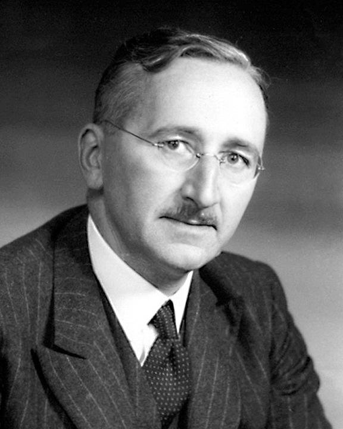

# Friedrich Hayek (1899–1992)

**Prerequisites:** [Markets, prices and property rights](../../01-foundations/10-markets-prices-and-property-rights.md), [Schools of thought](../05-schools-of-thought.md).

*Friedrich A. Hayek (portrait released by the Mises Institute). Credit: The original uploader was DickClarkMises at English Wikipedia. License: [CC BY-SA 3.0](https://creativecommons.org/licenses/by-sa/3.0). Source: [File:Friedrich Hayek portrait.jpg](https://commons.wikimedia.org/wiki/File:Friedrich_Hayek_portrait.jpg).*

Friedrich August von Hayek was an Austrian-British economist and political philosopher, the leading 20th-century figure of the Austrian school. His most influential economic idea is that **prices transmit dispersed knowledge**: no central planner can know what millions of people know about local circumstances, but market prices summarise that knowledge and coordinate behaviour. He shared the 1974 Nobel prize in economics with Gunnar Myrdal, and his political writings, especially *The Road to Serfdom* (1944), made him one of the most influential defenders of liberal market societies.

## Life

Hayek was born in Vienna in 1899 into a family of scholars; the philosopher Ludwig Wittgenstein was a distant cousin. He served in the Austro-Hungarian army on the Italian front in the First World War, then earned doctorates in law (1921) and political science (1923) at the University of Vienna. Influenced by Ludwig von Mises's critique of socialism, he became an economist and in 1927 the first director of the Austrian Institute for Business Cycle Research.

In 1931 Lionel Robbins brought him to the London School of Economics, where he became a central opponent of John Maynard Keynes in debates over money, capital and business cycles. He became a British citizen in 1938. In 1947 he founded the Mont Pelerin Society, an international association of liberal intellectuals. He moved to the University of Chicago's Committee on Social Thought (1950–1962), then to Freiburg, Germany, and Salzburg, Austria. He died in Freiburg in 1992.

## Knowledge and the price system

In "Economics and Knowledge" (1937) and especially "The Use of Knowledge in Society" (1945, *American Economic Review*), Hayek argued that the central economic problem is not allocating given resources with known preferences, as in textbook models, but using knowledge that "never exists in concentrated or integrated form but solely as the dispersed bits of incomplete and frequently contradictory knowledge which all the separate individuals possess". Much of this is "knowledge of the particular circumstances of time and place", often tacit.

His example: suppose a new use for tin is discovered, or a tin mine is closed. Users of tin do not need to know why tin has become scarcer. The price rises, and each user economises on tin, substitutes other materials, or pays more if tin is especially valuable to them. "The marvel is that in a case like that of a scarcity of one raw material, without an order being issued, without more than perhaps a handful of people knowing the cause, tens of thousands of people... are made to use the material or its products more sparingly."

## The socialist calculation debate

With Mises, Hayek argued that central planning could not rationally allocate resources, because without market prices for capital goods, planners lack the information needed to compare costs. Oskar Lange and Abba Lerner replied that planners could simulate markets by trial-and-error pricing. Hayek countered that the relevant knowledge is dispersed, tacit and constantly changing, and that competition is a **discovery procedure** ("Competition as a Discovery Procedure", 1968), not merely an equilibrium state. Many economists regard the economic failures of centrally planned economies as broadly confirming Hayek's concerns.

## Business cycles

In *Prices and Production* (1931), Hayek developed the Austrian theory of the business cycle: when central banks push interest rates below their natural level, credit expansion encourages over-investment in long-term ("roundabout") production that cannot be sustained, leading eventually to a bust. This theory lost the debate with Keynes in the 1930s in most economists' eyes, though it retains supporters.

## Political philosophy

- ***The Road to Serfdom*** (1944) argued that comprehensive economic planning tends to concentrate power and erode political freedom. A condensed version in *Reader's Digest* (1945) reached millions. Hayek accepted some government roles, including a minimum income floor and social insurance against common hazards.
- ***The Constitution of Liberty*** (1960) and ***Law, Legislation and Liberty*** (1973–79) developed his ideas of the **rule of law**, **spontaneous order** (orders that are "the result of human action but not of human design", a phrase he took from Adam Ferguson), and the limits of reason in designing society. He called the belief that society can be consciously redesigned from scratch "constructivist rationalism".
- In *The Fatal Conceit* (1988), he argued that market institutions evolved culturally and that their benefits are not obvious to reason alone.

## Legacy and criticism

Hayek influenced economists, legal scholars and politicians, including Margaret Thatcher. His knowledge argument is widely respected even by economists who reject his politics, and it anticipated work on information economics and mechanism design. Critics argue that he underestimated market failures, the potential of democratic regulation, and the problems of inequality; Keynesians reject his business cycle theory.

## Key ideas

- Prices aggregate and transmit dispersed, tacit knowledge, enabling coordination without central direction.
- Competition is a discovery procedure; central planning lacks the knowledge to allocate efficiently.
- Developed Austrian business cycle theory and debated Keynes.
- Defended the rule of law and spontaneous order; *The Road to Serfdom* warned of planning's political dangers.

## Where this leads

- Next thinker: [Ronald Coase](12-ronald-coase.md).
- Related: [Carl Menger](06-carl-menger.md), [asymmetric information](../../07-market-failure/10-asymmetric-information.md), [government failure](../../07-market-failure/15-government-failure.md).
- Glossary: [spontaneous order](../../glossary/spontaneous-order.md), [price signal](../../glossary/price-signal.md), [socialist calculation debate](../../glossary/socialist-calculation-debate.md).
