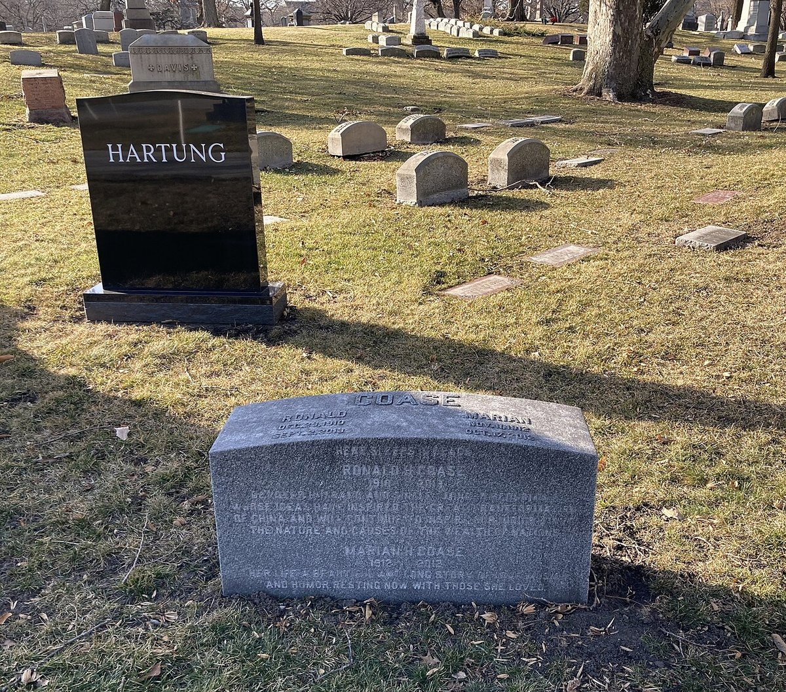
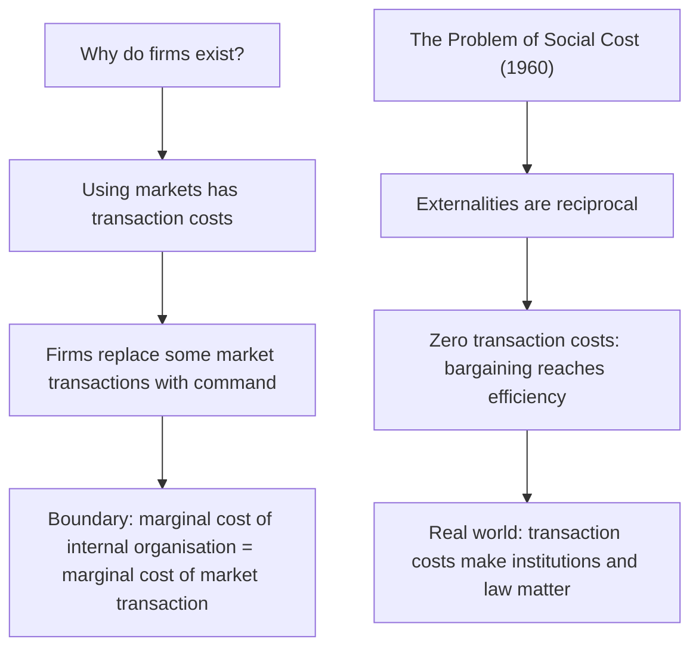

# Ronald Coase (1910–2013)

**Prerequisites:** [The firm](../../04-producer-theory/01-the-firm.md), [The Coase theorem](../../07-market-failure/06-coase-theorem.md).

*Grave of Ronald Coase at Graceland Cemetery, Chicago (no freely licensed portrait of Coase is available on Wikimedia Commons). Credit: Nick Number. License: [CC BY 4.0](https://creativecommons.org/licenses/by/4.0). Source: [File:Grave of Ronald Coase (1910–2013) at Graceland Cemetery, Chicago.jpg](https://commons.wikimedia.org/wiki/File:Grave_of_Ronald_Coase_(1910–2013)_at_Graceland_Cemetery,_Chicago.jpg).*

Ronald Harry Coase was a British-born economist who spent most of his career in the United States. In two short papers, written more than twenty years apart, he transformed economics by introducing **transaction costs** into the analysis of firms and of legal rules. "The Nature of the Firm" (1937) asked why firms exist; "The Problem of Social Cost" (1960) reframed externalities and founded law and economics. He received the 1991 Nobel prize "for his discovery and clarification of the significance of transaction costs and property rights for the institutional structure and functioning of the economy".

## Life

Coase was born in Willesden, near London, in 1910. His parents were telegraphists. As a child he had weak legs and wore leg-irons, attending a school for physically disabled children. He studied commerce at the London School of Economics, earning a degree in 1932. A travelling scholarship in 1931–32 took him to the United States, where he visited factories and companies such as Ford and General Motors, asking why some activities were done inside firms and others bought in the market.

He taught at the Dundee School of Economics, the University of Liverpool and the LSE (1935–1951), with wartime service in government statistical offices. He emigrated to the United States in 1951, teaching at the University of Buffalo and the University of Virginia, and in 1964 joined the University of Chicago Law School, where he edited the *Journal of Law and Economics* until 1982. He continued writing past 100, publishing *How China Became Capitalist* (2012) with Ning Wang. He died in Chicago in 2013, aged 102.

## The Nature of the Firm (1937)

If markets coordinate economic activity so well through prices, why do firms exist, inside which activity is coordinated by managers' commands? Coase's answer: **using the market is costly**. There are costs of discovering prices, negotiating and writing contracts, and enforcing them. Organising activity within a firm can save these costs, though firms face their own costs of management, which rise as firms grow. The boundary of the firm is set where the cost of organising one more transaction internally equals the cost of using the market (see [the firm](../../04-producer-theory/01-the-firm.md)).

**Example.** A carmaker can buy seats from a supplier or make them in-house. If seats are standard and many suppliers compete, buying is cheaper. If seats must be custom-designed for each model and frequent redesign requires close coordination, writing and enforcing contracts becomes costly, and in-house production may be cheaper. The paper was little cited for decades, but became the foundation of transaction cost economics, developed by Oliver Williamson.

## The Problem of Social Cost (1960)

The paper grew out of Coase's 1959 article on the Federal Communications Commission, which argued that radio spectrum could be allocated by auctioning property rights rather than by regulators. At a famous 1960 dinner at the home of Aaron Director in Chicago, Coase convinced a sceptical group of economists, including Milton Friedman and George Stigler, of his argument.

Its main points (see [the Coase theorem](../../07-market-failure/06-coase-theorem.md)):

- Harmful effects are **reciprocal**: restricting a polluter harms the polluter.
- If transaction costs were zero, parties would bargain to the efficient outcome regardless of the initial assignment of legal rights.
- Because transaction costs are positive in reality, the law's assignment of rights matters, and policy should compare the total costs of alternative institutional arrangements, including government action, rather than assume government can costlessly correct market failures.

Coase was frustrated that the "Coase theorem" became associated with the unrealistic zero-transaction-cost world; he wanted economists to study the world of positive transaction costs.

## Other contributions

- **"The Lighthouse in Economics"** (1974) showed that many British lighthouses were privately financed by port fees (see [public goods](../../07-market-failure/08-public-goods.md)).
- **"Durability and Monopoly"** (1972) proposed the **Coase conjecture**: a monopolist selling a durable good may be forced toward competitive pricing because buyers anticipate future price cuts.
- **Marginal cost pricing** (1946): he criticised the proposal that natural monopolies should price at marginal cost and cover losses from taxes, favouring multi-part tariffs (see [natural monopoly](../../05-market-structures/07-natural-monopoly-and-regulation.md)).

## Legacy

Coase's emphasis on transaction costs and property rights founded law and economics and new institutional economics, and influenced spectrum auctions, the theory of the firm and environmental policy, including tradable permits. He was a critic of "blackboard economics", theory disconnected from how real institutions work.

## Key ideas

- Firms exist because market transactions are costly; their boundaries reflect transaction costs.
- Externalities are reciprocal; with zero transaction costs, bargaining achieves efficiency.
- Real transaction costs make legal rules and institutions crucial; compare real alternatives.
- Founded law and economics; Nobel prize 1991.

## Where this leads

- Next thinker: [Kenneth Arrow](13-kenneth-arrow.md).
- Related: [cap and trade](../../07-market-failure/07-cap-and-trade-and-regulation.md), [twentieth-century microeconomics](../04-twentieth-century-microeconomics.md).
- Glossary: [transaction costs](../../glossary/transaction-costs.md), [Coase theorem](../../glossary/coase-theorem.md), [Coase conjecture](../../glossary/coase-conjecture.md).
