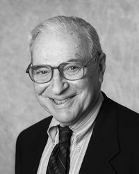
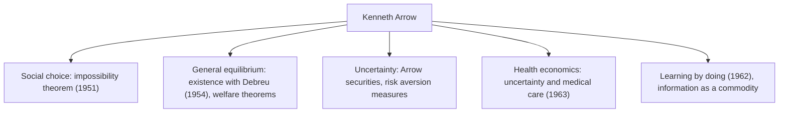

# Kenneth Arrow (1921–2017)

**Prerequisites:** [[the-welfare-theorems|The welfare theorems]], [[social-choice-and-arrows-theorem|Social choice and Arrow's theorem]].

*Kenneth Arrow at Stanford University. Credit: Linda A. Cicero / Stanford News Service. License: [CC BY 3.0](https://creativecommons.org/licenses/by/3.0). Source: [File:Kenneth Arrow, Stanford University.jpg](https://commons.wikimedia.org/wiki/File:Kenneth_Arrow,_Stanford_University.jpg).*

Kenneth Joseph Arrow was an American economist whose work laid foundations for several fields: social choice theory, general equilibrium theory, the economics of uncertainty and insurance, and the economics of information and health care. He shared the 1972 Nobel prize with John Hicks, and at 51 was then the youngest winner of the economics prize. Several of his former students, including Eric Maskin, Michael Spence and Roger Myerson, also went on to win the Nobel prize.

## Life

Arrow was born in New York City in 1921 to Romanian-Jewish immigrant parents, whose comfortable circumstances were wiped out in the Great Depression. He studied mathematics at the City College of New York (graduating in 1940) and went to Columbia University for graduate work in statistics, where Harold Hotelling steered him toward economics. During the Second World War he served as a weather officer in the US Army Air Corps. He later recalled that the forecasts he and his colleagues produced were no better than chance, and that when they reported this, they were told the commanding general knew the forecasts were no good but needed them for planning purposes.

He worked at the Cowles Commission in Chicago, then taught at Stanford University (1949–1968, and again from 1979), with an interval at Harvard (1968–1979). His PhD dissertation, published as *Social Choice and Individual Values* (1951), contained his impossibility theorem. He died in Palo Alto in 2017, aged 95.

## Social choice

At the RAND Corporation in 1948–49, Arrow was asked how to represent the preferences of a nation as a single "rational" actor. He proved that no method of aggregating individual rankings into a social ranking can satisfy a small set of reasonable conditions (unrestricted domain, Pareto, independence of irrelevant alternatives, non-dictatorship, transitivity). The **impossibility theorem** founded modern social choice theory and showed that "the will of the people" cannot be derived from individual preferences without further value judgements (see [[social-choice-and-arrows-theorem|social choice and Arrow's theorem]]).

## General equilibrium and the welfare theorems

In 1951, Arrow gave a rigorous proof of the two fundamental welfare theorems using convex analysis. In 1954, with Gérard Debreu, he proved the existence of a competitive general equilibrium ("Existence of an Equilibrium for a Competitive Economy", *Econometrica*). The **Arrow–Debreu model** treats goods differing by date and "state of the world" as distinct commodities. Arrow (1953) also showed that with a set of securities paying off in different states (**Arrow securities**), the number of markets needed could be reduced, foundational for financial economics (see [[general-equilibrium|general equilibrium]], [[path:economics/finance/01-foundations/10-risk-and-return.md|risk and return]]).

## Uncertainty, insurance and health

- **Risk aversion.** With John Pratt, Arrow developed the standard measures of risk aversion (the Arrow–Pratt measures), used throughout economics and finance (see [[choice-under-uncertainty|choice under uncertainty]]).
- **"Uncertainty and the Welfare Economics of Medical Care"** (1963, *American Economic Review*) founded health economics. Arrow argued that medical care differs from other goods because of uncertainty about illness and treatment and the large information gap between doctors and patients. He discussed **moral hazard** and **adverse selection** in insurance, and explained professional norms, licensing and non-profit hospitals as responses to these problems (see [[moral-hazard|moral hazard]], [[adverse-selection|adverse selection]]).
- **Information.** Arrow (1962) noted that information has unusual properties: its value to a buyer cannot be known until it is revealed, but once revealed, the buyer has it without paying, which makes markets for information prone to failure. He argued that this leads to underinvestment in research, supporting public funding of science.

**Arrow's information paradox, illustrated.** An inventor wants to sell a new manufacturing technique to a firm. The firm will not pay without knowing how good it is; but if the inventor explains it fully, the firm no longer needs to pay. Patents, non-disclosure agreements and reputation are partial solutions.

## Learning by doing and other work

In "The Economic Implications of Learning by Doing" (1962), Arrow modelled productivity as rising with cumulative experience (for example, airframe production costs falling as more planes are built), an important influence on endogenous growth theory (see [[g:learning-curve|learning curve]]). He also wrote on discrimination in labour markets, organisations (*The Limits of Organization*, 1974), and climate change economics.

## Legacy

Arrow's work underpins much of modern economic theory. His theorems define the conditions under which markets are efficient, and so also the conditions under which they fail, a duality reflected in his own nuanced views. He supported markets while emphasising the importance of information problems and the role of trust and social institutions.

## Key ideas

- Proved the impossibility theorem, founding social choice theory.
- Proved existence of general equilibrium with Debreu; formalised the welfare theorems; introduced Arrow securities.
- Founded health economics, emphasising uncertainty, moral hazard and adverse selection.
- Analysed information as a commodity and learning by doing.

## Where this leads

- Next thinker: [[john-nash|John Nash]].
- Related: [[efficiency-and-pareto-optimality|efficiency]], [[asymmetric-information|asymmetric information]].
- Glossary: [[g:arrows-impossibility-theorem|Arrow's impossibility theorem]], [[g:arrow-debreu-model|Arrow–Debreu model]], [[g:risk-aversion|risk aversion]].
