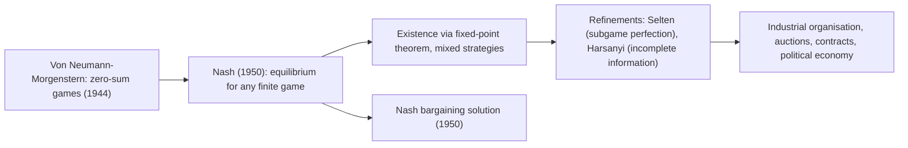

# John Nash (1928–2015)

**Prerequisites:** [Game theory basics](../../05-market-structures/10-game-theory-basics.md), [Nash equilibrium](../../05-market-structures/11-nash-equilibrium.md).

*John Forbes Nash Jr.. Credit: Anonymous. License: Public domain. Source: [File:John Forbes Nash (1928-2015) portrait.jpg](https://commons.wikimedia.org/wiki/File:John_Forbes_Nash_(1928-2015)_portrait.jpg).*

John Forbes Nash Jr. was an American mathematician whose concept of equilibrium in non-cooperative games became the central tool of game theory and, through it, of much of modern economics. He also made fundamental contributions to bargaining theory and to pure mathematics. His life, including decades of struggle with schizophrenia and later recovery, was portrayed in Sylvia Nasar's biography *A Beautiful Mind* (1998) and the 2001 film of the same name. He shared the 1994 Nobel prize in economics with John Harsanyi and Reinhard Selten, and the 2015 Abel Prize in mathematics with Louis Nirenberg.

## Life

Nash was born in Bluefield, West Virginia, in 1928. He studied at the Carnegie Institute of Technology (now Carnegie Mellon), initially chemical engineering, then mathematics. His professor's letter of recommendation to Princeton was a single sentence: "This man is a genius." At Princeton, at age 21, he wrote a 28-page doctoral thesis, "Non-Cooperative Games" (1950).

He then worked at the RAND Corporation and taught at the Massachusetts Institute of Technology, where he did major work in geometry and partial differential equations, including the Nash embedding theorems. In 1959 he began to suffer from paranoid schizophrenia, was hospitalised several times, and for many years was largely unable to work, living around Princeton. His wife, Alicia Larde Nash, supported him throughout (they divorced in 1963 and remarried in 2001). From the 1980s his symptoms gradually eased. He and Alicia died together in a taxi accident in New Jersey in 2015, days after he received the Abel Prize in Norway.

## The Nash equilibrium

Von Neumann and Morgenstern (1944) had solved two-person **zero-sum** games, where one player's gain is the other's loss. Nash's insight was to define an equilibrium for any finite game with any number of players, not just zero-sum ones:

**A Nash equilibrium** is a set of strategies, one for each player, such that no player can do better by unilaterally changing their strategy, given the strategies of the others.

In a one-page paper, "Equilibrium Points in n-Person Games" (*Proceedings of the National Academy of Sciences*, 1950), he proved, using a fixed-point theorem, that every finite game has at least one equilibrium, if players may use **mixed strategies** (randomising over actions) (see [Nash equilibrium](../../05-market-structures/11-nash-equilibrium.md)).

### Worked example: matching pennies

Two players each show a coin heads or tails. If the coins match, player 1 wins 1 dollar from player 2; if they differ, player 2 wins 1 dollar. There is no equilibrium in pure strategies: whatever one player does, the other wants to switch. Nash's theorem guarantees a mixed equilibrium: each player plays heads with probability 0.5. Then each is indifferent between heads and tails (expected payoff zero either way), so neither can gain by deviating.

### Applications

The concept applies wherever outcomes depend on others' choices: oligopoly pricing and output ([Cournot, Bertrand and Stackelberg](../../05-market-structures/13-cournot-bertrand-and-stackelberg.md)), auctions, bargaining, arms races, voting, evolutionary biology, and traffic routing. The [prisoners' dilemma](../../05-market-structures/12-prisoners-dilemma-and-cartels.md), formulated at RAND in 1950 by Merrill Flood and Melvin Dresher, illustrates that Nash equilibria can be collectively bad.

## The Nash bargaining solution

In "The Bargaining Problem" (1950), Nash took a different, axiomatic approach. Two parties can split gains from cooperation; if they fail to agree, each gets a disagreement payoff. Nash showed that a few reasonable axioms imply a unique solution: the outcome that maximises the product of the two parties' gains over their disagreement payoffs.

**Example.** Two people split 100 dollars; if they disagree, each gets 0. With equal bargaining positions and risk-neutral players, the product of gains x × (100 − x) is maximised at x = 50: an equal split. If one party's fallback is 20 and the other's is 0, the product (x − 20) × (100 − x) is maximised at x = 60: the party with the better outside option gets more.

The Nash bargaining solution is widely used in labour economics (wage bargaining), industrial organisation and trade.

## Legacy

Roger Myerson wrote that Nash's equilibrium concept was "one of the outstanding intellectual advances of the twentieth century", comparable to the discovery of the DNA double helix in its effects on the life sciences. Today it is taught in every economics programme and used across the social sciences.

## Key ideas

- Defined Nash equilibrium: no player gains from changing strategy alone.
- Proved every finite game has an equilibrium in mixed strategies.
- Developed the axiomatic Nash bargaining solution.
- Shared the 1994 Nobel prize; his recovery from schizophrenia became widely known through *A Beautiful Mind*.

## Where this leads

- Next thinker: [Elinor Ostrom](15-elinor-ostrom.md).
- Related: [repeated games](../../05-market-structures/14-repeated-games-and-strategic-moves.md), [oligopoly](../../05-market-structures/09-oligopoly.md).
- Glossary: [Nash equilibrium](../../glossary/nash-equilibrium.md), [mixed strategy](../../glossary/mixed-strategy.md), [Nash bargaining solution](../../glossary/nash-bargaining-solution.md).
