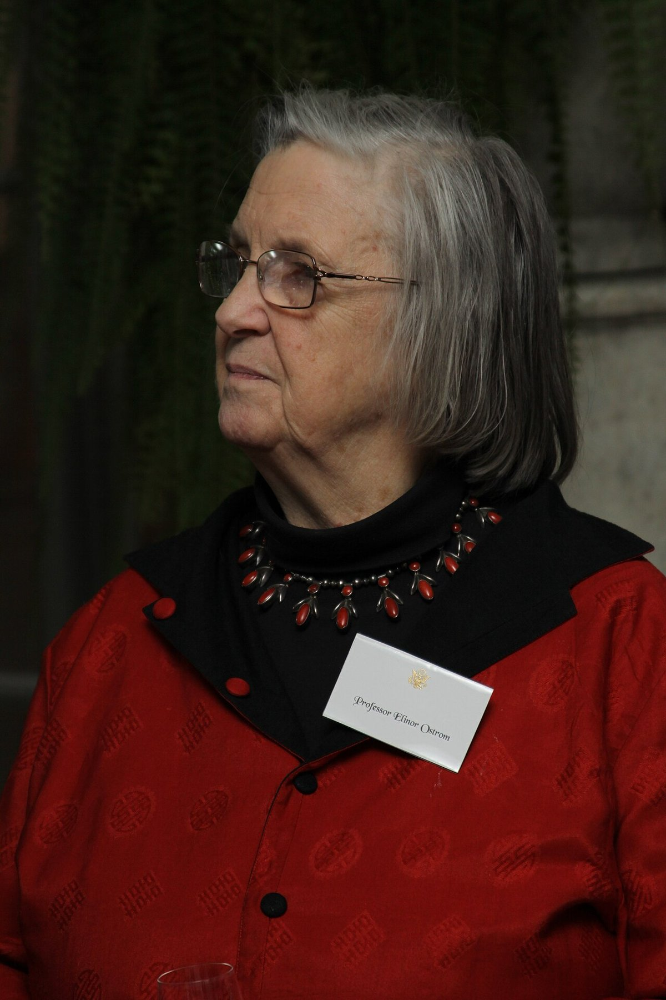
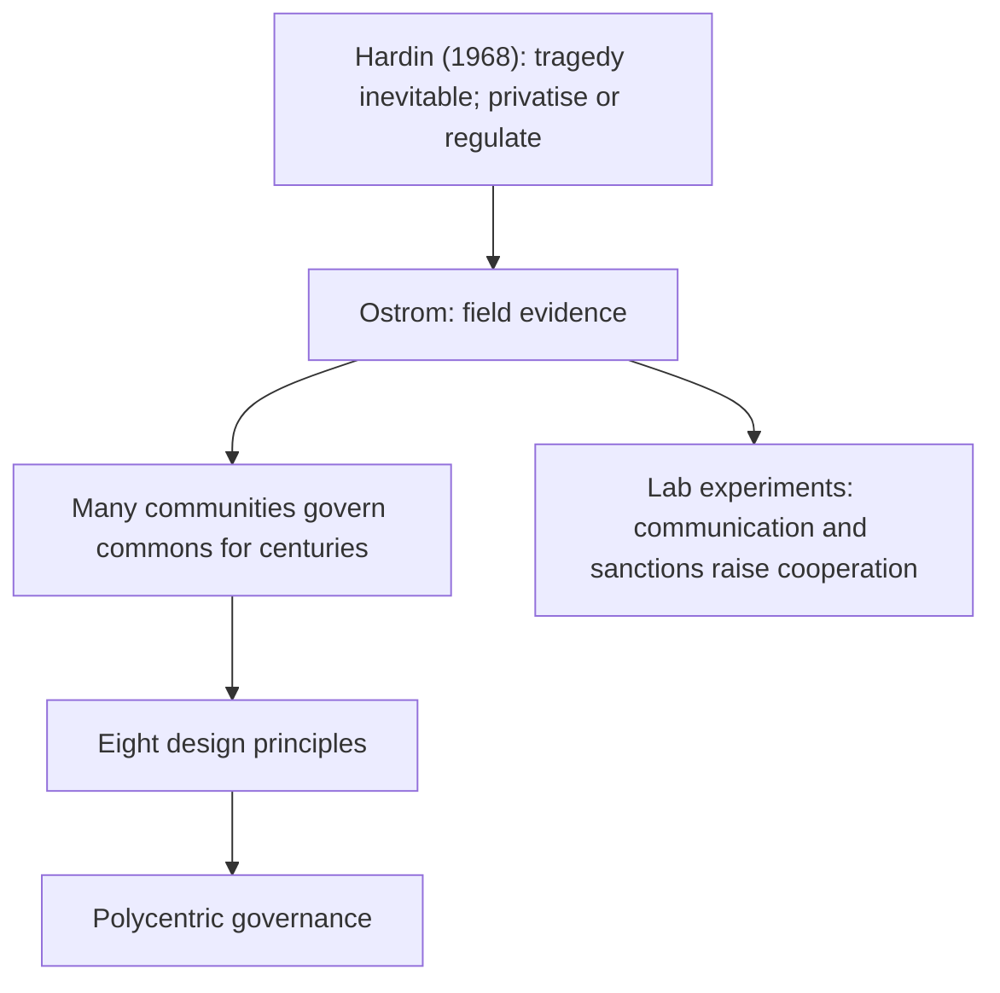

# Elinor Ostrom (1933–2012)

**Prerequisites:** [Common resources](../../07-market-failure/09-common-resources.md), [Public goods](../../07-market-failure/08-public-goods.md).

*Elinor Ostrom, 2009 Nobel laureate in economics. Credit: US Embassy Sweden. License: [CC BY 2.0](https://creativecommons.org/licenses/by/2.0). Source: [File:Nobel Laureate Elinor Ostrom (Economics).jpg](https://commons.wikimedia.org/wiki/File:Nobel_Laureate_Elinor_Ostrom_(Economics).jpg).*

Elinor Ostrom was an American political scientist whose field research showed that communities can successfully manage shared natural resources, such as forests, fisheries, pastures and irrigation systems, without either privatisation or top-down government control. In 2009 she became the first woman to receive the Nobel prize in economics, shared with Oliver Williamson, "for her analysis of economic governance, especially the commons".

## Life

Elinor Claire Awan was born in Los Angeles in 1933 and grew up during the Depression. She studied political science at the University of California, Los Angeles (BA 1954). She later recalled being discouraged from pursuing a PhD in economics because she lacked mathematics training, which women at her high school had been steered away from. She earned a PhD in political science at UCLA in 1965 with a dissertation on groundwater management in southern California, where water producers had organised to prevent over-pumping and seawater intrusion, an early case of self-governed commons.

In 1965 she married the political scientist Vincent Ostrom, and they moved to Indiana University, Bloomington. In 1973 they founded the Workshop in Political Theory and Policy Analysis, an interdisciplinary centre that brought together economists, political scientists, anthropologists and ecologists. She remained at Indiana for the rest of her career, also founding a centre at Arizona State University. She died in Bloomington in 2012.

## Governing the Commons (1990)

Garrett Hardin's "The Tragedy of the Commons" (1968) argued that shared resources are inevitably overused, and that the solutions were private property or government control. Ostrom challenged this dichotomy with evidence. In *Governing the Commons: The Evolution of Institutions for Collective Action*, she analysed long-lasting, self-governed commons including:

- alpine meadows and forests in Törbel, Switzerland, managed communally for centuries;
- common lands in Hirano, Nagaike and Yamanoka villages in Japan;
- the *huerta* irrigation systems of Valencia, Murcia and Alicante in Spain, governed by water tribunals, including Valencia's Tribunal de las Aguas, which has met weekly for centuries;
- the *zanjera* irrigation communities of the Philippines.

She also studied failures, such as some fisheries in Turkey and Sri Lanka, to see what distinguished them.

### Design principles

From these cases, Ostrom identified eight design principles shared by robust commons institutions (see [common resources](../../07-market-failure/09-common-resources.md)):

1. Clearly defined boundaries of the resource and of who may use it.
2. Rules fitting local conditions, with benefits proportional to costs.
3. Collective-choice arrangements allowing users to modify rules.
4. Monitoring by users or monitors accountable to them.
5. Graduated sanctions for violations.
6. Accessible, low-cost conflict-resolution mechanisms.
7. Recognition of the community's right to organise by external authorities.
8. Nested enterprises for larger systems.

## Experiments and methods

With Roy Gardner and James Walker, Ostrom ran laboratory experiments on common-pool resources (*Rules, Games, and Common-Pool Resources*, 1994). Groups who could not communicate overused the resource, as standard theory predicts. But when allowed to talk face to face, and especially when they could also sanction each other, they achieved much better outcomes, even though communication was "cheap talk" with no binding force.

**Illustration.** In one standard design, players choose how many tokens to invest in a common pool whose total return rises at first but then falls as total investment grows. With no communication, groups typically earned only a fraction of the maximum possible return. With repeated face-to-face communication, average efficiency rose substantially, often to a large majority of the maximum.

Ostrom used multiple methods: case studies, large-N comparative databases, laboratory experiments, game theory and agent-based models. She developed the **Institutional Analysis and Development (IAD) framework** to compare institutions systematically, and later a framework for analysing social-ecological systems.

## Polycentricity

With Vincent Ostrom, she championed **polycentric governance**: many overlapping centres of decision-making at different scales (neighbourhoods, cities, regions, nations), rather than a single central authority. Their research on police services in US metropolitan areas found that smaller local departments often performed as well as or better than large centralised ones. She applied similar thinking to climate change, arguing for action at multiple levels rather than waiting for a single global agreement.

## Legacy

Ostrom showed that the "tragedy of the commons" is not inevitable, but she also warned against "panaceas": no single institutional solution works everywhere. Her work influenced resource management, development policy, environmental governance and the study of knowledge commons such as open-source software.

## Key ideas

- Communities often manage common resources successfully, without privatisation or central control.
- Identified eight design principles of robust commons institutions.
- Experiments showed communication and sanctions dramatically raise cooperation.
- First woman to win the economics Nobel (2009); advocate of polycentric governance and against panaceas.

## Where this leads

- Next thinker: [Daniel Kahneman](16-daniel-kahneman.md).
- Related: [Ronald Coase](12-ronald-coase.md), [social preferences](../../09-behavioural-economics/06-social-preferences-and-fairness.md).
- Glossary: [tragedy of the commons](../../glossary/tragedy-of-the-commons.md), [common resource](../../glossary/common-resource.md), [polycentric governance](../../glossary/polycentric-governance.md).
