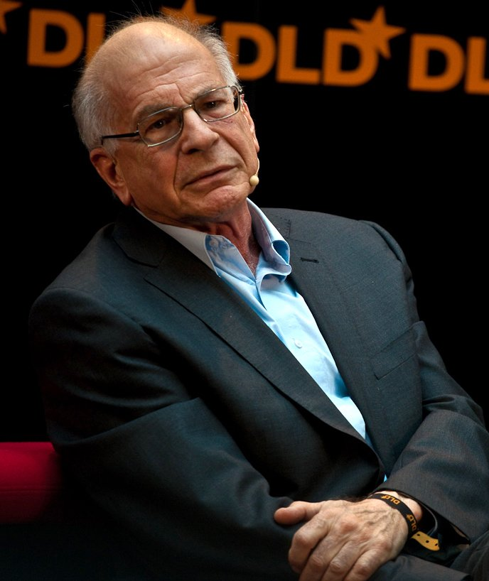
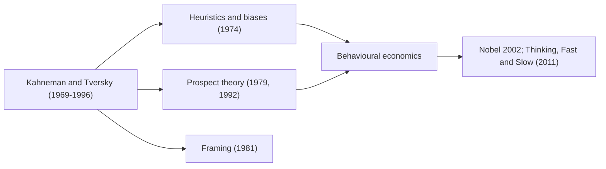

# Daniel Kahneman (1934–2024)

**Prerequisites:** [[heuristics-and-biases|Heuristics and biases]], [[prospect-theory-in-economics|Prospect theory in economics]].

*Daniel Kahneman, 2002 Nobel laureate in economics. Credit: nrkbeta. License: [CC BY-SA 2.0](https://creativecommons.org/licenses/by-sa/2.0). Source: [File:Daniel Kahneman (3283955327) (cropped).jpg](https://commons.wikimedia.org/wiki/File:Daniel_Kahneman_(3283955327)_(cropped).jpg).*

Daniel Kahneman was an Israeli-American psychologist whose research with Amos Tversky on judgement and decision-making founded behavioural economics. He received the 2002 Nobel prize in economics "for having integrated insights from psychological research into economic science, especially concerning human judgment and decision-making under uncertainty", sharing it with the experimental economist Vernon Smith. Tversky, who died in 1996, would almost certainly have shared it; the Nobel is not awarded posthumously. Kahneman's *Thinking, Fast and Slow* (2011) brought these ideas to a wide audience.

## Life

Kahneman was born in Tel Aviv in 1934, while his mother was visiting relatives, and grew up in Paris. During the German occupation of France, his Jewish family lived in hiding and on the move; his father died in 1944. In his Nobel autobiography, he recalled an encounter as a boy with a German SS soldier who, not realising he was Jewish, showed him a photograph of his son and gave him money, an experience that left him with a lasting sense of how complicated people are.

The family moved to Palestine in 1948. Kahneman studied psychology and mathematics at the Hebrew University of Jerusalem (BA 1954) and served in the Israel Defense Forces, where he designed an interview system for assessing recruits that remained in use for decades. He earned a PhD in psychology at the University of California, Berkeley (1961), and returned to teach at the Hebrew University. There, in 1969, he invited Amos Tversky to give a guest lecture, beginning one of the most productive collaborations in social science. He later held posts at the University of British Columbia (1978–1986), Berkeley, and Princeton University (from 1993). He died in 2024, aged 90.

## The collaboration with Tversky

Kahneman and Tversky worked closely together, often writing in the same room and arguing over every sentence. Their partnership is described in Michael Lewis's *The Undoing Project* (2016). Key works:

- **"Judgment under Uncertainty: Heuristics and Biases"** (*Science*, 1974): the representativeness, availability and anchoring heuristics and the biases they produce (see [[heuristics-and-biases|heuristics and biases]]).
- **"Prospect Theory: An Analysis of Decision under Risk"** (*Econometrica*, 1979): reference dependence, loss aversion, diminishing sensitivity and probability weighting (see [[prospect-theory-in-economics|prospect theory]]). One of the most cited papers ever published in economics.
- **"The Framing of Decisions and the Psychology of Choice"** (*Science*, 1981): the Asian disease problem and framing effects.
- **Cumulative prospect theory** (1992).

## Other contributions

- **The endowment effect** experiments with Jack Knetsch and Richard Thaler (1990).
- **Fairness in markets** (1986): survey evidence that people view price increases exploiting shortages as unfair (see [[social-preferences-and-fairness|social preferences and fairness]]).
- **The planning fallacy** (with Tversky, 1979): people underestimate how long projects take; the **outside view** (reference class forecasting) helps correct it.
- **Experienced versus remembered utility.** In the "cold-hand" experiments (1993), people preferred to repeat a longer painful episode that ended less painfully, showing the **peak–end rule**: memories of experiences are dominated by their most intense moment and their end, with **duration neglect**.
- **Well-being research.** With Angus Deaton (2010), he found that in the US, people's life evaluations kept rising with income, while day-to-day emotional well-being appeared to plateau around 75,000 dollars a year; a 2023 joint study with Matthew Killingsworth and Barbara Mellers revised this, finding that for most people happiness continues to rise with income.
- **Noise** (2021, with Olivier Sibony and Cass Sunstein): unwanted variability in professional judgements, such as sentencing or insurance underwriting.

## System 1 and System 2

*Thinking, Fast and Slow* organised decades of research around two modes of thinking, using terms from psychologists Keith Stanovich and Richard West:

| | System 1 | System 2 |
|---|---|---|
| Speed | Fast, automatic | Slow, deliberate |
| Effort | Effortless | Effortful |
| Example | Reading emotion on a face; 2 + 2 | Calculating 17 × 24; filling in a tax form |
| Errors | Heuristics and biases | Laziness: often endorses System 1's answer |

**Example.** "A bat and a ball cost 1.10 dollars in total. The bat costs 1 dollar more than the ball. How much does the ball cost?" System 1 suggests 10 cents. But then the bat would cost 1.10, and the total 1.20. The correct answer is 5 cents (ball 0.05, bat 1.05). (This item comes from Shane Frederick's Cognitive Reflection Test.)

## Self-correction

Kahneman was notable for publicly acknowledging errors. After failures to replicate some priming studies he had featured in *Thinking, Fast and Slow*, he wrote in 2012 to priming researchers warning of a "train wreck looming" and urging replication, and later acknowledged that he had placed too much faith in underpowered studies.

## Key ideas

- With Tversky, founded the study of heuristics and biases and created prospect theory.
- Introduced loss aversion, framing, the planning fallacy and the peak–end rule into economics.
- Won the 2002 Nobel prize; popularised System 1 and System 2.
- Modelled intellectual honesty by acknowledging weak evidence in his own popular work.

## Where this leads

- Back to the start of the thinkers: [[adam-smith|Adam Smith]].
- Related: [[the-rationality-assumption|the rationality assumption]], [[limits-and-critiques|limits and critiques]], [[path:economics/finance/07-behavioural-finance/02-prospect-theory-and-loss-aversion.md|prospect theory in finance]].
- Glossary: [[g:prospect-theory|prospect theory]], [[g:loss-aversion|loss aversion]], [[g:peak-end-rule|peak–end rule]], [[g:planning-fallacy|planning fallacy]].
