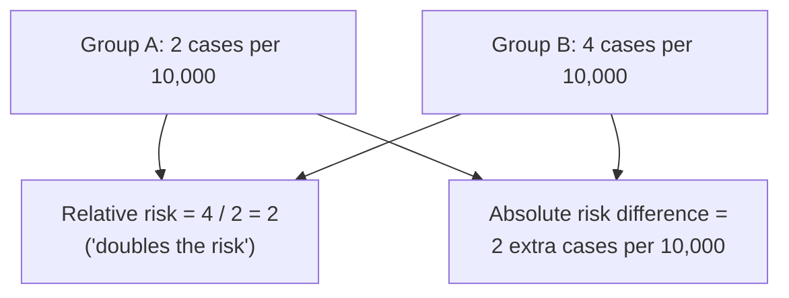

# Measuring disease

**Prerequisites:** [What epidemiology is](01-what-epidemiology-is.md)

*Florence Nightingale, a pioneer of medical statistics who used diagrams of death rates in the Crimean War to argue for sanitary reform. Credit: Henry Hering (1814-1893). License: Public domain. Source: [File:Florence_Nightingale_(H_Hering_NPG_x82368).jpg](https://commons.wikimedia.org/wiki/File:Florence_Nightingale_%28H_Hering_NPG_x82368%29.jpg).*

## Counts are not enough

"There were 500 measles cases" means little without knowing out of how many people, and over what time. Epidemiology turns counts into **rates** and **proportions** that can be compared across places and years.

## The core measures

| Measure | What it is | Example |
|---|---|---|
| **Incidence** | New cases in a population over a period | 12 new cases per 100,000 people per year |
| **Prevalence** | Existing cases at a point in time | About 1 in 31 eight-year-olds identified with autism in CDC monitoring sites, 2022 data ([Shaw et al., *MMWR Surveillance Summaries* 2025](https://doi.org/10.15585/mmwr.ss7402a1)) |
| **Attack rate** | Proportion of exposed people who get ill during an outbreak | 90% of susceptible household contacts of measles |
| **Mortality rate** | Deaths from a cause per population per time | Deaths per 100,000 per year |
| **Case fatality rate (CFR)** | Deaths among diagnosed cases | Tetanus CFR often 10–20% even with modern care |
| **Infection fatality rate (IFR)** | Deaths among all infections, including undiagnosed | Lower than CFR when many infections are mild |
| **Hospitalisation rate** | Proportion of cases hospitalised | About 1 in 5 unvaccinated US measles cases, per CDC |

**Incidence vs prevalence** matters a lot. A disease that lasts a long time (like chronic hepatitis B) has a high prevalence relative to its incidence. Autism is diagnosed once and lasts for life, so its prevalence reflects decades of diagnoses. Changes in diagnostic criteria, awareness and services can raise measured prevalence without any change in the underlying condition, which is central to [[autism-the-epidemiology-of-diagnosis|the autism prevalence debate]].

**CFR vs IFR** confused much early COVID-19 reporting. When testing is limited, only severe cases are counted, so CFR overstates the risk per infection.

## Absolute and relative risk

- **Relative risk (RR)** is the ratio of risks in two groups. "Doubles the risk" is a relative statement.
- **Absolute risk difference** is the subtraction: how many extra (or fewer) cases per number of people.

Both sides of vaccine debates sometimes present whichever number sounds more dramatic. A vaccine that is "95% effective" (relative) may prevent a small absolute number of cases if the disease is uncommon in the trial period; critics such as Ronald Brown and Peter Doshi pointed this out about COVID-19 vaccine trials. Equally, a side effect that "triples the risk" may mean one extra case per million doses. Good reporting gives both. A useful related figure is the **number needed to vaccinate (NNV)**: how many people must be vaccinated to prevent one case, which is 1 divided by the absolute risk reduction. See [efficacy, effectiveness and waning](13-efficacy-effectiveness-and-waning.md).

## Person-time

Because people are followed for different lengths of time, epidemiologists often count **person-time**: one person followed for two years contributes two person-years. Rates per 100,000 person-years let studies compare groups followed for different periods. This becomes important in vaccine safety studies, which compare the rate of an event in a "risk window" after vaccination with the rate in other periods.

## Where the numbers come from

- **Notifiable disease reporting**: doctors and labs must report certain diseases to public health. Reporting is incomplete; mild cases are missed.
- **Vital statistics**: death certificates, with known inaccuracies in cause-of-death coding.
- **Serosurveys**: testing blood for antibodies to estimate how many people have been infected or vaccinated.
- **Health records and registries**: Nordic countries link national registries by personal ID number, which is why so many large vaccine safety studies come from Denmark, Finland, Sweden and Norway.

Each source has blind spots. A single number almost never tells the whole story.

## Key ideas

- Rates and proportions, not raw counts, allow fair comparisons.
- Incidence counts new cases; prevalence counts existing ones; changes in diagnosis can shift prevalence.
- CFR depends on which cases are counted; IFR includes all infections.
- Report both relative and absolute risk; the number needed to vaccinate translates effectiveness into practical terms.

## Where this leads

- Next: [Transmission and the reproduction number](03-transmission-and-the-reproduction-number.md).
