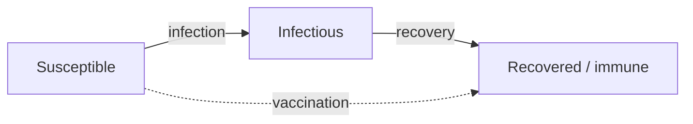

# Transmission and the reproduction number

**Prerequisites:** [Measuring disease](02-measuring-disease.md); [Infection and transmission](../microbiology/06-infection-and-transmission.md)

*Diagram of the SIR model: susceptible, infected and recovered compartments, with transition rates. Credit: Arthur Goldberg. License: [CC BY-SA 4.0](https://creativecommons.org/licenses/by-sa/4.0). Source: [File:Diagram of SIR epidemic model states and transition rates.svg](https://commons.wikimedia.org/wiki/File:Diagram_of_SIR_epidemic_model_states_and_transition_rates.svg).*

## One case, how many more?

The **basic reproduction number**, written **R₀** ("R nought"), is the average number of people one infectious person would infect in a population where *everyone* is susceptible and no one is taking special precautions. It summarises how contagious a disease is in a particular setting.

- If R₀ is above 1, each case produces more than one new case on average, and an outbreak can grow.
- If it is below 1, chains of transmission die out.

The **effective reproduction number**, **Rₑ** or **Rₜ**, is the same idea in the real population at a given time, after accounting for immunity and behaviour. The aim of public health measures, including vaccination, is to push Rₜ below 1.

## What determines R₀

R₀ is not a fixed property of a pathogen alone. Roughly, it is the product of:

1. how many contacts an infectious person has per day,
2. the chance that a contact leads to transmission, and
3. how many days the person stays infectious.

So the same disease can have different R₀ values in a crowded city and a scattered rural area, or in a society with large families versus small ones.

## Typical values

Published estimates vary widely, but commonly cited ranges are:

| Disease | Commonly cited R₀ range |
|---|---|
| Measles | 12–18 |
| Pertussis | 12–17 |
| Chickenpox | 10–12 |
| Mumps | 4–7 |
| Rubella | 6–7 |
| Polio | 5–7 |
| Smallpox | 5–7 |
| Diphtheria | 6–7 |
| Seasonal influenza | about 1–2 |
| SARS-CoV-2 (ancestral strain) | about 2.5–3; higher for later variants |

These figures come from the textbook literature (for example Anderson and May's *Infectious Diseases of Humans*) and should be read as orders of magnitude. A 2017 systematic review of measles R₀ found estimates spread far wider than the "12–18" textbook range, depending on setting and method ([Guerra et al., *Lancet Infectious Diseases* 2017](https://doi.org/10.1016/S1473-3099(17)30307-9)).

## The SIR model

Epidemiologists model outbreaks by dividing a population into compartments:

Early in an outbreak, almost everyone is susceptible, and cases grow roughly exponentially. As more people become immune, each case finds fewer susceptible contacts, Rₜ falls, the outbreak peaks and declines. Vaccination moves people from S to R *without* their passing through I. That is the mathematical core of how vaccination protects the unvaccinated too, developed in [herd immunity](04-herd-immunity.md).

Real models add complications: age groups, waning immunity, births (which constantly add new susceptibles), seasonality and uneven mixing. Uneven mixing matters a great deal for vaccines: a country can have 95% national coverage but still have outbreaks in communities where coverage is much lower, as happened with measles among the Orthodox Jewish communities of New York in 2018–19, in the Mennonite community of West Texas in 2025, and in Canada from 2024. See [[outbreaks-and-coverage|outbreaks and coverage]].

## Generation time and doubling

Two other quantities help describe speed:

- **Serial interval / generation time**: the typical time between one case and the next in a chain (about 10–14 days for measles; 2–4 days for influenza).
- **Doubling time**: during exponential growth, how long it takes cases to double.

A disease with a modest R₀ and a short generation time can explode faster than one with a higher R₀ and a long generation time.

## Key ideas

- R₀ is the average number of infections caused by one case in a fully susceptible population; Rₜ is the real-world figure at a given time.
- R₀ depends on contacts, transmission probability and duration of infectiousness, so it varies by setting.
- Measles and pertussis have very high R₀; influenza is low but spreads fast because generations are short.
- Vaccination moves people from susceptible to immune without infection, lowering Rₜ.

## Where this leads

- Next: [Herd immunity](04-herd-immunity.md).
- Related: [[measles|measles]].
