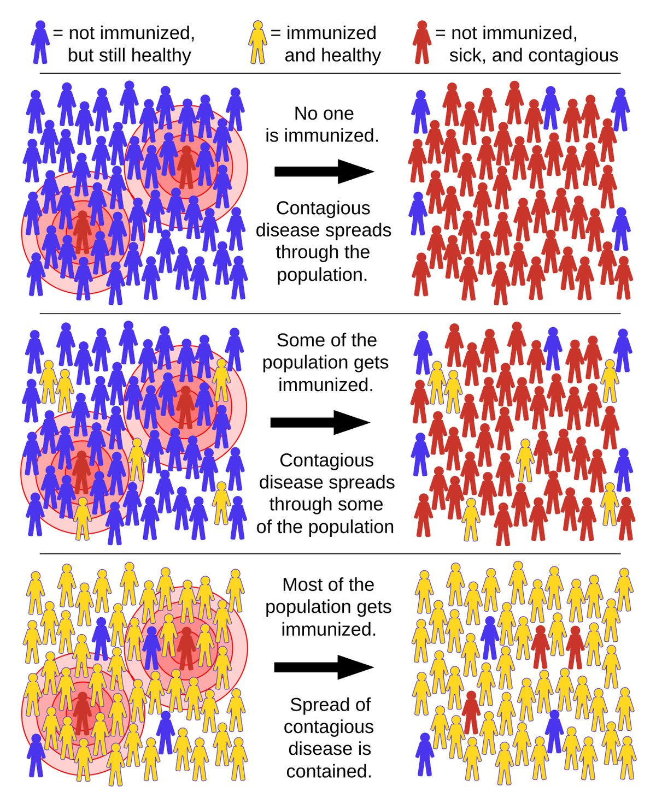
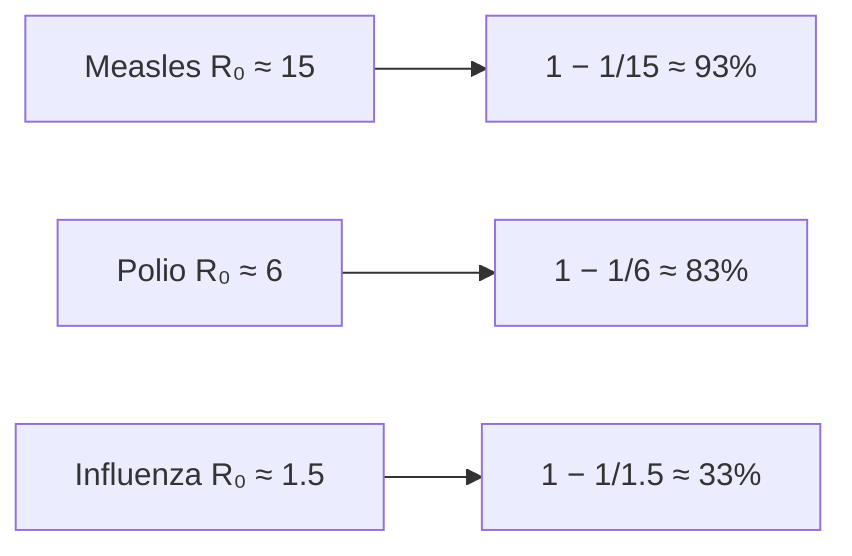

# Herd immunity

**Prerequisites:** [Transmission and the reproduction number](03-transmission-and-the-reproduction-number.md)

*Illustration of herd immunity: when enough of a population is immune, infection cannot spread far, protecting susceptible individuals. Credit: Tkarcher. License: [CC BY-SA 4.0](https://creativecommons.org/licenses/by-sa/4.0). Source: [File:Herd immunity.svg](https://commons.wikimedia.org/wiki/File:Herd_immunity.svg).*

## Protection for those who are not immune

When enough people in a community are immune, an infectious person meets too few susceptible people to keep a chain of transmission going. Outbreaks fizzle, and even people who are not immune (newborns too young to be vaccinated, people whose vaccine did not take, people who cannot be vaccinated for medical reasons) are indirectly protected. This is **herd immunity**, also called **community immunity** or **herd protection**. The term was in use in veterinary and human medicine by the early 20th century; a review of its history and meanings is [Fine, Eames & Heymann, *Clinical Infectious Diseases* 2011](https://doi.org/10.1093/cid/cir007).

## The threshold

If each case would infect R₀ others in a fully susceptible population, and a fraction *p* of the population is immune, then each case infects on average R₀ × (1 − *p*) others. Transmission declines when that number falls below 1. Solving gives the classic **herd immunity threshold**:

> threshold = 1 − 1/R₀

This is why public health agencies aim for about 95% coverage with two doses of measles vaccine: the disease is so contagious that only very high immunity stops it.

## Why the simple formula is only a starting point

Several factors complicate it, and critics and defenders alike point to them:

- **Vaccines are not 100% effective.** If a vaccine prevents infection in 97% of recipients, coverage must be higher than the threshold to reach it.
- **Vaccines vary in whether they block transmission.** Herd protection depends on stopping infection and spread, not just disease. The inactivated polio vaccine (IPV) protects excellently against paralysis but blocks gut infection less well than the oral vaccine. Acellular pertussis vaccine protects against disease but, in baboon experiments, did not prevent colonisation and transmission ([Warfel, Zimmerman & Merkel, *PNAS* 2014](https://doi.org/10.1073/pnas.1314688110)). Tetanus vaccine gives no herd protection at all, because tetanus does not spread person to person.
- **Immunity wanes.** Herd immunity can erode as protection fades, which is one explanation offered for pertussis resurgence.
- **Populations are not evenly mixed.** National coverage of 92% can hide schools or communities at 60%. Outbreaks happen in pockets.
- **Pathogens change.** New variants with higher transmissibility or immune escape raise the bar, as happened with SARS-CoV-2. Early pandemic estimates of a 60–70% threshold for COVID-19 proved unreachable for preventing infection once variants arose and protection against infection waned.

## Natural vs vaccine-induced herd immunity

Herd immunity can be reached through infection as well as vaccination. Before vaccines, measles produced herd immunity every few years, after it had infected most children and before a new crop of susceptible babies accumulated; the result was epidemic cycles with many deaths each time. The **Great Barrington Declaration** (October 2020), written by Martin Kulldorff, Sunetra Gupta and Jay Bhattacharya, proposed "focused protection" of the vulnerable while letting lower-risk people build COVID-19 immunity through infection. Its supporters argued lockdowns caused great harm; critics, including the authors of the opposing **John Snow Memorandum** in *The Lancet*, argued the vulnerable could not be effectively shielded and that infection-acquired immunity wanes. The episode is discussed in [the COVID-19 controversies lesson](../immunology/vaccines/07-controversies/10-covid-19-vaccines-mandates-and-mortality.md).

## Herd immunity and ethics

Herd immunity creates a classic **collective action problem**. If almost everyone else is vaccinated, an individual can benefit from their immunity without bearing any vaccine risk ("free riding"). If many people reason that way, coverage falls below the threshold and everyone is exposed. This tension underlies debates over mandates and exemptions; see [mandates and ethics](../immunology/vaccines/09-public-health-and-ethics/04-mandates-and-ethics.md).

## Key ideas

- Herd immunity protects non-immune people when enough of the population is immune.
- The classic threshold is 1 − 1/R₀: about 92–95% for measles, much lower for less contagious diseases.
- Imperfect vaccines, failure to block transmission, waning, uneven mixing and new variants all complicate the picture.
- Herd immunity is a collective good, which raises ethical questions about free riding and mandates.

## Where this leads

- Next: [Outbreaks, epidemics and endemicity](05-outbreaks-epidemics-and-endemicity.md).
- Related: [eradication and elimination](../immunology/vaccines/09-public-health-and-ethics/01-eradication-and-elimination.md).
