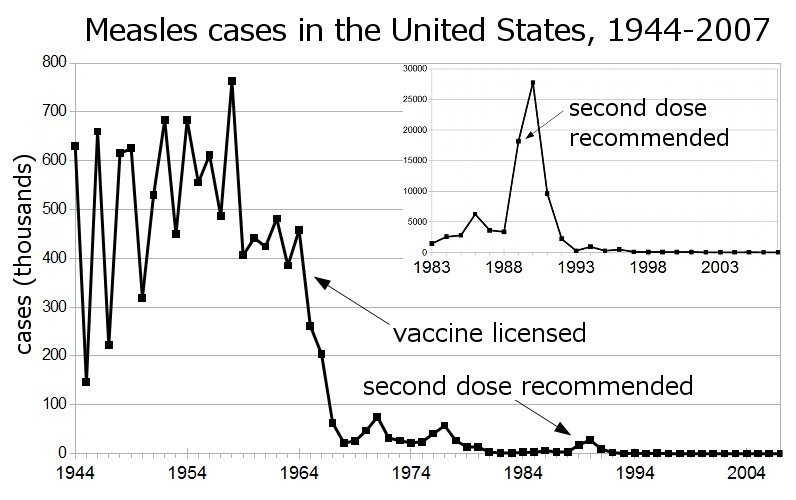
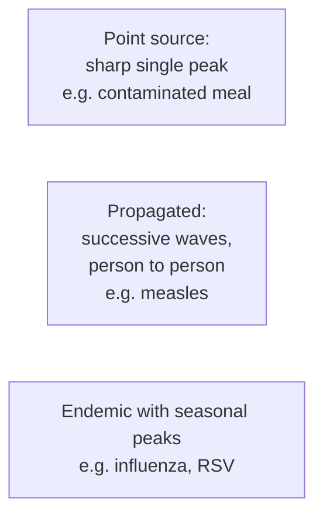

# Outbreaks, epidemics and endemicity

**Prerequisites:** [Herd immunity](04-herd-immunity.md)

*Reported measles cases in the United States, 1944–2007, showing the collapse after vaccine licensure in 1963. Credit: 2over0. License: Public domain. Source: [File:Measles US 1944-2007 inset.png](https://commons.wikimedia.org/wiki/File:Measles_US_1944-2007_inset.png).*

## Words for how much disease there is

- **Endemic**: a disease constantly present in a population at a fairly predictable level (malaria in much of sub-Saharan Africa; measles in the pre-vaccine era almost everywhere).
- **Outbreak**: more cases than expected in a limited area or group. The CDC counts a measles outbreak as three or more linked cases.
- **Epidemic**: a larger increase above the expected level, across a wider area.
- **Pandemic**: an epidemic spreading across several countries or continents, usually affecting many people (influenza 1918, 1957, 1968, 2009; COVID-19 from 2020).

"Endemic" does not mean "mild". Before vaccination, measles was endemic and killed millions of children worldwide each year.

## Epidemic curves

An **epidemic curve** plots cases by date of onset. Its shape gives clues:

The chart above (US measles, 1944–2007) shows something different: a long-term endemic pattern with epidemic peaks every two to three years, then the drop after the first measles vaccine was licensed in 1963. Before vaccination the US reported about 400,000–500,000 cases a year, though the CDC estimates that 3–4 million people were actually infected annually, since most cases went unreported.

## Elimination and resurgence

A disease is **eliminated** from a country or region when it is no longer endemic there: there is no continuous transmission for at least 12 months, although imported cases can still occur. The Americas were declared free of endemic measles in 2016. That status is fragile:

- **Venezuela** lost elimination status in 2018, and Brazil in 2019 (it was regained in 2024).
- **Canada** lost its measles elimination status in November 2025, after a single strain (genotype D8) had circulated for more than 12 months, starting with an outbreak in New Brunswick in October 2024. Canada reported 146 measles cases in 2024 and 5,425 (confirmed and probable) in 2025 ([PHAC statement, November 2025](https://www.canada.ca/en/public-health/news/2025/11/statement-from-the-public-health-agency-of-canada-on-canadas-measles-elimination-status.html); [PHAC measles monitoring](https://health-infobase.canada.ca/measles-rubella/)). Because of this, PAHO announced that the Americas as a whole had lost its measles-free verification ([PAHO, 10 November 2025](https://www.paho.org/en/news/10-11-2025-paho-calls-regional-action-americas-lose-measles-elimination-status)).
- **The United States** reported 2,288 confirmed cases in 2025, more than in any year since the early 1990s, including the West Texas outbreak (762 cases, two child deaths), and more than 5,800 in 2026 by mid-November ([CDC measles data](https://www.cdc.gov/measles/data-research/index.html)). In November 2026 PAHO determined that the US, Mexico and Bolivia had also lost elimination status ([CDC joint statement, 17 November 2026](https://www.cdc.gov/media/releases/2026/loss-of-usmeasles-elimination-status.html)).

These events are discussed in [[outbreaks-and-coverage|outbreaks and coverage]].

## Outbreak investigation

When an outbreak is detected, public health teams typically:

1. confirm the diagnosis (laboratory testing, genotyping);
2. define what counts as a case;
3. find cases and contacts;
4. describe them by person, place and time;
5. form and test hypotheses about the source;
6. control spread: isolation, quarantine of susceptible contacts, post-exposure vaccination or immune globulin;
7. declare the outbreak over after two incubation periods with no new cases (42 days for measles).

Genotyping lets investigators tell whether cases are linked and whether a virus is a vaccine strain or a wild strain, which matters for claims that vaccinated people "caused" outbreaks; the measles vaccine virus does not spread person to person in any meaningful way, while the oral polio vaccine virus can (see [vaccine-derived polio](../immunology/vaccines/06-adverse-events/10-vaccine-derived-polio.md)).

## Key ideas

- Endemic means steadily present; outbreak, epidemic and pandemic describe increasing scales of excess.
- Epidemic curves reveal how a disease is spreading.
- Elimination means no continuous transmission for 12 months; Canada (2025) and the US (2026) lost measles elimination status.
- Outbreak investigation follows a standard sequence, and genotyping identifies sources.

## Where this leads

- Next: [Causation and association](06-causation-and-association.md).
- Related: [measles](../immunology/vaccines/03-diseases/measles.md), [[eradication-and-elimination|eradication and elimination]].
