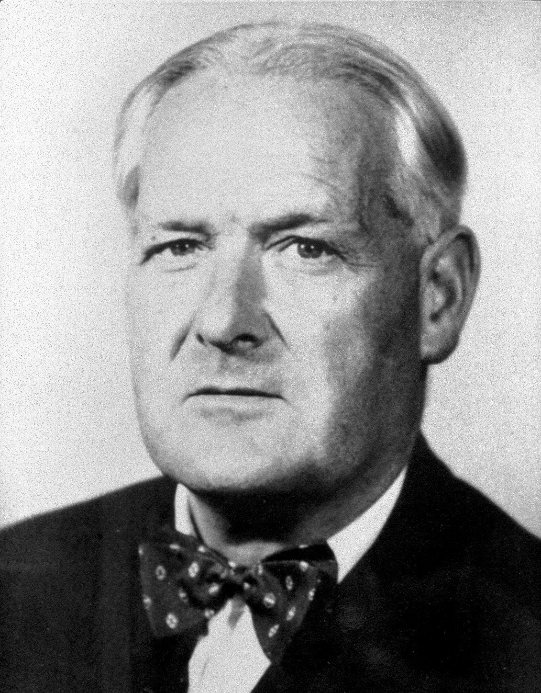
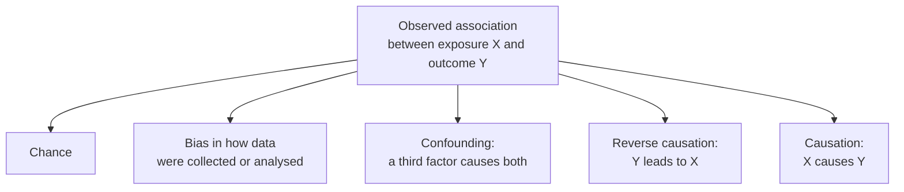

# Causation and association

**Prerequisites:** [Measuring disease](02-measuring-disease.md)

*Sir Austin Bradford Hill, statistician, whose 1965 lecture set out the considerations still used to judge causation. Credit: Unknown authorUnknown author. License: [CC BY 4.0](https://creativecommons.org/licenses/by/4.0). Source: [File:Austin_Bradford_Hill.jpg](https://commons.wikimedia.org/wiki/File:Austin_Bradford_Hill.jpg).*

## Association is not causation

Two things are **associated** when they occur together more (or less) often than chance would predict. Association alone does not tell us that one causes the other. Possible explanations for an association include:

Vaccine debates provide examples of each. Autism diagnoses rose in the same decades that the childhood schedule expanded: an association in time, but so did organic food sales and mobile phone use; a shared time trend is weak evidence of anything. Children who are less healthy may be vaccinated later or not at all (reverse causation and confounding), which can make unvaccinated children look healthier or sicker depending on the study.

## The Bradford Hill considerations

In 1965 the British statistician Sir Austin Bradford Hill, who with Richard Doll had shown that smoking causes lung cancer, gave a lecture listing nine "viewpoints" for judging whether an association is causal ([Hill, *Proceedings of the Royal Society of Medicine* 1965](https://doi.org/10.1177/003591576505800503)). He stressed that none is a strict rule.

| Consideration | Question | Vaccine example |
|---|---|---|
| Strength | How large is the association? | Pandemrix and narcolepsy: very large relative risks |
| Consistency | Is it seen repeatedly, in different places and methods? | Myocarditis after mRNA vaccines: found in Israel, US, Nordic countries |
| Specificity | Is the exposure linked to one particular outcome? | Intussusception after rotavirus vaccines |
| Temporality | Does the cause come before the effect? | Essential, but not sufficient: "after" is not "because of" |
| Biological gradient | Does more exposure mean more effect? | Myocarditis more common after second dose than first |
| Plausibility | Is there a believable mechanism? | VITT: antibodies to platelet factor 4 |
| Coherence | Does it fit what else is known? | |
| Experiment | Does removing the exposure reduce the effect? | Rotashield withdrawn, excess intussusception ended |
| Analogy | Have similar causes had similar effects? | |

Temporality is the only consideration that is required. It is also the one most often mistaken for proof. The fallacy *post hoc ergo propter hoc* ("after this, therefore because of this") drives many personal accounts of vaccine injury, but it also cuts the other way: a true vaccine injury will also look like "something happened after the vaccine". The tools in [base rates and coincidence](11-base-rates-and-coincidence.md) and [self-controlled designs](09-self-controlled-designs.md) are how epidemiologists separate the two.

## Population causation vs individual causation

Two different questions are often confused:

1. **General causation**: can this vaccine cause this condition at all, in anyone? Answered with population studies.
2. **Specific causation**: did this vaccine cause *this* person's condition? Much harder, and often impossible to answer with certainty.

Courts and compensation programmes have to decide specific causation, usually on the "balance of probabilities" (more likely than not). The US Vaccine Injury Compensation Program uses a [table](../immunology/vaccines/08-litigation-and-compensation/04-the-vaccine-injury-table.md) of presumed injuries to avoid this problem for well-established effects; see [causality assessment](../immunology/vaccines/06-adverse-events/13-causality-assessment.md) for the WHO's method for individual cases.

## Scientific reviews of causation

Expert committees grade causal evidence using categories. The US Institute of Medicine (now the National Academies, NASEM) used four in its 2011 report *Adverse Effects of Vaccines* ([Institute of Medicine, *Adverse Effects of Vaccines: Evidence and Causality* (2011)](https://doi.org/10.17226/13164)): evidence **convincingly supports**, **favours acceptance of**, **favours rejection of**, or is **inadequate to accept or reject** a causal relationship. Of 158 vaccine–adverse event pairs reviewed, the large majority fell in the "inadequate" category, meaning the evidence was too thin to decide either way. Both sides cite this. Critics read it as evidence that vaccine safety is understudied; the committee itself noted that "inadequate" often reflected the rarity of the conditions and lack of studies, not a signal of harm. Five vaccine–event pairs were placed in "favours rejection", including MMR and autism. These points recur throughout [the controversies section](../immunology/vaccines/07-controversies/README.md).

## Key ideas

- An association can arise from chance, bias, confounding, reverse causation or causation.
- Bradford Hill's considerations help judge causation; only temporality is essential, and it is never sufficient.
- General causation (can it?) differs from specific causation (did it, in this person?).
- Expert reviews grade evidence; "inadequate to decide" is not the same as "shown to be harmful" or "shown to be safe".

## Where this leads

- Next: [Randomised controlled trials](07-randomised-controlled-trials.md).
