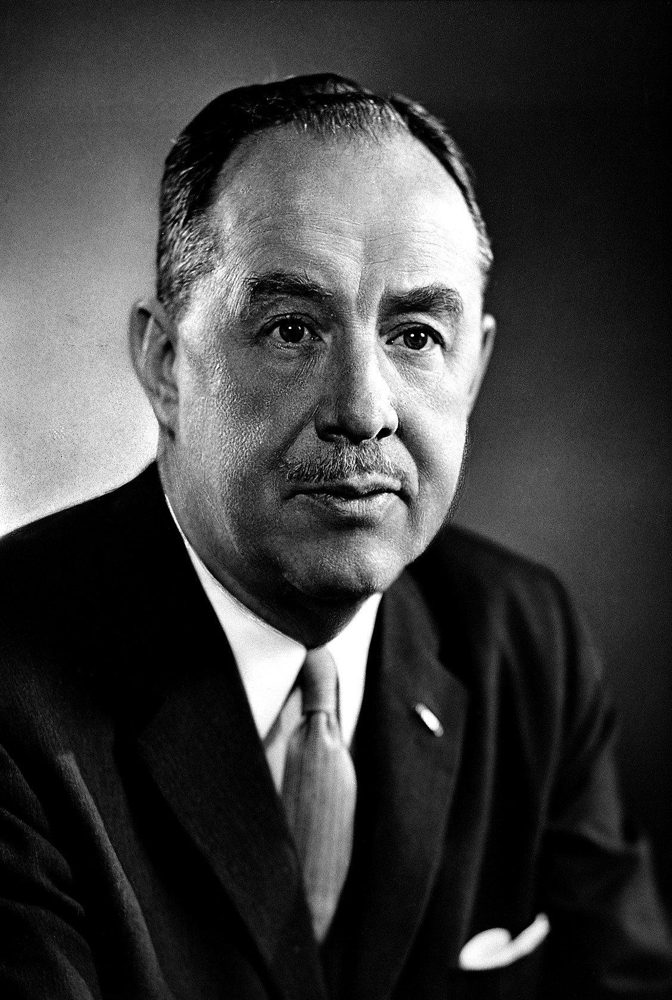
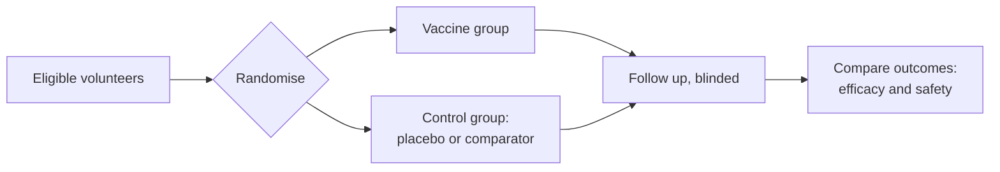

# Randomised controlled trials

**Prerequisites:** [Causation and association](06-causation-and-association.md)

*Thomas Francis Jr., the virologist who directed the 1954 field trial of the Salk polio vaccine. Credit: https://wellcomeimages.org/indexplus/obf_images/81/53/6b333a57126af8f198a3ff31eac0.jpg Gallery: https://wellcomeimages.org/indexplus/image/L. License: [CC BY 4.0](https://creativecommons.org/licenses/by/4.0). Source: [File:Thomas_Francis_Jr._Photograph_by_Fabian_Bachrach._Wellcome_L0018740.jpg](https://commons.wikimedia.org/wiki/File:Thomas_Francis_Jr._Photograph_by_Fabian_Bachrach._Wellcome_L0018740.jpg).*

## Why randomise?

The best way to know whether a vaccine causes an effect (good or bad) is to give it to one group and not to another *otherwise identical* group, then compare. **Randomisation** makes the groups comparable: by assigning people by chance, it balances not only known factors (age, health) but also unknown ones. Any difference that emerges beyond what chance would produce can then be attributed to the vaccine.

## Ingredients of a good trial

- **Control group**: receives a **placebo** (an inert substance such as saline) or an **active comparator** (another vaccine).
- **Blinding**: participants, and ideally investigators and outcome assessors, do not know who got what ("double-blind"). This prevents expectations from colouring reports of symptoms or diagnoses.
- **Pre-specified outcomes**: what counts as success (for example, laboratory-confirmed symptomatic disease) is decided in advance.
- **Adequate size**: enough people and events to detect the effect of interest.
- **Intention-to-treat analysis**: analysing people in the group they were assigned to, even if they did not complete the doses.

## A landmark: the 1954 polio trial

The **Francis field trial** of Jonas Salk's inactivated polio vaccine in 1954 enrolled about 1.8 million American children, the "Polio Pioneers". Part of it was a placebo-controlled, double-blind randomised trial involving roughly 400,000 children. In April 1955 Thomas Francis announced that the vaccine was safe and effective (about 80–90% effective against paralytic polio, depending on the analysis). See [[salk-sabin-and-the-cutter-incident|Salk, Sabin and the Cutter incident]].

## What trials can and cannot do

**Strengths:** they give the most reliable estimates of efficacy and of common side effects.

**Limits:**

- **Size.** A trial of 40,000 people (large by drug standards; the Pfizer–BioNTech COVID-19 trial had about 44,000) can reliably detect side effects occurring around 1 in 10,000 or more often, but not those at 1 in 100,000. Rare effects like VITT or myocarditis in young men were found after rollout, not in trials.
- **Duration.** Trials follow people for months to a few years, not decades.
- **Population.** Trials often exclude pregnant women, the frail elderly and people with serious illness, so results may not apply to them.
- **Unblinding.** After the COVID-19 vaccines were authorised, many placebo recipients were offered the vaccine, ending long-term placebo comparisons. Defenders said it would be unethical to withhold a proven vaccine; critics said it removed the chance to measure long-term safety and all-cause outcomes.

## The placebo debate

A recurring criticism is that many vaccines were licensed without a "true" (inert saline) placebo. Some trials used another vaccine as a control, or an adjuvant-only control (the original Gardasil trials used an aluminium-adjuvant control in most participants). Critics, including the Informed Consent Action Network (ICAN) and, since 2025, the US Department of Health and Human Services under Robert F. Kennedy Jr., argue that this makes it impossible to know the vaccines' true background safety profile. Defenders respond that:

- when an effective vaccine exists, giving children saline instead leaves them unprotected, which ethics codes such as the Declaration of Helsinki restrict;
- an active control is the right comparison when the question is whether a new vaccine is as good as or better than the existing one;
- many vaccines did have saline placebo trials (the 1954 polio trial, early COVID-19 trials, rotavirus trials and others);
- large post-licensure observational studies supplement the trials.

The fuller argument is in [the placebo controls debate](../immunology/vaccines/02-development-and-regulation/03-placebo-controls-debate.md).

## Key ideas

- Randomisation balances known and unknown factors, making cause-and-effect conclusions possible.
- Good trials use controls, blinding, pre-specified outcomes, adequate size and intention-to-treat analysis.
- Trials are the best source on efficacy and common side effects but too small and short for very rare or long-delayed effects.
- Whether vaccine trials should always use an inert placebo is genuinely debated.

## Where this leads

- Next: [Cohort and case-control studies](08-cohort-and-case-control-studies.md).
- Related: [clinical trial phases](../immunology/vaccines/02-development-and-regulation/02-clinical-trial-phases.md).
