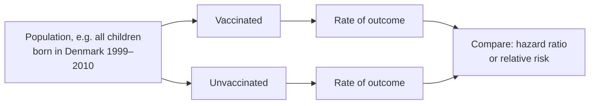
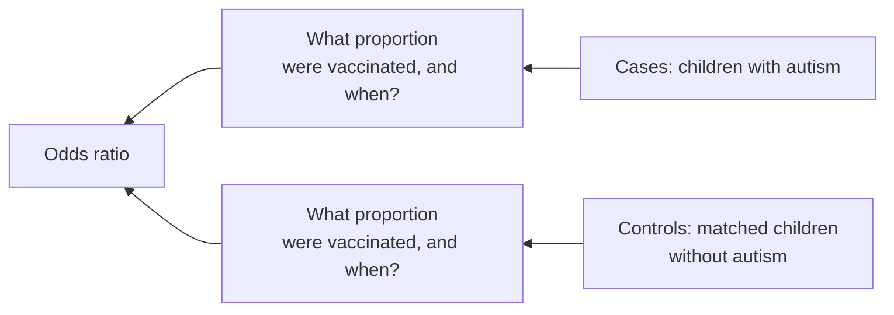

# Cohort and case-control studies

**Prerequisites:** [Randomised controlled trials](07-randomised-controlled-trials.md)

*Statens Serum Institut in Copenhagen, Denmark's national public health institute, whose registry-based cohort studies are among the largest in vaccine safety research. Credit: Leif Jørgensen. License: [CC BY-SA 4.0](https://creativecommons.org/licenses/by-sa/4.0). Source: [File:Statens Serum Institut.jpg](https://commons.wikimedia.org/wiki/File:Statens_Serum_Institut.jpg).*

## When you cannot randomise

Most questions about vaccine safety after licensing are answered by **observational studies**: researchers observe who was vaccinated and who was not, and compare outcomes, without assigning vaccines themselves. They can include millions of people and decades of follow-up, which trials cannot. Their weakness is that vaccinated and unvaccinated people may differ in ways that affect the outcome. The two classic designs are the cohort study and the case-control study.

## Cohort studies

A **cohort** is a group followed over time. In a vaccine cohort study, researchers identify a population, record who was vaccinated, and compare how often an outcome occurs in vaccinated versus unvaccinated people (or more vs fewer doses).

Examples central to this course:

- [Madsen et al., *NEJM* 2002](https://doi.org/10.1056/NEJMoa021134): all 537,303 children born in Denmark 1991–1998; no higher autism risk among the MMR-vaccinated.
- [Hviid et al., *Annals of Internal Medicine* 2019](https://doi.org/10.7326/M18-2101): 657,461 Danish children born 1999–2010, followed through 2013; the hazard ratio for autism comparing MMR-vaccinated with unvaccinated was 0.93 (95% confidence interval 0.85–1.01), and no increased risk in subgroups such as siblings of autistic children.
- [Jain et al., *JAMA* 2015](https://doi.org/10.1001/jama.2015.3077): 95,727 US children with older siblings, using insurance data; no increased autism risk with MMR, including in children whose older sibling had autism.

**Strengths:** large, real-world, can study many outcomes and long follow-up. **Weaknesses:** confounding (vaccinated and unvaccinated families differ), misclassification of vaccination or diagnosis, and small unvaccinated groups in countries with high coverage.

## Case-control studies

A **case-control study** works backwards. Researchers identify people with the outcome (**cases**) and similar people without it (**controls**), then compare their past exposure to the vaccine.

Case-control studies are efficient for rare outcomes, because you start with the cases instead of following huge cohorts waiting for them. [Smeeth et al., *Lancet* 2004](https://doi.org/10.1016/S0140-6736(04)17020-7) used UK general practice records to compare 1,294 children with pervasive developmental disorders and 4,469 controls and found no association with MMR. [DeStefano et al., *Pediatrics* 2004](https://doi.org/10.1542/peds.113.2.259) compared age at first MMR in 624 autistic children and 1,824 controls in Atlanta; this is the study at the centre of the "CDC whistleblower" claims discussed in [that lesson](../immunology/vaccines/07-controversies/04-cdc-whistleblower-claims.md).

**Weaknesses:** **recall bias** (parents of sick children may remember exposures differently, though using medical records avoids this), and choosing appropriate controls is tricky.

Case-control designs are also used to measure vaccine **effectiveness**, including the **test-negative design**: people with symptoms are tested, and vaccination rates among those who test positive are compared with those who test negative. This is how influenza vaccine effectiveness is estimated each season.

## Measures you will see

- **Relative risk (RR)** or **hazard ratio (HR)** from cohort studies; **odds ratio (OR)** from case-control studies. A value of 1 means no difference; below 1 means lower risk in the vaccinated; above 1 means higher.
- **95% confidence interval (CI)**: the range of values compatible with the data. If it includes 1, the study did not find a statistically clear difference. A narrow interval around 1 (such as 0.85–1.01) is strong evidence against any large effect; a wide interval (such as 0.3–4.0) means the study simply could not tell.

## Ecological studies

An **ecological study** compares groups (countries, states, years) rather than individuals: for example, plotting national infant mortality against the number of vaccine doses in each country's schedule ([Miller & Goldman, *Human & Experimental Toxicology* 2011](https://doi.org/10.1177/0960327111407644)). Such studies can suggest hypotheses but are prone to the **ecological fallacy**: a pattern across countries need not hold for individuals, and countries differ in many ways (how they define and record infant deaths, poverty, health care). That paper is discussed in [[too-many-too-soon|too many, too soon]].

## Key ideas

- Cohort studies follow exposed and unexposed groups forward; case-control studies start from the outcome and look back.
- Observational studies can be huge and long, but are vulnerable to confounding and bias.
- Confidence intervals show how precise an estimate is; narrow intervals around 1 rule out large effects.
- Ecological comparisons between countries or years generate hypotheses but cannot establish individual-level causation.

## Where this leads

- Next: [Self-controlled designs](09-self-controlled-designs.md).
- Then: [Bias and confounding](10-bias-and-confounding.md).
