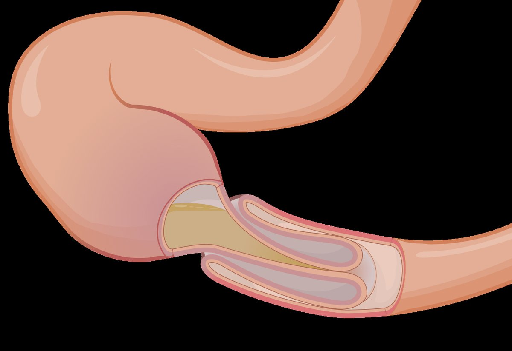
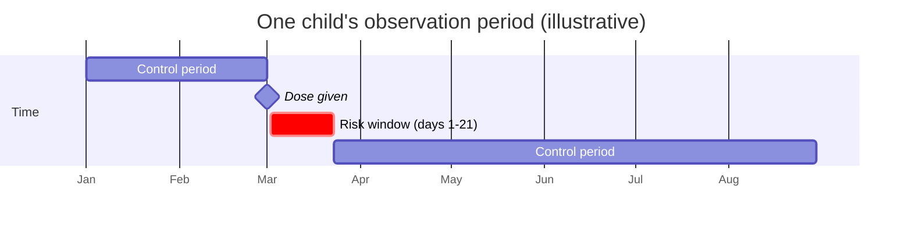

# Self-controlled designs

**Prerequisites:** [Cohort and case-control studies](08-cohort-and-case-control-studies.md)

*Diagram of intussusception, in which one segment of intestine telescopes into the next; self-controlled case series helped quantify its link to rotavirus vaccines. Credit: Olek Remesz (wiki-pl: Orem, commons: Orem). License: [CC BY-SA 3.0](https://creativecommons.org/licenses/by-sa/3.0). Source: [File:Intussusception.svg](https://commons.wikimedia.org/wiki/File:Intussusception.svg).*

## Using people as their own controls

A persistent problem in vaccine safety research is that vaccinated and unvaccinated people differ. One elegant solution is to compare each person with *themselves*: was a person more likely to have the event in the days or weeks just after vaccination than at other times? Because the same person is compared across time, factors that do not change (genes, family background, chronic conditions, socioeconomic status) cancel out automatically.

## The self-controlled case series (SCCS)

The **self-controlled case series** was developed by the British statistician Paddy Farrington in the 1990s specifically for vaccine safety ([Farrington, *Biometrics* 1995](https://doi.org/10.2307/2533328); a tutorial is [Whitaker et al., *Statistics in Medicine* 2006](https://doi.org/10.1002/sim.2302)). It uses only people who had the event (the cases), all of whom were vaccinated at some point. Each person's follow-up time is split into a **risk window** (for example, days 1–21 after a dose) and **control periods** (all other times). The method estimates the **relative incidence**: how much more often the event occurs in the risk window than in control time.

If events cluster in the risk windows more than chance would predict, that suggests the vaccine is involved. If they are spread evenly, it suggests not.

### Classic findings using SCCS

- **MMR and febrile seizures, and ITP.** Early SCCS work in England confirmed an increased risk of febrile seizures 6–11 days after MMR and of ITP within about six weeks, while finding no link with autism or bowel disease.
- **Rotavirus vaccines and intussusception.** SCCS studies in Mexico, Brazil, Australia, the US and the UK found a small increased risk in the week after the first dose, roughly 1 to 6 extra cases per 100,000 vaccinated infants depending on the country. See [intussusception and rotavirus vaccines](../immunology/vaccines/06-adverse-events/05-intussusception-and-rotavirus-vaccines.md).
- **COVID-19 vaccines and myocarditis.** English studies by Patone and colleagues used SCCS to estimate excess myocarditis by vaccine, dose, age and sex, and compared it with the excess after SARS-CoV-2 infection itself ([Patone et al., *Circulation* 2022](https://doi.org/10.1161/CIRCULATIONAHA.122.059970)).

### Assumptions and weaknesses

SCCS assumes that the event does not itself change the chance of being vaccinated later. That assumption fails for some events: a child who has a serious illness may have vaccination postponed, and death obviously ends follow-up. Adaptations exist for these situations. SCCS also handles poorly outcomes with vague or gradual onset, such as autism, where it is hard to date "the event". For that reason, autism research relies mainly on cohort and case-control studies.

## Other self-controlled methods

- **Case-crossover design**: compares a person's exposure just before an event with their exposure in earlier "control" windows.
- **Self-controlled risk interval (SCRI)**: a simplified version comparing a risk window with a fixed control window shortly before or after; used for rapid analyses in the US Vaccine Safety Datalink.

## Rapid cycle analysis

Self-controlled and similar comparisons are used for near-real-time monitoring. The Vaccine Safety Datalink runs weekly **rapid cycle analyses** on new vaccines, comparing observed with expected counts of pre-specified events. This is how a signal for febrile seizures after the combined MMRV vaccine was detected and confirmed ([Klein et al., *Pediatrics* 2010](https://doi.org/10.1542/peds.2010-0665)). See [active surveillance systems](../immunology/vaccines/02-development-and-regulation/09-active-surveillance-systems.md).

## Key ideas

- Self-controlled designs compare each person with themselves at different times, cancelling out fixed confounders.
- The SCCS, invented for vaccine safety, compares event rates in post-vaccination risk windows with other times.
- It confirmed small real risks (febrile seizures, ITP, intussusception, myocarditis) and helped refute others.
- It works best for acute events with clear onset dates; it is unsuitable for conditions such as autism.

## Where this leads

- Next: [Bias and confounding](10-bias-and-confounding.md).
