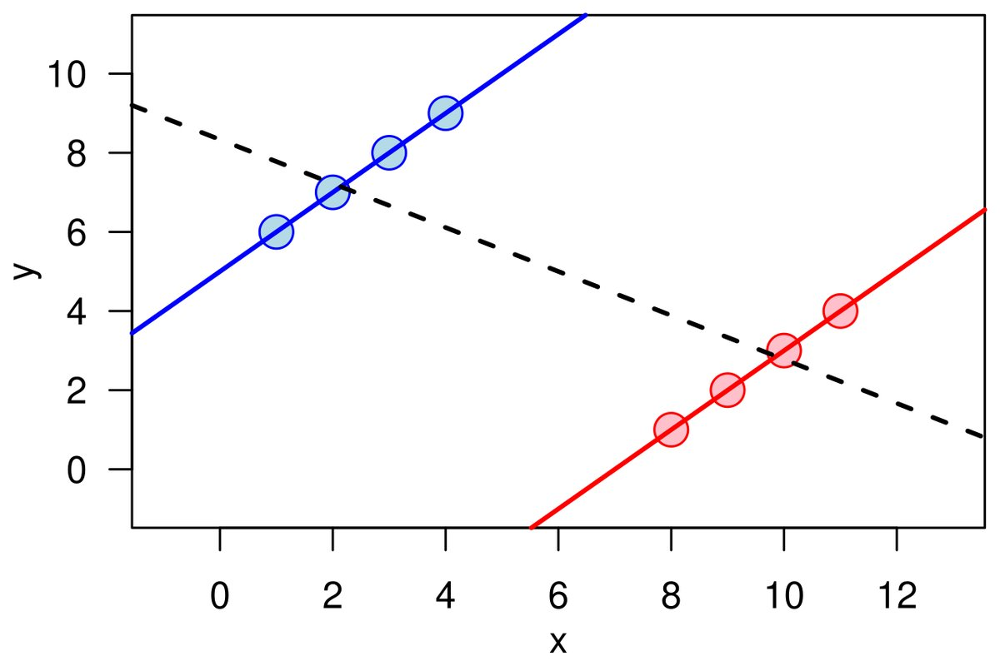
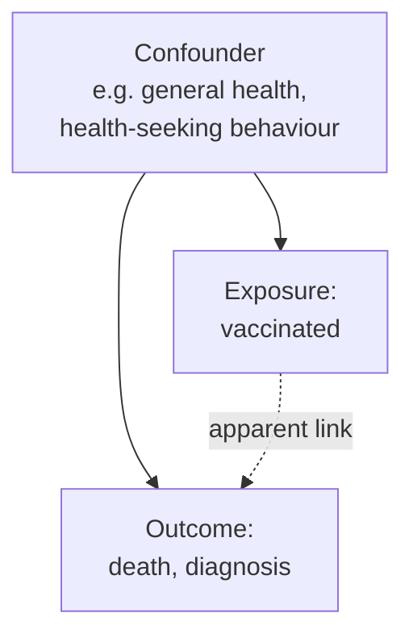

# Bias and confounding

**Prerequisites:** [Cohort and case-control studies](08-cohort-and-case-control-studies.md)

*Simpson's paradox: a trend that appears in several groups can reverse when the groups are combined, a classic consequence of confounding. Credit: Schutz. License: Public domain. Source: [File:Simpson's paradox continuous.svg](https://commons.wikimedia.org/wiki/File:Simpson's_paradox_continuous.svg).*

## Systematic error

**Random error** (chance) shrinks as studies get bigger. **Systematic error**, or bias, does not: a biased study of a million people is precisely wrong. Understanding the main biases is the key to judging both pro- and anti-vaccine claims, since both sides cite observational studies.

## Confounding

A **confounder** is a third factor associated with both the exposure and the outcome, creating a false association (or hiding a real one).

Researchers handle confounding by **matching**, **stratification**, **statistical adjustment**, or designs that remove it (randomisation, self-controlled methods). They can only adjust for confounders they have measured, so **residual confounding** always remains possible.

### The healthy vaccinee effect

A well-documented confounder in vaccine research runs in favour of vaccines. People who get vaccinated, especially older adults getting flu shots, tend to be healthier and more health-conscious than those who do not, and frail people near the end of life are less likely to be vaccinated. Observational studies of flu vaccines in the elderly reported large reductions in all-cause winter deaths, larger than influenza itself could plausibly cause. Jackson and colleagues showed that much of this apparent benefit appeared even *before* flu season, a sign of bias rather than vaccine effect ([Jackson et al., *International Journal of Epidemiology* 2006](https://doi.org/10.1093/ije/dyi274)). Critics of vaccine effectiveness claims, including Tom Jefferson of the Cochrane vaccines group, have long cited this. It is a reminder that observational studies can overstate benefits as well as harms.

### Confounding the other way

Confounding can also make vaccines look harmful. Children with developmental concerns may visit doctors more often, so they may be both more often vaccinated on time and more often diagnosed with conditions. Conversely, families who refuse vaccines may also be less likely to seek diagnoses, making unvaccinated children appear healthier. Surveys comparing vaccinated and unvaccinated children recruited through home-schooling or vaccine-sceptical networks face this problem acutely.

## Selection bias

**Selection bias** occurs when the people studied differ systematically from the population of interest, or when the way they enter the study is linked to both exposure and outcome. Online surveys, self-selected samples and studies of people who report to compensation programmes are particularly vulnerable.

## Information bias

- **Recall bias**: people who suffered an outcome search their memory harder for possible causes.
- **Misclassification**: vaccination records or diagnoses recorded wrongly. If misclassification is random, it tends to hide real effects; if it differs between groups, it can create false ones.
- **Detection bias**: one group is examined more closely. After a vaccine is publicised as risky, doctors look harder for that problem in vaccinated people.

## Publication and reporting bias

Studies with striking results are more likely to be published, and outcomes may be selectively reported. Industry-funded trials are on average more likely to report favourable conclusions than independently funded ones ([Lundh et al., Cochrane methodology review, 2017](https://doi.org/10.1002/14651858.MR000033.pub3)), and a review of influenza vaccine studies found that industry-funded studies were published in more prestigious journals and cited more, regardless of quality ([Jefferson et al., *BMJ* 2009](https://doi.org/10.1136/bmj.b354)). Advocacy-funded studies on the other side face the same incentive problems. See [conflicts of interest and funding](../immunology/vaccines/07-controversies/14-conflicts-of-interest-and-funding.md).

## Other traps

- **Immortal time bias**: if people are counted as "vaccinated" from a date they had to survive to reach, the vaccinated group gets free survival time.
- **Collider bias**: adjusting for a factor caused by both exposure and outcome can create a spurious association.
- **Multiple comparisons**: test enough outcomes and some will be "significant" by chance (at the 5% level, about 1 in 20).

## Key ideas

- Bias is systematic error and does not shrink with sample size.
- Confounders affect both exposure and outcome; adjustment helps only for measured confounders.
- The healthy vaccinee effect can make vaccines look better than they are; other confounders can make them look worse.
- Selection, information, publication, immortal time and multiple-comparison biases are common traps for both sides.

## Where this leads

- Next: [Base rates and coincidence](11-base-rates-and-coincidence.md).
