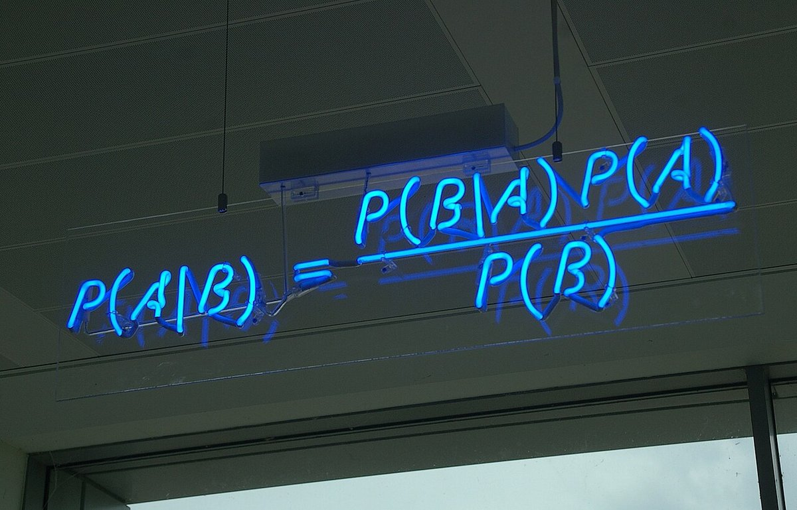
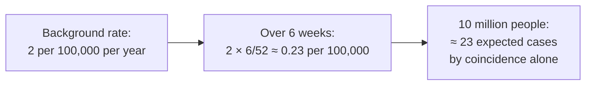

# Base rates and coincidence

**Prerequisites:** [Bias and confounding](10-bias-and-confounding.md)

*Bayes' theorem in neon at the offices of Autonomy in Cambridge; reasoning about base rates is a form of Bayesian thinking. Credit: mattbuck (category). License: [CC BY-SA 3.0](https://creativecommons.org/licenses/by-sa/3.0). Source: [File:Bayes' Theorem MMB 01.jpg](https://commons.wikimedia.org/wiki/File:Bayes'_Theorem_MMB_01.jpg).*

## The expected number of coincidences

Every day, by chance, some people develop serious illnesses, are diagnosed with chronic conditions, or die. When millions of people are vaccinated, some of these events will happen shortly after vaccination purely by coincidence. The question is never "did anything bad happen after vaccination?" (something always will) but "did more happen than would have happened anyway?"

The figure for "anyway" is the **background rate** (or base rate): how often an event occurs in a comparable unvaccinated population over the same period.

## A worked example

Suppose a condition occurs in about 2 people per 100,000 per year. Now vaccinate 10 million people and watch them for six weeks.

So about 23 cases would be expected in the six weeks after vaccination even if the vaccine did nothing. If surveillance finds 25, that is consistent with chance. If it finds 80, that is a **signal** worth investigating. This **observed-versus-expected** comparison is a basic tool of vaccine safety monitoring. Before the COVID-19 vaccine rollout, researchers published background rates of conditions like Guillain-Barré syndrome, Bell's palsy and myocarditis precisely so that post-vaccination reports could be interpreted.

## Timing and childhood development

Many conditions first become apparent at the ages when vaccines are given:

- Signs of autism often become noticeable to parents between about 12 and 24 months, the same period as the MMR vaccine.
- Sudden infant death syndrome peaks at 2–4 months, the age of the first infant vaccines.
- Febrile seizures peak in the second year.
- Type 1 diabetes, epilepsy and many developmental conditions also first appear in childhood.

This overlap guarantees many temporal coincidences, and many sincere parental reports of "it started right after the shot". It does not mean every such report is a coincidence; it means individual timing alone cannot distinguish cause from coincidence, which is why population comparisons are needed. For autism specifically, home video studies have found signs in some children before the age of MMR vaccination, and the cohort studies in [MMR and autism](../immunology/vaccines/07-controversies/01-mmr-and-autism.md) compare vaccinated with unvaccinated children directly.

## The base-rate fallacy

The **base-rate fallacy** is ignoring how common something is when judging probabilities. A familiar vaccine example involves outbreak statistics. In a highly vaccinated population, most people who catch measles during an outbreak may be unvaccinated, but in some outbreaks of mumps or COVID-19, many cases occur in vaccinated people. That can sound like the vaccine failed. It need not have:

> If 95% of a population is vaccinated and the vaccine is 90% effective, then among 1,000 people exposed: 950 vaccinated × 10% = 95 vaccinated cases; 50 unvaccinated × 100% = 50 unvaccinated cases. Most cases are in the vaccinated, yet each vaccinated person was ten times less likely to get sick.

The right comparison is the **rate** of disease in each group, not the share of cases. This applies in both directions: a claim that "most hospital patients were vaccinated" and a claim that "most deaths after vaccination were in the elderly" both need denominators and base rates before they mean anything.

## Regression to the mean

When people seek help at the peak of a fluctuating problem, they will tend to improve afterwards whatever is done. This makes treatments look effective and, conversely, can make a later dip look like harm. It is a reason why uncontrolled before-and-after comparisons are unreliable.

## Key ideas

- Serious events will occur after vaccination by chance; the question is whether they exceed the background rate.
- Observed-versus-expected analysis is a standard way to detect real signals.
- Many childhood conditions emerge at the ages vaccines are given, guaranteeing coincidences.
- The base-rate fallacy misleads in both directions; compare rates, not shares of cases.

## Where this leads

- Next: [Surveillance: passive and active](12-surveillance-passive-and-active.md).
