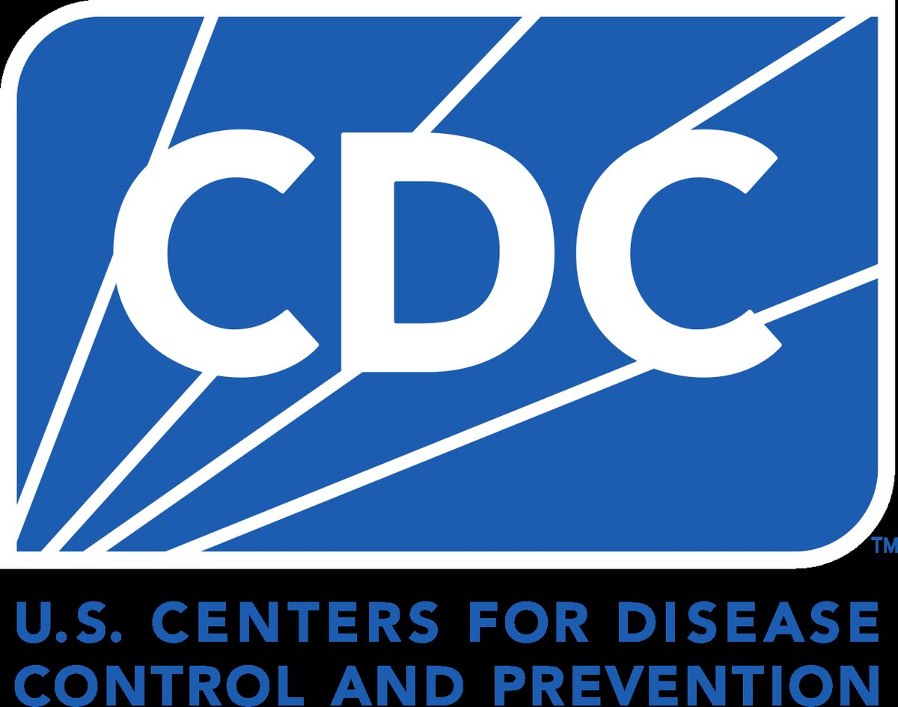
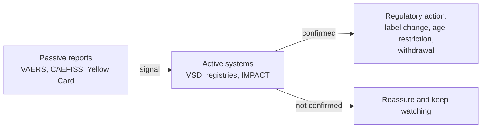

# Surveillance: passive and active

**Prerequisites:** [Base rates and coincidence](11-base-rates-and-coincidence.md)

*The US Centers for Disease Control and Prevention (CDC), which co-runs VAERS and runs the Vaccine Safety Datalink. Credit: U.S. Centers for Disease Control and Prevention. License: Public domain. Source: [File:CDC_logo_2024.svg](https://commons.wikimedia.org/wiki/File:CDC_logo_2024.svg).*

## Watching continuously

**Public health surveillance** is the ongoing, systematic collection and analysis of health data to guide action. For vaccines, it has two jobs: tracking the diseases vaccines prevent (to see whether programmes are working) and tracking adverse events after vaccination (to find safety problems trials missed).

## Passive surveillance

In **passive** systems, health professionals, manufacturers or the public submit reports voluntarily (or, for some events, as a legal requirement). The system waits for reports to arrive.

Examples for vaccine safety:

- **VAERS** (Vaccine Adverse Event Reporting System), United States, run jointly by the CDC and FDA since 1990.
- **CAEFISS** (Canadian Adverse Events Following Immunization Surveillance System), Canada.
- The **Yellow Card** scheme, United Kingdom.
- **EudraVigilance**, European Union.
- **VigiBase**, the WHO's global database, maintained by the Uppsala Monitoring Centre.

**Strengths:** cheap, cover the whole population, can detect unexpected or very rare events, and anyone can report.

**Weaknesses:**

- **Under-reporting**: many events, especially mild or delayed ones, are never reported. A 2010 report for the US Agency for Healthcare Research and Quality by Harvard Pilgrim Health Care ([Lazarus et al., *Electronic Support for Public Health–VAERS* final report to AHRQ (2010)](https://digital.ahrq.gov/sites/default/files/docs/publication/r18hs017045-lazarus-final-report-2011.pdf), often called the "Lazarus report") stated that fewer than 1% of vaccine adverse events were reported to VAERS. Critics frequently cite this figure; others note it came from a pilot project and that serious events are reported at much higher rates.
- **Stimulated reporting**: media attention or litigation can cause surges of reports unrelated to true risk. VAERS reports of autism rose sharply after autism litigation began.
- **No denominator**: the system counts reports, not how many people were vaccinated, so it cannot calculate rates on its own.
- **No control group**: it cannot say whether events happened more often than in unvaccinated people.
- **Unverified content**: reports may be incomplete, duplicated or wrong.

The correct use of passive data is **signal detection**: spotting unusual patterns that need investigation in better systems. How to read VAERS specifically is covered in [[reading-vaers-correctly|reading VAERS correctly]].

## Active surveillance

In **active** systems, investigators go looking: they monitor defined populations through medical records, clinics or follow-up contact, so they know the denominator and can compare vaccinated and unvaccinated people.

Examples:

- **Vaccine Safety Datalink (VSD)**: a CDC collaboration with several US integrated health-care organisations, covering the electronic records of millions of people.
- **IMPACT** (Immunization Monitoring Program ACTive), run by the Canadian Paediatric Society in children's hospitals across Canada.
- The FDA's **BEST** system and the **Sentinel** initiative, using insurance claims and health records.
- Nordic national registries, linked by personal identity numbers.
- **v-safe**, a smartphone-based system launched for COVID-19 vaccines, which actively sent check-in surveys to registered vaccine recipients (it sits between passive and active: active follow-up, but self-selected enrolment).

Active systems can calculate rates, compare groups and confirm or refute signals from passive reports. Their limits: smaller populations than the whole country, and dependence on the quality of coded medical records.

## Disease surveillance

Disease surveillance uses mandatory notification of certain diseases, laboratory reporting, sentinel physician networks (such as those for influenza), and environmental surveillance. **Wastewater testing** has become important: poliovirus is monitored in sewage to detect silent circulation, which is how vaccine-derived poliovirus was found in London and New York in 2022.

## Key ideas

- Surveillance tracks both vaccine-preventable diseases and adverse events.
- Passive systems (VAERS, CAEFISS, Yellow Card) catch signals but have no denominators or controls and suffer under- and over-reporting.
- Active systems (VSD, IMPACT, registries) can calculate rates and test signals.
- Good safety monitoring chains the two: passive signals, active confirmation.

## Where this leads

- Next: [Efficacy, effectiveness and waning](13-efficacy-effectiveness-and-waning.md).
- Related: [[post-market-surveillance|post-market surveillance]], [[reading-vaers-correctly|reading VAERS correctly]].
