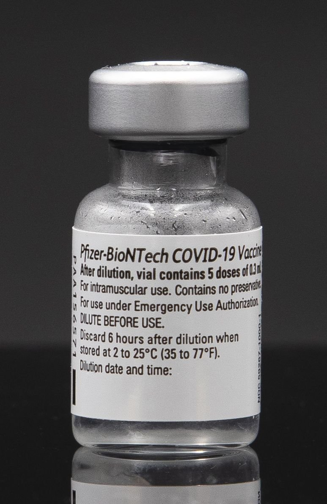
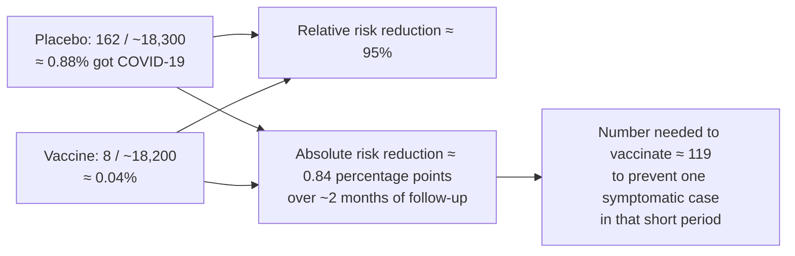

# Efficacy, effectiveness and waning

**Prerequisites:** [Randomised controlled trials](07-randomised-controlled-trials.md); [Measuring disease](02-measuring-disease.md)

*The Pfizer–BioNTech COVID-19 vaccine, whose reported 95% efficacy became one of the most argued-over numbers of the pandemic. Credit: Arne Müseler. License: [CC BY-SA 3.0 de](https://creativecommons.org/licenses/by-sa/3.0/de/deed.en). Source: [File:Covid19_vaccine_biontech_pfizer_3.jpg](https://commons.wikimedia.org/wiki/File:Covid19_vaccine_biontech_pfizer_3.jpg).*

## Three related ideas

- **Efficacy**: how well a vaccine works in the controlled conditions of a randomised trial.
- **Effectiveness**: how well it works in the real world, in ordinary populations, with imperfect storage, timing and coverage, measured by observational studies.
- **Impact**: the population-level change after a programme is introduced, including indirect (herd) effects.

They can differ. Trial participants are selected and closely followed; real-world use includes older, sicker people, missed doses and new variants. Effectiveness may be lower than efficacy, or occasionally higher once herd effects kick in.

## How efficacy is calculated

Vaccine efficacy (VE) is the proportional reduction in disease among the vaccinated compared with the unvaccinated:

> VE = (risk in unvaccinated − risk in vaccinated) / risk in unvaccinated = 1 − relative risk

A worked example using the published figures from the Pfizer–BioNTech trial ([Polack et al., *NEJM* 2020 (BNT162b2 trial)](https://doi.org/10.1056/NEJMoa2034577)): among about 18,000 people in each arm evaluated for the primary endpoint, there were 8 cases of confirmed symptomatic COVID-19 in the vaccine group and 162 in the placebo group, giving VE ≈ 1 − 8/162 ≈ 95%.

Both figures are correct. The relative number describes how much the vaccine reduced *each person's* risk; the absolute number depends on how much disease was circulating during the short trial. As critics pointed out, the absolute risk reduction was under 1%, and the trial was not designed to show reductions in deaths or transmission. Defenders noted that absolute benefit grows with longer exposure and higher incidence, as happened in later waves. Good analysis reports both. See [measuring disease](02-measuring-disease.md).

## Endpoints matter

What a VE figure refers to depends on the **endpoint**: infection (including asymptomatic), symptomatic disease, severe disease, hospitalisation, death, or transmission. A vaccine can be 50% effective against infection and 90% against hospitalisation at the same time. Claims that "the vaccine doesn't work" or "the vaccine is 95% effective" are meaningless without saying against what, in whom, and when.

## Waning

Protection often declines over time:

- **Acellular pertussis**: protection falls substantially within a few years of the fifth childhood dose; studies in California after a 2010 outbreak estimated that the odds of pertussis rose by about 42% per year after the last dose ([Klein et al., *NEJM* 2012](https://doi.org/10.1056/NEJMoa1200850)).
- **COVID-19 mRNA vaccines**: protection against infection dropped markedly within months, especially against Omicron, while protection against severe disease held up better.
- **Mumps**: outbreaks among two-dose-vaccinated university students led to a third dose being recommended in outbreak settings in the US (2017).
- **Influenza**: effectiveness varies yearly with how well the vaccine strains match circulating viruses; the CDC's US estimates have ranged from about 10% to 60% across recent seasons.

Some vaccines show little waning against severe disease (measles, the conjugate vaccines in combination with herd effects, HPV so far). Waning is a real, documented limitation, not a fringe claim, and it is the main reason for booster doses and for changes to schedules.

## Primary and secondary vaccine failure

- **Primary failure**: the vaccine never produced protective immunity (for example, about 7% of children after one dose of measles vaccine, which is why a second dose is given).
- **Secondary failure**: protection was achieved but waned.

## Key ideas

- Efficacy is measured in trials; effectiveness in real-world use; impact at population level.
- VE = 1 − relative risk; it says nothing about absolute benefit, which depends on how common the disease is.
- Always ask "effective against what endpoint, in whom, and for how long?"
- Waning is real for several vaccines (pertussis, COVID-19, mumps, influenza) and drives booster policy.

## Where this leads

- Next: [Systematic reviews and meta-analysis](14-systematic-reviews-and-meta-analysis.md).
- Then the main course: [How vaccines work](../immunology/vaccines/01-how-vaccines-work/01-how-vaccines-work.md).
