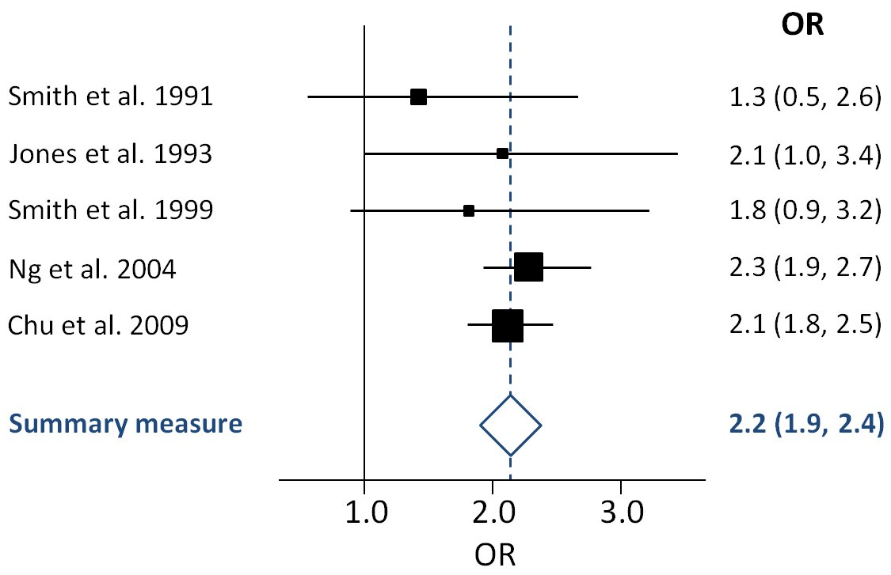
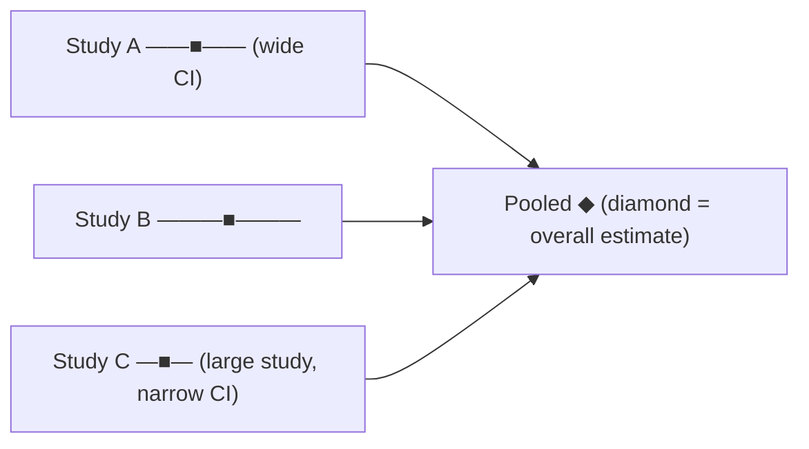

# Systematic reviews and meta-analysis

**Prerequisites:** [Cohort and case-control studies](08-cohort-and-case-control-studies.md); [Bias and confounding](10-bias-and-confounding.md)

*A forest plot, the standard way of displaying the results of a meta-analysis. Credit: James Grellier. License: [CC BY-SA 3.0](https://creativecommons.org/licenses/by-sa/3.0). Source: [File:Generic_forest_plot.png](https://commons.wikimedia.org/wiki/File:Generic_forest_plot.png).*

## Why one study is never enough

Individual studies can be small, biased or unlucky. A **systematic review** gathers *all* relevant studies on a question using a pre-specified, reproducible search and selection method, assesses their quality, and summarises them. A **meta-analysis** statistically combines their results into an overall estimate.

The Cochrane logo is itself a lesson: it depicts a **forest plot** from a 1989 meta-analysis showing that giving corticosteroids to women in premature labour reduced infant deaths, years after enough individual trials existed to show it but before practice changed.

## Reading a forest plot

Each line is a study: the square is its estimate, its size reflects the study's weight, and the horizontal line is the confidence interval. A vertical line marks "no effect" (1 for ratios). The diamond at the bottom is the pooled estimate. If the diamond does not touch the no-effect line, the combined evidence shows a statistically clear effect.

## In vaccine science

Important systematic reviews you will meet in this course include:

- [Taylor, Swerdfeger & Eslick, *Vaccine* 2014 (meta-analysis)](https://doi.org/10.1016/j.vaccine.2014.04.085): a meta-analysis of five cohort studies (over 1.2 million children) and five case-control studies (over 9,900 children), finding no association between vaccination (MMR, thimerosal or mercury) and autism.
- [Di Pietrantonj et al., Cochrane review of MMR/MMRV vaccines, 2020](https://doi.org/10.1002/14651858.CD004407.pub4): the Cochrane review of MMR and MMRV vaccines, which found them effective and found no evidence of association with autism, while noting that many of the safety studies were of limited methodological quality.
- [Arbyn et al., Cochrane review of HPV vaccines, 2018](https://doi.org/10.1002/14651858.CD009069.pub3): the Cochrane review of HPV vaccines, criticised by Jørgensen, Gøtzsche and Jefferson for missing trials and for including adjuvant-containing controls ([Jørgensen, Gøtzsche & Jefferson, *BMJ Evidence-Based Medicine* 2018](https://doi.org/10.1136/bmjebm-2018-111012)); Cochrane's editors defended it. This dispute is examined in [[hpv-vaccine-safety-claims|HPV vaccine safety claims]].
- [Maglione et al., *Pediatrics* 2014](https://doi.org/10.1542/peds.2014-1079): a review for the US Agency for Healthcare Research and Quality of the safety of routine childhood vaccines, which found some rare adverse events (such as febrile seizures after MMR) supported by evidence, and found strong evidence that MMR is not associated with autism.

## Quality of evidence

Reviews grade evidence using frameworks such as **GRADE** (high, moderate, low, very low certainty). Randomised trials start as high certainty and observational studies as low, then are rated up or down for risk of bias, inconsistency, imprecision, indirectness and publication bias. Several national advisory committees (including ACIP since 2010 and NACI) use GRADE-style methods to make recommendations.

## Weaknesses

- **Garbage in, garbage out**: a meta-analysis of biased studies gives a precise biased answer.
- **Heterogeneity**: combining studies that differ in populations, vaccines or definitions can be misleading.
- **Publication bias**: if negative studies were never published, the pooled result is skewed. **Funnel plots** can hint at this.
- **Reviewer choices**: which studies to include is a judgement; reviews on the same question can disagree. Reviews by authors with interests, whether industry or advocacy, deserve scrutiny of those choices.

## Key ideas

- Systematic reviews collect all studies with a reproducible method; meta-analyses pool them statistically.
- Forest plots display each study's estimate and the combined result.
- Evidence certainty is graded; observational evidence starts lower than randomised evidence.
- Reviews inherit the flaws of their studies and depend on judgement calls about inclusion.

## Where this leads

- The main course: [How vaccines work](../immunology/vaccines/01-how-vaccines-work/01-how-vaccines-work.md).
- Related: [expert reviews (IOM, NASEM, Cochrane)](../immunology/vaccines/02-development-and-regulation/11-expert-reviews-iom-nasem-cochrane.md).
