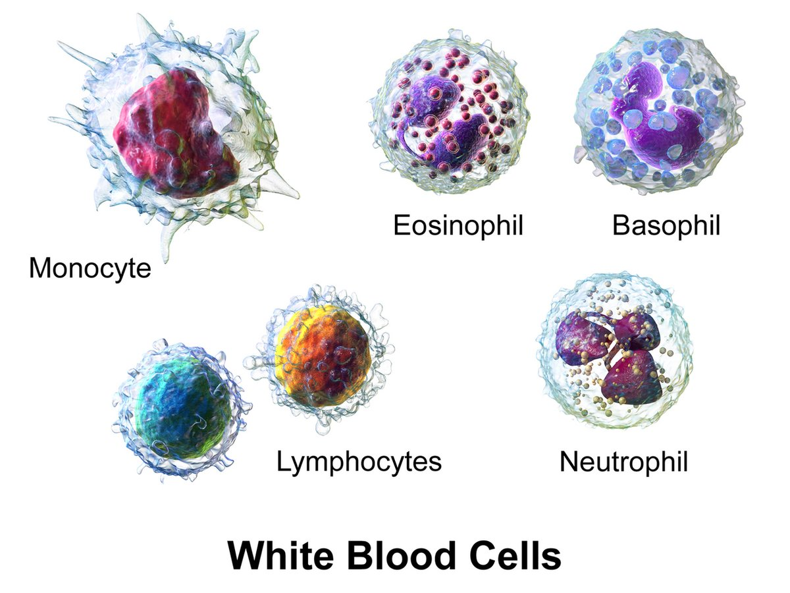
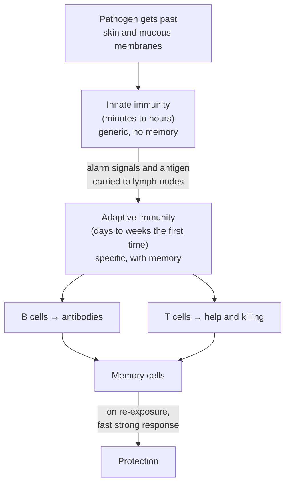

# The immune system at a glance

**Prerequisites:** [Cells and the chemistry of life](../microbiology/01-cells-and-the-chemistry-of-life.md); [Infection and transmission](../microbiology/06-infection-and-transmission.md)

*Illustration of the main kinds of white blood cell: neutrophil, eosinophil, basophil, lymphocyte and monocyte. Credit: BruceBlaus. When using this image in external sources it can be cited as: Blausen.com staff (2014). "Medical gallery of Blausen Medical 2014. License: [CC BY 3.0](https://creativecommons.org/licenses/by/3.0). Source: [File:Blausen 0909 WhiteBloodCells.png](https://commons.wikimedia.org/wiki/File:Blausen_0909_WhiteBloodCells.png).*

## A defence system with two layers

The immune system is the set of cells, molecules and organs that protect the body from infection and from some cancers. It has no single headquarters. Its cells circulate in blood and lymph, gather in lymph nodes, the spleen, tonsils and the lining of the gut, and patrol every tissue.

It is usually described in two layers:

- **Innate immunity** is ready from birth. It recognises broad features shared by many microbes (bacterial cell-wall components, viral RNA) and responds within minutes to hours with inflammation, fever and cells that swallow and kill invaders. It does not improve much with repeated exposure. See [barriers and innate immunity](02-barriers-and-innate-immunity.md).
- **Adaptive immunity** recognises very specific molecular shapes, called [[g:antigen|antigens]]. Its first response to a new pathogen takes days to a couple of weeks to build, but it leaves behind **memory**, so the next response is faster and stronger. This is the layer vaccines are designed to train.

The two layers depend on each other. Innate cells raise the alarm and present antigens to adaptive cells; adaptive cells produce antibodies and signals that make innate cells more effective.

## The cast of cells

All blood cells come from stem cells in the bone marrow. The white blood cells (leukocytes) include:

- **Neutrophils**: the most numerous; rush to infection sites and engulf bacteria. Pus is largely dead neutrophils.
- **Macrophages** (from monocytes): large eaters that clear debris and microbes and signal to other cells.
- **Dendritic cells**: sentinels in skin and mucosa that capture antigens and carry them to lymph nodes. They are the crucial bridge from innate to adaptive immunity, and the main cells that vaccines need to activate.
- **Natural killer (NK) cells**: kill virus-infected and tumour cells without prior training.
- **Mast cells, eosinophils and basophils**: involved in defence against parasites and in allergy, including [[g:anaphylaxis|anaphylaxis]].
- **Lymphocytes**: the adaptive cells. **B cells** make antibodies; **T cells** help other cells and kill infected cells.

## Organs

- **Bone marrow** makes blood cells; B cells mature there.
- The **thymus**, behind the breastbone, is where T cells mature and learn not to attack the body's own tissues.
- **Lymph nodes** are meeting points where dendritic cells bring antigens and B and T cells are activated. Swollen glands during an infection are busy lymph nodes, and swollen nodes near the injection site are a known minor vaccine reaction.
- The **spleen** filters blood, and is particularly important against encapsulated bacteria. People without a working spleen are offered extra pneumococcal, meningococcal and Hib vaccines.
- **Mucosal lymphoid tissue** in the gut and airways guards the main entry points.

## Self and non-self

The immune system must attack invaders while leaving the body's own tissues alone. This is called **tolerance**. It is learned mostly during lymphocyte development: cells that react strongly to self-antigens are deleted or restrained. When tolerance fails, the result is **autoimmune disease** (for example type 1 diabetes, multiple sclerosis). Some claims about vaccines involve autoimmunity; the general mechanisms are in [when immunity goes wrong](09-when-immunity-goes-wrong.md), and specific claims are assessed in the [[d:immunology/vaccines/06-adverse-events|adverse events]] section.

## Scale

A newborn's immune system is immature in some ways but meets an enormous number of antigens from birth: bacteria colonising the skin and gut, food, and the environment. Estimates of how many antigens an infant could theoretically respond to at once are a key part of the "too many, too soon" debate; see [[too-many-too-soon|that lesson]] and [Offit et al., *Pediatrics* 2002](https://doi.org/10.1542/peds.109.1.124), which argued that infants have a very large theoretical capacity to respond to vaccines.

## Key ideas

- Innate immunity is fast and generic; adaptive immunity is slower the first time but specific and has memory.
- Dendritic cells link the two by presenting antigens to lymphocytes in lymph nodes.
- B cells make antibodies; T cells help and kill.
- Tolerance prevents attack on self; its failure is autoimmunity.

## Where this leads

- Next: [Barriers and innate immunity](02-barriers-and-innate-immunity.md).
- Later: [How vaccines work](vaccines/01-how-vaccines-work/01-how-vaccines-work.md).
