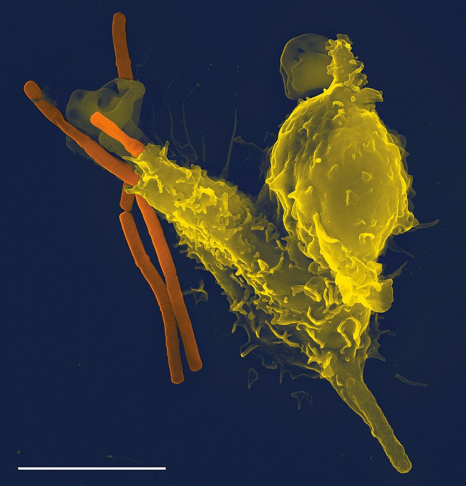
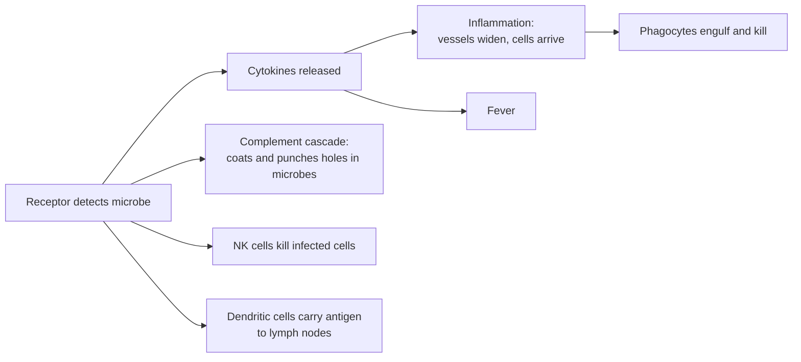

# Barriers and innate immunity

**Prerequisites:** [The immune system at a glance](01-the-immune-system-at-a-glance.md)

*Scanning electron micrograph of a neutrophil (yellow) engulfing anthrax bacteria (orange). Credit: Volker Brinkmann. License: [CC BY 2.5](https://creativecommons.org/licenses/by/2.5). Source: [File:Neutrophil with anthrax copy.jpg](https://commons.wikimedia.org/wiki/File:Neutrophil_with_anthrax_copy.jpg).*

## The first line: barriers

Most microbes never get inside the body. Physical and chemical barriers stop them:

- **Skin**: a dry, acidic, constantly shedding wall. Wounds and burns breach it, which is how tetanus spores get in.
- **Mucous membranes** of the nose, airways, gut and genital tract, coated in mucus that traps particles. In the airways, tiny hairs (cilia) sweep mucus upward to be swallowed. Pertussis toxin and other bacterial factors damage this cleaning system.
- **Chemicals**: stomach acid, enzymes in tears and saliva (lysozyme), antimicrobial peptides.
- **The microbiome**: harmless resident bacteria compete with pathogens for space and food.

## The second line: innate immunity

When a microbe breaches the barriers, innate immunity responds within minutes to hours.

### Recognising danger

Innate cells carry **pattern recognition receptors**, the best known being the **Toll-like receptors (TLRs)**. They detect molecular patterns that are common to microbes but absent from healthy human cells, such as bacterial lipopolysaccharide, flagellin, and double-stranded or unusual RNA. Cells also detect "danger signals" released by damaged tissue.

This matters directly for vaccines. A purified protein on its own often provokes only a weak immune response, because it lacks these danger signals. **Adjuvants** are ingredients added to vaccines to supply them. Aluminium salts, oil-in-water emulsions, and newer adjuvants that stimulate specific TLRs all work, at least partly, by engaging innate immunity; see [adjuvants](vaccines/01-how-vaccines-work/10-adjuvants.md). mRNA vaccines contain modified nucleosides partly to avoid an excessive innate reaction to the RNA itself.

### The responders

- **Phagocytes** (neutrophils and macrophages) engulf microbes and destroy them with enzymes and reactive chemicals.
- The **complement system** is a set of blood proteins that, once triggered, coat microbes (making them easier to eat), attract cells, and can punch holes in bacterial membranes. People with certain complement deficiencies are unusually vulnerable to meningococcal disease, and some drugs that block complement (such as eculizumab) carry a warning to vaccinate against meningococcus first.
- **Natural killer cells** destroy virus-infected cells that have hidden their usual identity markers.
- **Interferons** are signalling proteins released by virus-infected cells that put neighbouring cells into an antiviral state.
- **Dendritic cells** pick up antigens and migrate to lymph nodes to start the adaptive response.

## Innate memory?

Classical immunology held that innate immunity has no memory. Research since about 2010 has described **trained immunity**: innate cells can be reprogrammed by some exposures, including the BCG vaccine, to respond more strongly to later, unrelated infections for some months. This is one proposed mechanism for the **non-specific effects** of vaccines, a research area associated with Peter Aaby and Christine Stabell Benn in Guinea-Bissau and Denmark. They report that live vaccines (BCG, measles, oral polio) may reduce deaths from unrelated infections, and that the non-live DTP vaccine may increase mortality in girls in some settings ([Mogensen et al., *EBioMedicine* 2017](https://doi.org/10.1016/j.ebiom.2017.01.041)). These findings are debated; they come mostly from observational studies in West Africa, and a WHO-commissioned systematic review ([Higgins et al., *BMJ* 2016 (WHO-commissioned review)](https://doi.org/10.1136/bmj.i5170)) judged the evidence on DTP inconclusive and asked for more research. The topic is covered in [[dtp-and-whole-cell-pertussis|the DTP controversy lesson]].

## Inflammation is double-edged

The same innate response that clears infection causes the symptoms people associate with it: fever, aches, redness, swelling. Many common vaccine side effects (a sore arm, low fever, tiredness for a day or two) are signs of this innate response to the vaccine. Over-activation causes harm: septic shock and cytokine storms are innate responses gone too far. See [inflammation and fever](03-inflammation-and-fever.md).

## Key ideas

- Skin, mucous membranes, chemicals and the microbiome keep most microbes out.
- Innate cells recognise common microbial patterns using receptors such as TLRs and respond within hours.
- Phagocytes, complement, NK cells and interferons are the main innate tools; dendritic cells pass the baton to adaptive immunity.
- Adjuvants work by engaging innate immunity; common vaccine side effects largely reflect the innate response.

## Where this leads

- Next: [Inflammation and fever](03-inflammation-and-fever.md).
- Related: [adjuvants](vaccines/01-how-vaccines-work/10-adjuvants.md), [[common-reactions|common vaccine reactions]].
