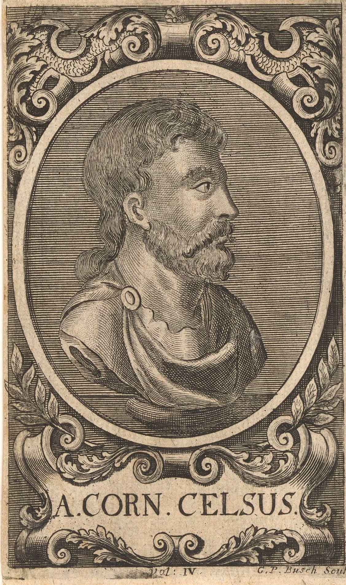
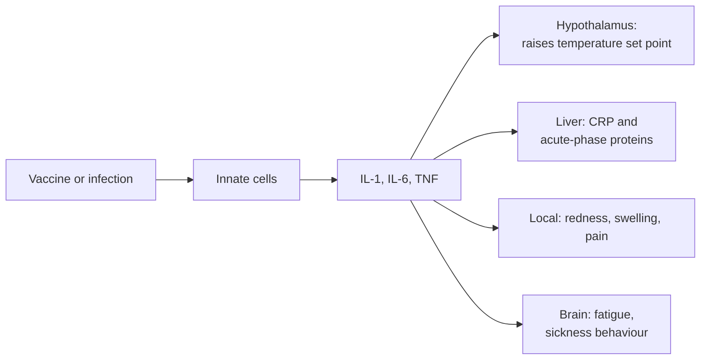

# Inflammation and fever

**Prerequisites:** [Barriers and innate immunity](02-barriers-and-innate-immunity.md)

*Aulus Cornelius Celsus, the Roman writer credited with the classic description of inflammation's four signs. Credit: Georg Paul Busch. License: [CC0](http://creativecommons.org/publicdomain/zero/1.0/deed.en). Source: [File:Portret_van_Aulus_Cornelius_Celsus,_RP-P-1908-2809.jpg](https://commons.wikimedia.org/wiki/File:Portret_van_Aulus_Cornelius_Celsus,_RP-P-1908-2809.jpg).*

## The four classic signs

The Roman writer Celsus, in the 1st century AD, described inflammation by four signs: *rubor* (redness), *calor* (heat), *tumor* (swelling) and *dolor* (pain). A fifth, loss of function, was added later. Each sign reflects something the body is doing deliberately:

- Blood vessels widen, bringing more blood: **redness and heat**.
- Vessel walls become leaky, letting fluid, proteins and white cells into the tissue: **swelling**.
- Chemical mediators such as prostaglandins and bradykinin sensitise nerves: **pain**, which discourages use of an injured part.

## The chemistry: cytokines

Inflammation is coordinated by small signalling proteins called **cytokines**. Some important ones:

- **Interleukin-1 (IL-1), IL-6 and tumour necrosis factor (TNF)** drive fever, fatigue and the liver's production of "acute-phase" proteins such as C-reactive protein (CRP).
- **Chemokines** attract white cells to the site.
- **Interferons** create an antiviral state.

These same molecules act on the brain to produce **sickness behaviour**: tiredness, loss of appetite, aches and the urge to rest. That is why people can feel unwell for a day after a vaccine without being infected; the vaccine has triggered a brief, controlled version of the signals an infection would.

## Fever

Fever is a regulated rise in the body's temperature set point, controlled by the **hypothalamus** in response to cytokines and prostaglandins. It is not the same as overheating. Moderate fever seems to help defence in several ways: many microbes grow less well at higher temperature, and some immune processes speed up.

Fever after vaccination is common with some vaccines. Rates vary widely by vaccine, dose and age; the product monograph or the CDC "Pink Book" chapter for each vaccine gives figures. Fever after the old whole-cell pertussis (DTP) vaccine was particularly common, which is one reason acellular vaccines replaced it; see [[dtp-and-whole-cell-pertussis|DTP and whole-cell pertussis]].

## Febrile seizures

Young children (roughly 6 months to 5 years) can have a seizure when their temperature rises quickly. **Febrile seizures** are frightening to witness but, in the great majority of cases, are brief and leave no lasting harm. They affect around 2 to 5% of children at some point, most often with ordinary infections. Some vaccines slightly increase the short-term risk because they cause fever: the measles-containing vaccines in the second week after vaccination, and the combined MMRV vaccine more than separate MMR plus varicella in toddlers ([Klein et al., *Pediatrics* 2010](https://doi.org/10.1542/peds.2010-0665); [Barlow et al., *NEJM* 2001](https://doi.org/10.1056/NEJMoa003077)). The details and absolute numbers are in [[febrile-seizures|febrile seizures]].

## Should you lower a fever after vaccination?

Some studies have found that giving paracetamol (acetaminophen) *preventively* at the time of vaccination slightly reduced antibody responses to some vaccines ([Prymula et al., *Lancet* 2009](https://doi.org/10.1016/S0140-6736(09)61208-3) is the best-known trial). For that reason many authorities advise against routine preventive fever reducers but accept treating a fever or discomfort if it develops. Always check current local guidance.

## When inflammation goes too far

Inflammation that is too strong, too widespread or too prolonged causes harm: septic shock, acute respiratory distress, and chronic inflammatory diseases. Rare inflammatory complications after some vaccines, such as myocarditis (inflammation of the heart muscle) after mRNA COVID-19 vaccines, are assessed in [[myocarditis-and-mrna-vaccines|myocarditis and mRNA vaccines]]. The infections themselves can cause the same complications, usually more often, which is why risk comparisons matter; see [[weighing-risks-against-benefits|weighing risks against benefits]].

## Key ideas

- Redness, heat, swelling and pain are deliberate effects of blood-vessel changes and chemical mediators.
- Cytokines (IL-1, IL-6, TNF) coordinate inflammation, fever and the "sickness behaviour" that can follow vaccination.
- Fever is a regulated rise in the set point; febrile seizures in young children are usually harmless and some vaccines slightly raise their short-term risk.
- Excessive inflammation causes serious disease; rare inflammatory vaccine complications must be compared with the infection's own risk.

## Where this leads

- Next: [Antigens and antigen presentation](04-antigens-and-antigen-presentation.md).
- Related: [[common-reactions|common vaccine reactions]], [[febrile-seizures|febrile seizures]].
