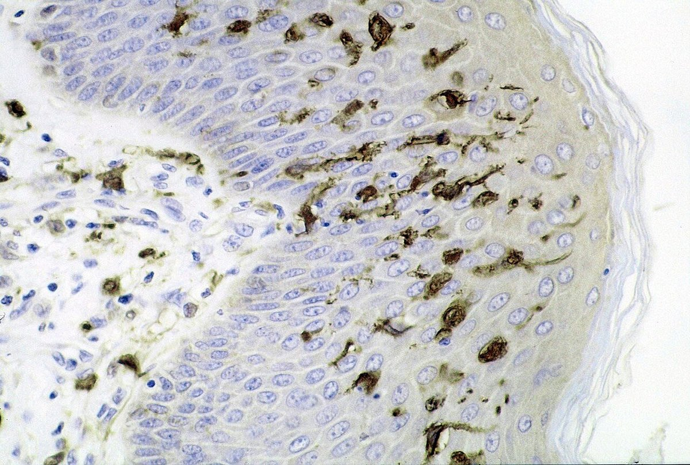
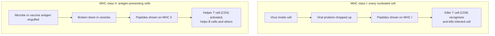

# Antigens and antigen presentation

**Prerequisites:** [The immune system at a glance](01-the-immune-system-at-a-glance.md); [Barriers and innate immunity](02-barriers-and-innate-immunity.md)

*A dendritic cell, the sentinel that captures antigens and presents them to T cells. Credit: Haymanj. License: Public domain. Source: [File:Dendritic_cells.jpg](https://commons.wikimedia.org/wiki/File:Dendritic_cells.jpg).*

## What an antigen is

An **antigen** is any molecule that the adaptive immune system can specifically recognise. Most are proteins or polysaccharides on the surface of microbes, but almost any large molecule can be one. The small patch of an antigen that an antibody or T cell actually touches is called an **epitope**. A single viral protein may carry dozens of epitopes.

Not every antigen provokes a useful response. Two related ideas:

- **Immunogenicity**: how strongly something provokes an immune response. Large, foreign, complex proteins are usually immunogenic; small molecules and simple sugars often are not on their own.
- **Protective antigen**: the antigen whose recognition actually protects. For tetanus it is the toxin; for measles, the surface haemagglutinin and fusion proteins; for pneumococcus, the capsule polysaccharide of each serotype. Finding the protective antigen is often the hardest part of vaccine design.

## Antibodies see shapes; T cells see fragments

B cells and antibodies recognise antigens in their natural three-dimensional shape, floating free or on a microbe's surface. T cells cannot. They recognise only short fragments of proteins (peptides) that have been chopped up inside a cell and displayed on its surface by special molecules called **MHC** (major histocompatibility complex; in humans also called HLA).

- **MHC class I** is on nearly every cell. It displays fragments of proteins made *inside* the cell. If a virus is replicating there, viral peptides appear on MHC I and **CD8 killer T cells** can recognise and destroy the cell.
- **MHC class II** is mainly on professional antigen-presenting cells (dendritic cells, macrophages, B cells). It displays fragments of material the cell has *engulfed*. **CD4 helper T cells** recognise these and coordinate the response.

## Why this matters for vaccine design

This split explains why different vaccine types produce different kinds of immunity:

- **Live attenuated** vaccines and **mRNA** or **viral-vector** vaccines cause the body's own cells to make the antigen inside them, so it appears on MHC I as well as MHC II. They tend to produce strong killer T-cell responses as well as antibodies.
- **Inactivated**, **subunit** and **toxoid** vaccines deliver ready-made antigen from outside. It is mostly taken up by antigen-presenting cells and shown on MHC II, favouring helper T cells and antibodies, with weaker killer T-cell responses.

See [types of vaccines](vaccines/01-how-vaccines-work/02-types-of-vaccines.md) for the full comparison.

## Dendritic cells: the bridge

Dendritic cells sit in the skin, the muscle's connective tissue and the mucosa. When they detect danger signals through their pattern receptors, they swallow nearby antigen, mature, and migrate through lymph vessels to the nearest lymph node, where they present it to T cells. They also deliver **co-stimulatory signals**. A T cell that sees its antigen *without* co-stimulation tends to be switched off rather than activated. That is one reason why adjuvants, which mature dendritic cells, can make the difference between a vaccine that works and one that does not.

## Polysaccharides and the T-cell problem

Sugars cannot be displayed on MHC, so pure polysaccharide antigens (such as a bacterial capsule) activate B cells *without* T-cell help. These **T-independent** responses are weak in children under about two years old and produce little memory. The fix, chemically linking the sugar to a carrier protein so that T cells can help, is the principle of [conjugate vaccines](vaccines/01-how-vaccines-work/07-conjugate-vaccines.md).

## HLA diversity

Each person inherits a particular set of HLA genes, and there are thousands of variants in the human population. Different people therefore present different peptides from the same pathogen, which partly explains why individuals respond differently to the same vaccine, and why certain HLA types are linked to particular rare reactions. The narcolepsy linked to the Pandemrix vaccine, for example, occurred almost entirely in people carrying the HLA-DQB1*06:02 allele, which is also strongly linked to narcolepsy in general; see [[narcolepsy-and-pandemrix|narcolepsy and Pandemrix]].

## Key ideas

- An antigen is a molecule the adaptive immune system recognises; an epitope is the part it touches.
- Antibodies recognise intact shapes; T cells recognise peptide fragments displayed on MHC.
- MHC I shows what is made inside a cell (to killer T cells); MHC II shows what was engulfed (to helper T cells).
- Vaccine type affects which pathway is used; polysaccharides need conjugation to get T-cell help.

## Where this leads

- Next: [B cells and antibodies](05-b-cells-and-antibodies.md).
- Related: [types of vaccines](vaccines/01-how-vaccines-work/02-types-of-vaccines.md).
