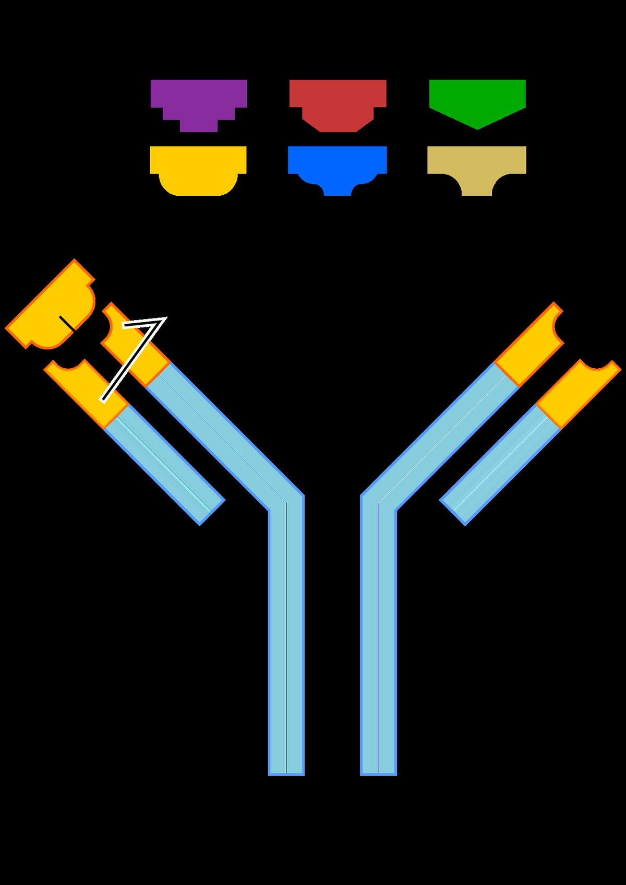
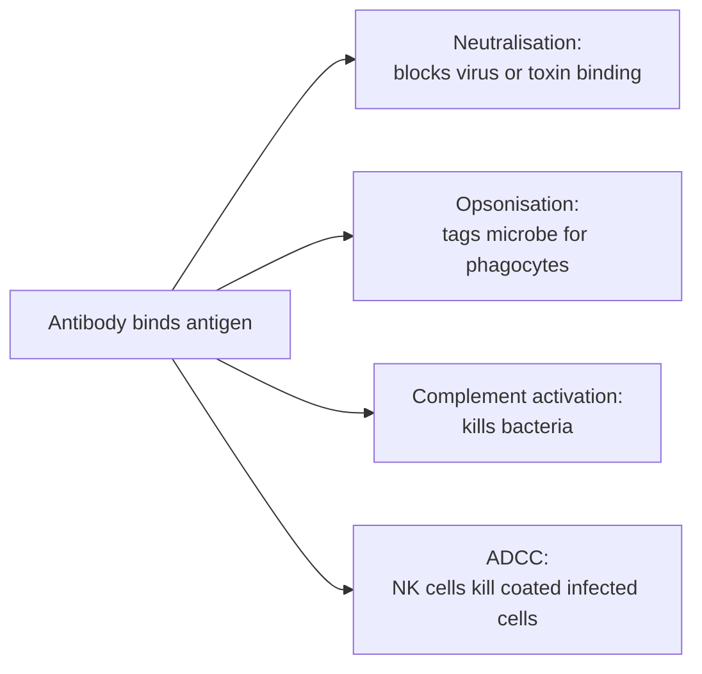

# B cells and antibodies

**Prerequisites:** [Antigens and antigen presentation](04-antigens-and-antigen-presentation.md)

*Diagram of an antibody (immunoglobulin G): two heavy chains and two light chains forming a Y, with antigen-binding sites at the tips. Credit: Fvasconcellos 19:03, 6 May 2007 (UTC). License: Public domain. Source: [File:Antibody.svg](https://commons.wikimedia.org/wiki/File:Antibody.svg).*

## The antibody molecule

An **antibody** (immunoglobulin) is a Y-shaped protein. The two tips of the Y are the **variable regions**, which differ from one antibody to the next and bind a particular epitope. The stem is the **constant region**, which determines what happens after binding: whether the antibody activates complement, recruits phagocytes, or crosses the placenta.

Each B cell makes antibodies of one specificity. The body generates enormous diversity by shuffling gene segments as B cells develop (V(D)J recombination), so that before any infection a person already has B cells capable of recognising an immense range of shapes.

## Five classes

| Class | Where and what |
|---|---|
| **IgM** | First antibody made in a new response; large, good at activating complement |
| **IgG** | Main antibody in blood; long-lasting; crosses the placenta to protect newborns |
| **IgA** | In mucus, saliva, tears and breast milk; guards mucosal surfaces |
| **IgE** | Binds mast cells; defence against parasites; drives allergy and anaphylaxis |
| **IgD** | Mostly a receptor on naive B cells |

Measuring IgM vs IgG helps doctors tell a recent infection from an old one. It is also why the timing of blood tests in vaccine trials matters.

## What antibodies do

- **Neutralisation**: antibodies coat a virus's attachment proteins or a toxin's binding site, so it cannot enter cells. This is the main mechanism of protection for tetanus, diphtheria, measles, polio and many others.
- **Opsonisation**: coating bacteria so phagocytes can grab them. Crucial against encapsulated bacteria.
- **Complement activation**: antibody-coated bacteria trigger the complement cascade. The standard lab measure for meningococcal vaccines is the **serum bactericidal assay**, which measures this killing.
- **Antibody-dependent cellular cytotoxicity (ADCC)**: NK cells kill infected cells displaying antibody-coated viral proteins.

## A primary response, step by step

1. A naive B cell whose receptor fits the antigen binds it, engulfs it, and displays fragments on MHC II.
2. A helper T cell that recognises the same antigen gives the B cell the signals it needs.
3. The B cell multiplies. Some become **plasma cells**, antibody factories. Others enter **germinal centres** in lymph nodes.
4. In germinal centres, B cells mutate their antibody genes and are selected for tighter binding (**affinity maturation**) and switch from IgM to IgG or IgA (**class switching**).
5. The best become **long-lived plasma cells** (which can sit in bone marrow secreting antibody for years or decades) and **memory B cells**.

This takes one to two weeks the first time, which is why vaccines need to be given before exposure and why some need several doses spaced weeks apart. See [immunological memory](07-immunological-memory.md).

## Correlates of protection

For some diseases, a blood level of antibody has been shown to predict protection. This is called a **correlate of protection**. Examples widely cited in the vaccine literature include an anti-tetanus toxin level of about 0.1 IU/mL, and an anti-HBs level of 10 mIU/mL for hepatitis B. Correlates let regulators approve new versions of vaccines by showing equivalent antibody responses (**immunobridging**) instead of running a new efficacy trial. Critics argue that antibody levels are a surrogate and do not always capture real-world protection, especially where T cells or mucosal immunity matter. Both points are fair: correlates are well established for some diseases (tetanus, diphtheria, hepatitis B, Hib) and uncertain for others (pertussis, COVID-19). See [[clinical-trial-phases|clinical trial phases]].

## Maternal antibodies

IgG crosses the placenta, especially in the third trimester, so newborns start life with some of their mother's antibodies. These protect for weeks to months, then fade. They can also interfere with some live vaccines, which is one reason the measles vaccine is usually given at 12 months rather than at birth. Vaccinating in pregnancy (pertussis, influenza, RSV, COVID-19) boosts these antibodies on purpose. See [passive and active immunity](08-passive-and-active-immunity.md).

## Key ideas

- Antibodies are Y-shaped proteins; the tips bind epitopes, the stem decides the effect.
- IgG (blood, placenta), IgA (mucosa), IgM (early) and IgE (allergy) have different roles.
- Antibodies protect by neutralising, tagging microbes, activating complement and recruiting killer cells.
- Germinal centres refine antibodies and create long-lived plasma cells and memory B cells; antibody levels can sometimes serve as correlates of protection.

## Where this leads

- Next: [T cells](06-t-cells.md).
- Related: [immunological memory](07-immunological-memory.md), [passive and active immunity](08-passive-and-active-immunity.md).
