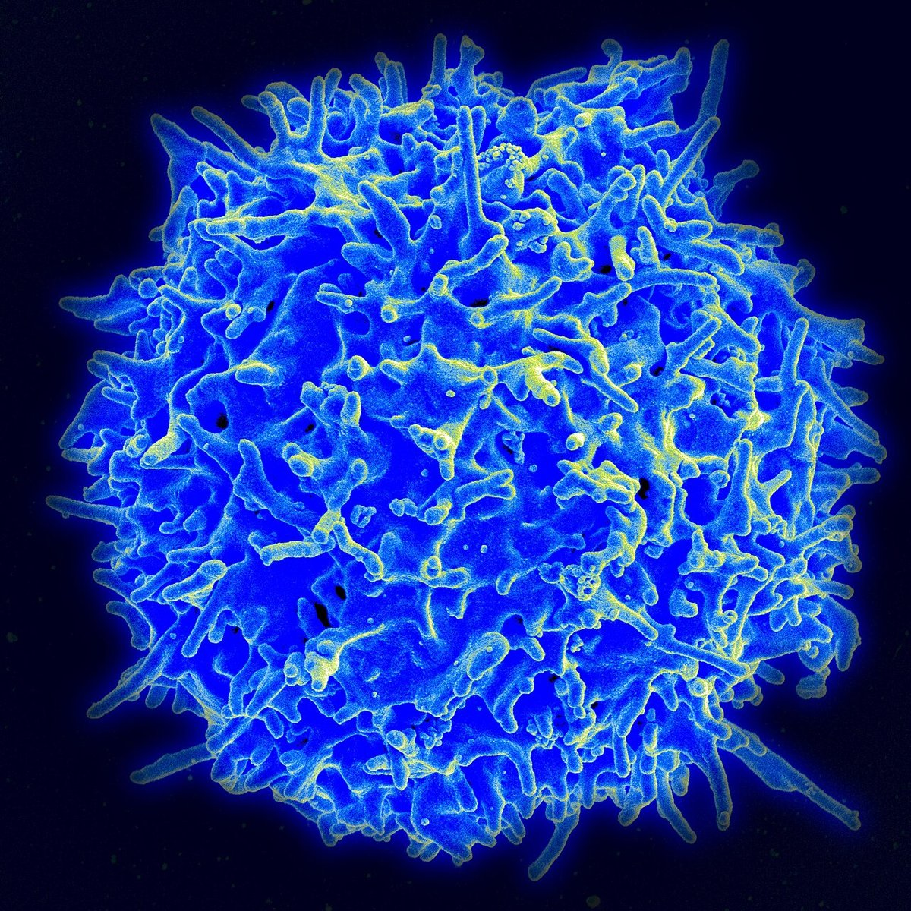
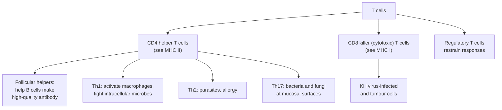

# T cells

**Prerequisites:** [Antigens and antigen presentation](04-antigens-and-antigen-presentation.md); [B cells and antibodies](05-b-cells-and-antibodies.md)

*Scanning electron micrograph of a human T lymphocyte. Credit: NIAID/NIH. License: Public domain. Source: [File:Healthy Human T Cell.jpg](https://commons.wikimedia.org/wiki/File:Healthy_Human_T_Cell.jpg).*

## Made in the thymus

T cells are lymphocytes that mature in the **thymus** (hence "T"). Each carries a **T-cell receptor** that recognises one particular peptide displayed on MHC. In the thymus, T cells that cannot recognise MHC at all, or that react too strongly to the body's own peptides, are eliminated. The survivors are released as **naive T cells**, circulating until they meet their antigen.

## Main types

- **CD4 helper T cells** are coordinators. They recognise antigen on MHC II and release cytokines that direct other cells. A specialised subset, **T follicular helper cells**, is essential for germinal centres, affinity maturation and long-lived antibody. Without CD4 help, B-cell responses to proteins are weak and short. HIV destroys CD4 cells, which is why people with advanced HIV respond poorly to vaccines and are vulnerable to many infections.
- **CD8 killer T cells** recognise viral or tumour peptides on MHC I and kill the cell displaying them. They cannot prevent infection (they only see cells that are already infected), but they limit how far a virus spreads and how severe the illness becomes.
- **Regulatory T cells** dampen immune responses and help maintain tolerance to self.

## What T cells contribute to vaccine protection

Most licensed vaccines were designed around antibodies, and antibodies are the most common correlate of protection. But T cells contribute in several ways:

1. **Helping antibodies.** Every protein-based vaccine depends on CD4 help for good antibody and memory responses.
2. **Controlling infection.** Killer T cells probably explain why some vaccines protect against severe disease even when antibodies wane or a variant partly escapes them. During the COVID-19 pandemic, studies found that T-cell responses to SARS-CoV-2 were less affected by new variants than neutralising antibodies were, which was offered as one explanation for durable protection against severe disease.
3. **Intracellular bacteria.** Against tuberculosis, protection depends heavily on Th1 cells activating macrophages. This is one reason TB vaccines are so hard: antibodies are not enough, and the BCG vaccine protects young children against severe forms but gives variable protection against adult lung TB ([Mangtani et al., *Clinical Infectious Diseases* 2014](https://doi.org/10.1093/cid/cit790)).

## Herpesviruses and T cells

Shingles is a good example of T-cell immunity in action. After childhood chickenpox, the varicella-zoster virus lies dormant in nerve cells. T-cell immunity keeps it in check. As T-cell immunity declines with age (**immunosenescence**) or with immunosuppression, the virus can reactivate as shingles. The recombinant shingles vaccine (Shingrix) is designed to boost VZV-specific CD4 T cells, and showed about 97% efficacy against shingles in adults 50 and over in its pivotal trial ([Lal et al., *NEJM* 2015 (ZOE-50)](https://doi.org/10.1056/NEJMoa1501184)).

## T cells and adverse reactions

T cells are also involved in some rare harmful reactions: delayed hypersensitivity reactions, and possibly the autoimmune mechanisms proposed for conditions like narcolepsy after Pandemrix. Delayed-type hypersensitivity is also the basis of the TB skin test: a T-cell reaction to tuberculin protein, appearing 48 to 72 hours later. See [when immunity goes wrong](09-when-immunity-goes-wrong.md).

## Key ideas

- T cells mature in the thymus and recognise peptides on MHC.
- CD4 helper cells coordinate responses and are essential for strong, lasting antibody; CD8 killer cells destroy infected cells.
- T cells contribute to protection against severe disease, especially when antibodies wane or variants arise, and are central for TB and shingles.
- T cells are also involved in some rare adverse reactions.

## Where this leads

- Next: [Immunological memory](07-immunological-memory.md).
- Related: [varicella and shingles](vaccines/03-diseases/shingles-and-varicella.md), [tuberculosis and BCG](vaccines/03-diseases/tuberculosis-and-bcg.md).
