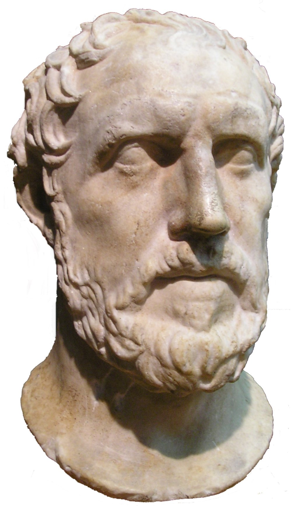
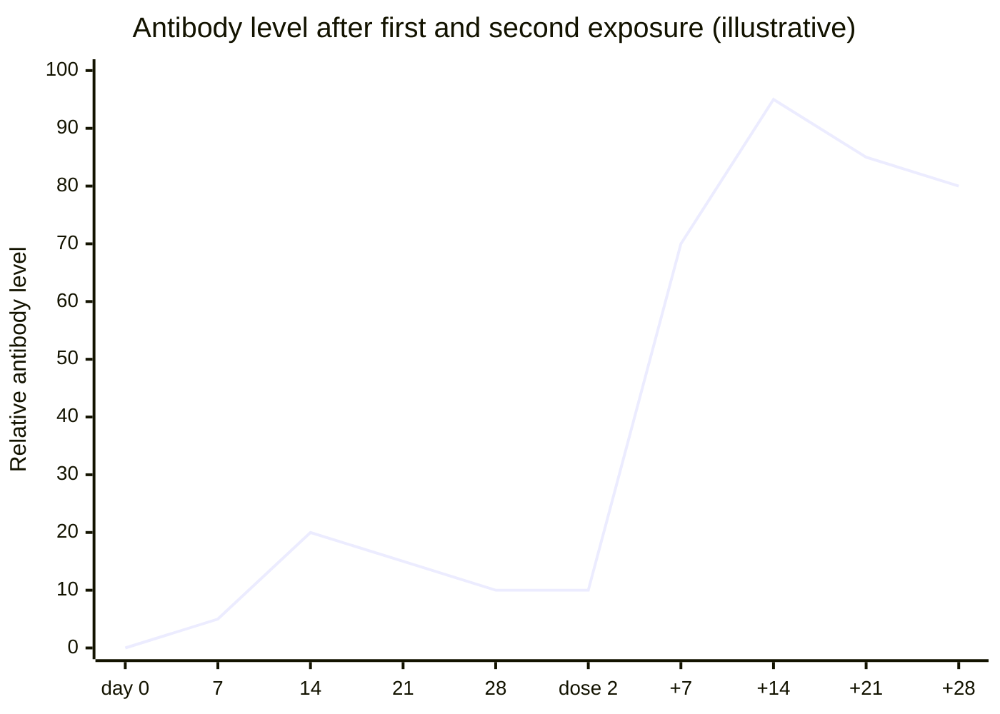

# Immunological memory

**Prerequisites:** [B cells and antibodies](05-b-cells-and-antibodies.md); [T cells](06-t-cells.md)

*Bust of Thucydides, whose account of the plague of Athens (430 BC) noted that survivors did not catch the disease a second time, or not fatally. Credit: Credit as given on Wikimedia Commons. License: Public domain. Source: [File:Thucydides-bust-cutout ROM.jpg](https://commons.wikimedia.org/wiki/File:Thucydides-bust-cutout_ROM.jpg).*

## An ancient observation

Long before anyone knew about cells, people noticed that survivors of some diseases did not catch them again. Thucydides, describing the plague of Athens in 430 BC, wrote that those who had recovered nursed the sick because the same person was not attacked twice, or at least not fatally. The same observation, applied to smallpox, led to [variolation](vaccines/04-history/01-variolation.md) and then to vaccination. Immunological memory is the reason vaccines work at all.

## Primary and secondary responses

- The **primary response** to a new antigen is slow (one to two weeks) and relatively small, starting with IgM.
- A **secondary (anamnestic) response**, on re-exposure, is faster, larger, mostly IgG, and of higher affinity, because memory B and T cells are already waiting.

The chart is schematic, not real data. It shows why many vaccines are given as a **primary series** of two or three doses followed by **boosters**.

## Where memory lives

- **Long-lived plasma cells**, mainly in bone marrow, keep secreting antibody without further stimulation, sometimes for decades. These maintain baseline antibody levels.
- **Memory B cells** do not secrete antibody but can rapidly become plasma cells on re-exposure.
- **Memory T cells** (central memory in lymph nodes, effector memory in tissues, and tissue-resident memory at entry points) respond faster and in larger numbers than naive cells.

## How long does it last?

Durability varies enormously:

| Example | Typical durability |
|---|---|
| Measles (infection or two vaccine doses) | Very long; most people stay protected for decades |
| Tetanus toxoid | Wanes over years; boosters recommended (every 10 years in Canada's adult schedule) |
| Acellular pertussis | Wanes noticeably within a few years |
| Influenza | Antibodies wane within a season, and the virus changes |
| Hepatitis B | Antibody may fall below detectable levels, but immune memory usually still protects against chronic infection |

Several factors affect durability: whether the vaccine is live (live vaccines often last longer), the adjuvant, the number and spacing of doses (longer intervals often give better memory), age (infants and the elderly respond differently), and whether the pathogen changes its antigens.

The distinction between **antibody levels** and **memory** is important and often misunderstood. Falling antibody levels do not always mean lost protection. For diseases with long incubation periods (hepatitis B, for example), memory cells have time to respond before disease sets in. For diseases that act fast or infect at mucosal surfaces (pertussis, meningococcus, influenza), circulating antibody needs to be present at the moment of exposure, so waning matters more.

## Waning and boosting

**Waning immunity** is the decline in protection over time. It is real for several vaccines and is a fair point raised by critics: protection from acellular pertussis vaccine wanes faster than from the old whole-cell vaccine, and COVID-19 vaccine protection against infection waned within months. The usual responses are boosters, changing the timing of doses, or vaccinating the people at highest risk (for example vaccinating pregnant women against pertussis to protect newborns). See [efficacy, effectiveness and waning](../epidemiology/13-efficacy-effectiveness-and-waning.md).

Before vaccination, natural boosting happened when people encountered circulating disease. As diseases become rare, that natural boosting disappears, and vaccine-induced immunity has to stand on its own. This has been argued, for example, as a factor in the varicella-shingles relationship (the "exogenous boosting" hypothesis), which remains debated.

## Original antigenic sin and imprinting

The first version of a pathogen the immune system meets can shape responses to later variants. This is called **imprinting** (or, older, "original antigenic sin"). It is well studied for influenza and was discussed for COVID-19 variant boosters. It can be helpful (cross-protection) or a limitation (responses biased toward the old strain).

## Key ideas

- Memory explains why recovery or vaccination protects against later infection.
- Secondary responses are faster, larger and better than primary ones; this is why primary series and boosters exist.
- Long-lived plasma cells maintain antibodies; memory B and T cells respond on re-exposure.
- Durability varies by disease and vaccine; falling antibody levels do not always mean lost protection, but waning is a real issue for some vaccines.

## Where this leads

- Next: [Passive and active immunity](08-passive-and-active-immunity.md).
- Related: [natural versus vaccine immunity](vaccines/07-controversies/11-natural-versus-vaccine-immunity.md).
