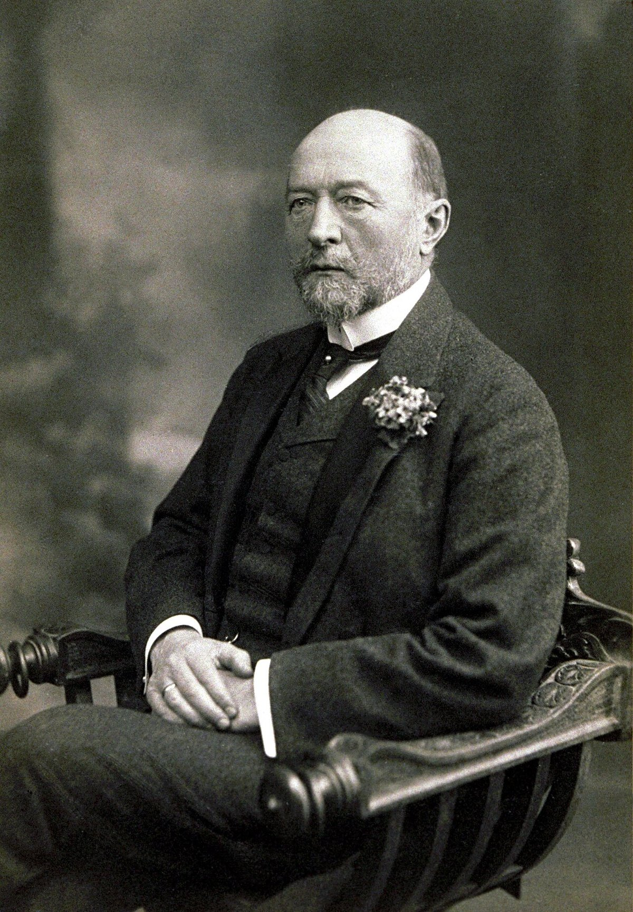
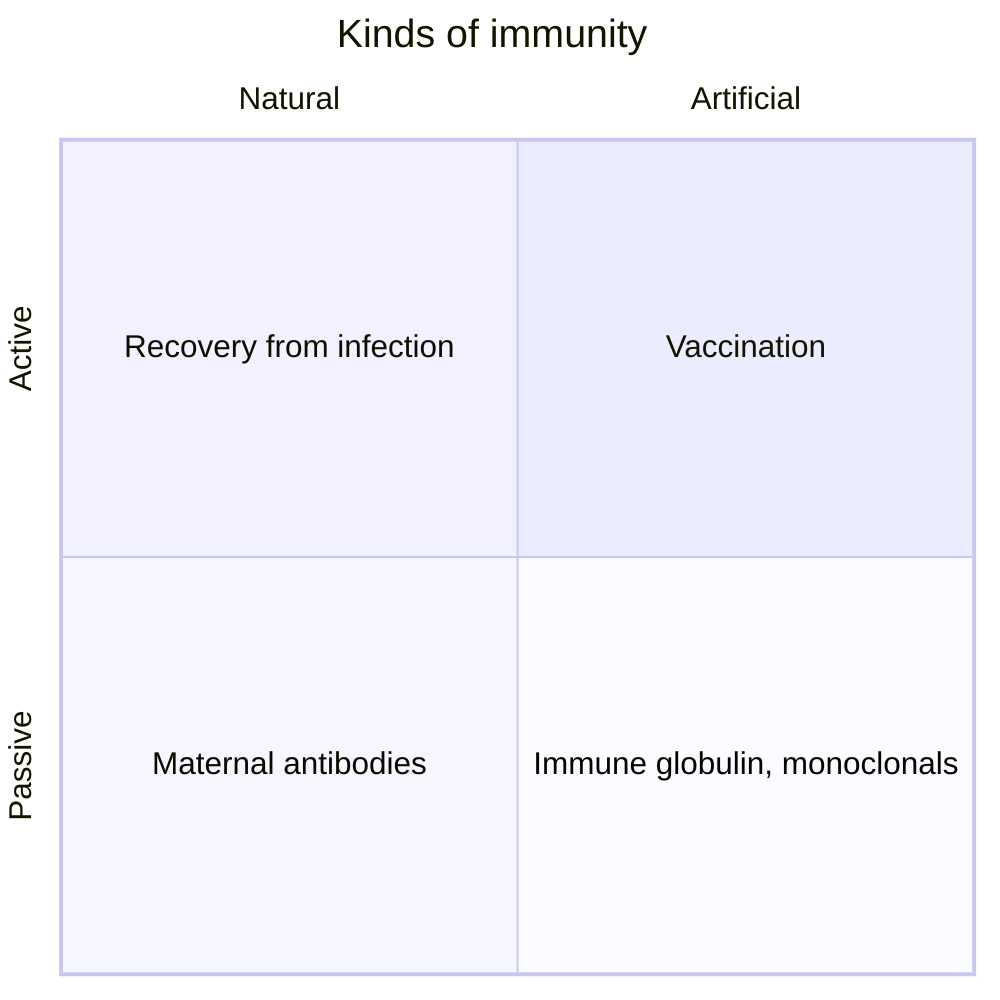

# Passive and active immunity

**Prerequisites:** [Immunological memory](07-immunological-memory.md)

*Emil von Behring, who developed diphtheria antitoxin, the first widely used passive immunisation. Credit: Fritz Schuhmann, Hofphotograph Bad Kissingen. License: Public domain. Source: [File:Emil_von_Behring_sitzend.jpg](https://commons.wikimedia.org/wiki/File:Emil_von_Behring_sitzend.jpg).*

## Two ways to be protected

**Active immunity** is produced by your own immune system, after infection or vaccination. It takes time to develop but creates memory and can last for years.

**Passive immunity** is borrowed: antibodies made by someone else (another person, an animal, or a laboratory) are transferred to you. It works immediately but fades within weeks to months as the antibodies are broken down, and it leaves no memory.

## Natural passive immunity: from mother to baby

- **Across the placenta.** IgG antibodies cross from mother to fetus, mostly in the last trimester. Babies born very prematurely receive less.
- **Breast milk.** Contains IgA that protects the baby's gut and airways locally, and other protective factors. It does not provide systemic immunity in the way placental IgG does.

Maternal antibodies protect newborns against diseases the mother is immune to, for a few months. They are also why **vaccination in pregnancy** has become a strategy: vaccinating the mother against pertussis, influenza, RSV or COVID-19 raises the antibodies passed to the baby during the most vulnerable early months, before the baby can be vaccinated effectively. A UK observational study after pertussis vaccination in pregnancy was introduced in 2012 reported about 91% effectiveness against infant pertussis in the first months of life ([Amirthalingam et al., *Lancet* 2014](https://doi.org/10.1016/S0140-6736(14)60686-3)). The maternal RSV vaccine trial reported 81.8% efficacy against severe RSV illness in infants within 90 days of birth ([Kampmann et al., *NEJM* 2023](https://doi.org/10.1056/NEJMoa2216480)).

Maternal antibody can also **interfere** with some infant vaccines, particularly live vaccines such as measles, by neutralising the vaccine virus before it can replicate. This is one reason measles vaccine is usually given at 12 months in North America, and can be given from 6 months in outbreaks with an extra dose later.

## Artificial passive immunity

- **Antitoxins** made in horses were the first (diphtheria, 1890s). Horse serum could cause **serum sickness**, an immune reaction to the foreign proteins.
- **Human immune globulin**, purified from donated blood plasma. Examples: hepatitis B immune globulin (HBIG) given with the vaccine to babies of infected mothers; rabies immune globulin injected around a bite wound; tetanus immune globulin for dirty wounds in unvaccinated people; varicella-zoster immune globulin for exposed high-risk people; measles immune globulin for exposed infants.
- **Monoclonal antibodies**, made in cell cultures. For RSV, **nirsevimab** (Beyfortus) is a long-acting monoclonal given to infants for their first RSV season; its main trial reported 74.5% efficacy against medically attended RSV lower respiratory infection ([Hammitt et al., *NEJM* 2022](https://doi.org/10.1056/NEJMoa2110275)). Older palivizumab required monthly injections. Monoclonals were also used against COVID-19 and Ebola.

Strictly, monoclonal antibodies are not vaccines; they do not train the immune system. Some schedules list them alongside vaccines (the US schedule includes nirsevimab), which can confuse counts of "how many vaccines" children get.

## Post-exposure prophylaxis

Some diseases have an incubation period long enough that giving passive and active immunisation *after* exposure can prevent illness. Rabies is the most dramatic example: once symptoms appear it is almost always fatal, but immediate wound washing, rabies immune globulin and a vaccine series after a bite are nearly always effective. Hepatitis B, measles, varicella and tetanus also have post-exposure protocols. See [rabies](vaccines/03-diseases/rabies.md).

## Active immunity: infection vs vaccination

Active immunity can come from infection or from vaccination. Which gives "better" immunity is a long-running debate. Infection sometimes gives broader or longer protection, but at the cost of the disease's risks; vaccination gives protection without those risks, sometimes needing boosters. The evidence for different diseases is discussed in [[natural-versus-vaccine-immunity|natural versus vaccine immunity]].

## Key ideas

- Active immunity is self-made, slow to develop and lasting; passive immunity is borrowed, immediate and temporary.
- Mothers pass IgG to babies across the placenta; vaccinating in pregnancy boosts this deliberately.
- Immune globulins and monoclonal antibodies give artificial passive protection; monoclonals are not vaccines.
- Post-exposure prophylaxis combines passive and active immunisation for diseases like rabies and hepatitis B.

## Where this leads

- Next: [When immunity goes wrong](09-when-immunity-goes-wrong.md).
- Related: [vaccination in pregnancy, adults and travel](vaccines/05-schedules/08-pregnancy-adult-and-travel-vaccination.md), [RSV](vaccines/03-diseases/rsv.md).
