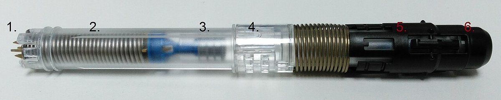

# When immunity goes wrong

**Prerequisites:** [T cells](06-t-cells.md); [B cells and antibodies](05-b-cells-and-antibodies.md)

*An adrenaline (epinephrine) auto-injector, the first-line emergency treatment for anaphylaxis. Credit: Chemistryroxpharmacysux. License: [CC BY-SA 4.0](https://creativecommons.org/licenses/by-sa/4.0). Source: [File:Epipen design (cropped).jpg](https://commons.wikimedia.org/wiki/File:Epipen_design_%28cropped%29.jpg).*

## Too much, too little, or the wrong target

The immune system can fail in three broad ways: it can over-react to harmless things (**hypersensitivity** and **allergy**), attack the body itself (**autoimmunity**), or under-react (**immunodeficiency**). Each is relevant to vaccines, both because rare adverse events involve these mechanisms and because people with these conditions may need different vaccine advice.

## Hypersensitivity

Immunologists traditionally group hypersensitivity reactions into four types (the Gell and Coombs classification):

| Type | Mechanism | Speed | Example |
|---|---|---|---|
| I | IgE on mast cells triggers release of histamine | Minutes | Hay fever, food allergy, **anaphylaxis** |
| II | Antibodies against cell surfaces | Hours to days | Immune thrombocytopenia (ITP), some drug reactions |
| III | Immune complexes deposit in tissues | Days | Serum sickness, Arthus reaction |
| IV | T-cell mediated, delayed | 48–72 hours | Contact dermatitis, TB skin test |

**Anaphylaxis** is a rapid, potentially life-threatening allergic reaction involving the skin, airways and circulation. After vaccination it is rare; a Vaccine Safety Datalink study estimated about 1.3 cases per million doses across vaccines ([McNeil et al., *J Allergy Clin Immunol* 2016](https://doi.org/10.1016/j.jaci.2015.07.048)). It usually begins within minutes, which is why vaccine providers ask people to wait 15 minutes after vaccination and keep adrenaline on hand. The culprit is usually an ingredient (such as gelatin, or polyethylene glycol in mRNA vaccines) rather than the antigen. See [[anaphylaxis|anaphylaxis]].

An **Arthus reaction** (type III) is a painful local swelling that can occur when someone with very high antibody levels gets an extra dose of tetanus or diphtheria toxoid too soon. It is one reason for minimum intervals between tetanus boosters.

## Autoimmunity

Autoimmune diseases occur when tolerance fails and the immune system attacks the body's own tissues. Examples: type 1 diabetes, multiple sclerosis, rheumatoid arthritis, Guillain-Barré syndrome (GBS), immune thrombocytopenia.

Proposed mechanisms by which an infection or, in principle, a vaccine might trigger autoimmunity include:

- **Molecular mimicry**: a microbial protein resembles a human one, so immune cells primed against the microbe cross-react. GBS after *Campylobacter* gut infection is the best-established example.
- **Bystander activation**: inflammation activates self-reactive cells that were previously dormant.
- **Epitope spreading**: tissue damage exposes new self-antigens.

Infections are well-established triggers of autoimmune conditions. Whether vaccines are triggers is assessed case by case. For a few vaccine–condition pairs the evidence supports a small causal link: ITP after MMR (roughly 1 in 40,000 doses in [France et al., *Pediatrics* 2008](https://doi.org/10.1542/peds.2007-1578), compared with a higher risk after natural measles or rubella), GBS after the 1976 swine flu vaccine (about 1 extra case per 100,000 vaccinated, [Schonberger et al., *American Journal of Epidemiology* 1979](https://doi.org/10.1093/oxfordjournals.aje.a112795)), narcolepsy after Pandemrix, and vaccine-induced thrombotic thrombocytopenia after adenovirus-vector COVID-19 vaccines. For many other proposed links (multiple sclerosis after hepatitis B vaccine, type 1 diabetes after various vaccines), large reviews have found the evidence favours rejection of a causal relationship or is inadequate to decide ([Institute of Medicine, *Adverse Effects of Vaccines: Evidence and Causality* (2011)](https://doi.org/10.17226/13164)). See [[guillain-barre-syndrome|Guillain-Barré syndrome]] and [[itp-and-other-blood-disorders|ITP]].

A further hypothesis, **ASIA** ("autoimmune/inflammatory syndrome induced by adjuvants"), was proposed by Yehuda Shoenfeld in 2011. Supporters say it unifies varied symptoms after adjuvant exposure; critics, including many immunologists, say its criteria are so broad that almost anyone could meet them and that controlled studies have not confirmed it. It is covered in [[aluminium-adjuvants|aluminium adjuvants]].

## Immunodeficiency

- **Primary** immunodeficiencies are inherited (for example severe combined immunodeficiency, SCID).
- **Secondary** ones come from disease or treatment: HIV, chemotherapy, high-dose steroids, organ transplant drugs, absent spleen.

Live vaccines can cause serious infection in severely immunocompromised people, so they are generally **contraindicated** for them. For example, rotavirus vaccine is contraindicated in infants with SCID, and vaccine-derived polio from the oral vaccine can persist for years in people with certain immune defects. Non-live vaccines are safe but may produce weaker responses. Immunocompromised people depend heavily on the immunity of those around them, a central argument for community vaccination; see [herd immunity](../epidemiology/04-herd-immunity.md).

## Key ideas

- Hypersensitivity comes in four types; anaphylaxis (type I) is rare after vaccination but needs immediate treatment.
- Autoimmunity can be triggered by infections; for a few vaccine–condition pairs there is a small, established risk, for many others there is not.
- Immunodeficient people may not be able to receive live vaccines and depend on others' immunity.

## Where this leads

- Next branch: [Epidemiology](../epidemiology/01-what-epidemiology-is.md).
- Related: [[causality-assessment|causality assessment]], [[contraindications-and-precautions|contraindications and precautions]].
