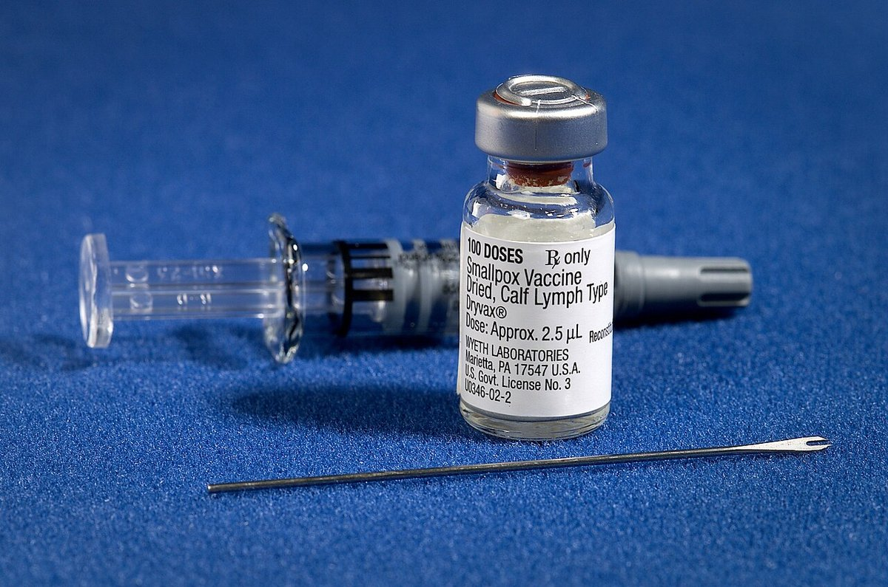
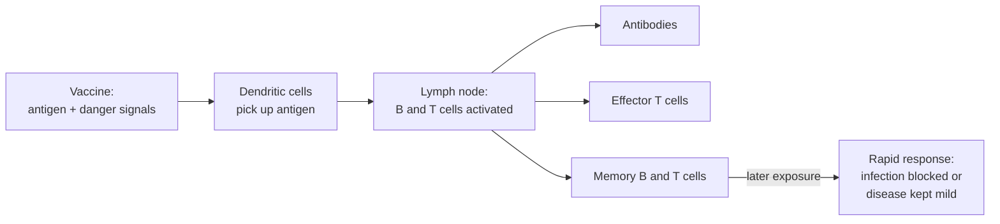

# How vaccines work

**Prerequisites:** [Immunological memory](../../07-immunological-memory.md); [Antigens and antigen presentation](../../04-antigens-and-antigen-presentation.md); [Herd immunity](../../../epidemiology/04-herd-immunity.md)

*Components of a smallpox vaccination kit: diluent, a vial of Dryvax smallpox vaccine and a bifurcated needle. Credit: Photo Credit: James Gathany Content Providers(s): CDC. License: Public domain. Source: [File:Smallpox_vaccine.jpg](https://commons.wikimedia.org/wiki/File:Smallpox_vaccine.jpg).*

## The core idea

A **vaccine** is a preparation that trains the adaptive immune system to recognise a pathogen (or its toxin) *without* the person having to suffer the disease. It presents the immune system with antigens that look like the real threat, together with enough "danger" signals to provoke a proper response. The immune system responds as it would to an infection: B cells make antibodies, T cells are activated, and, crucially, memory cells are left behind. If the real pathogen arrives later, the memory response is fast and strong enough to prevent disease or reduce its severity.

The word comes from Latin *vacca*, cow. Edward Jenner's 1796 experiments used cowpox to protect against smallpox; Louis Pasteur later proposed calling all such preparations "vaccines" in Jenner's honour. See [[jenner-and-cowpox|Jenner and cowpox]].

## Vaccination, immunisation, inoculation

- **Vaccination**: giving a vaccine.
- **Immunisation**: becoming immune, by vaccination or other means (including passive antibody). Often used interchangeably with vaccination.
- **Inoculation**: introducing material into the body; historically used for [[variolation|variolation]], the deliberate infection with smallpox material that preceded vaccination.

## What a vaccine has to achieve

A good vaccine must balance several goals:

1. **Show the right antigen** in the right shape (the *protective* antigen).
2. **Provoke enough of a response**: strong enough to protect, sometimes requiring adjuvants or several doses.
3. **Produce the right kind of response**: neutralising antibodies for toxins and many viruses, opsonising antibodies for encapsulated bacteria, T cells for intracellular pathogens, mucosal IgA for gut and airway infections.
4. **Last**: generate durable memory, or allow boosting.
5. **Be safe**: cause as few and as mild side effects as possible, with serious harms extremely rare.
6. **Be practical**: stable, affordable, manufacturable at scale, deliverable in the places that need it.

There are trade-offs. Live vaccines tend to give strong, lasting immunity but cannot be given to severely immunocompromised people. Highly purified subunit vaccines are very safe but may need adjuvants and boosters. The different approaches are described in [types of vaccines](02-types-of-vaccines.md).

## Direct and indirect protection

Vaccines protect in two ways:

- **Direct protection** of the vaccinated person.
- **Indirect protection** of others, when vaccination reduces transmission. This produces [herd immunity](../../../epidemiology/04-herd-immunity.md) and is why vaccinating children against pneumococcus reduced pneumococcal disease in elderly people, and why vaccinating girls against HPV reduced infection in unvaccinated boys.

Not every vaccine gives much indirect protection. Tetanus toxoid gives none; inactivated polio vaccine and acellular pertussis vaccine give less than the alternatives they replaced; COVID-19 vaccines gave only modest and short-lived reductions in transmission. This matters in ethical arguments: the case for requiring a vaccine to protect *others* is stronger when it actually reduces transmission. See [[mandates-and-ethics|mandates and ethics]].

## What vaccines cannot do

- They do not act instantly: it takes about one to two weeks after a dose to build protection (longer for a full series).
- Most are not treatments for an established infection (rabies, hepatitis B and a few others can be given soon after exposure because those infections are slow to develop).
- No vaccine is 100% effective in every person. Some people do not respond (primary failure); protection may wane (secondary failure).
- Some pathogens have so far defeated vaccine development, notably HIV, despite decades of effort.

## The overall record

Measured by lives, vaccination is one of the most consequential health interventions in history. A modelling study for the WHO estimated that vaccination under the Expanded Programme on Immunization averted about 154 million deaths over the 50 years from 1974, most of them infants ([Shattock et al., *Lancet* 2024](https://doi.org/10.1016/S0140-6736(24)00850-X)). Like all models, this depends on assumptions about what would have happened without vaccines; critics of such estimates point to the role of nutrition, sanitation and medical care, which is the subject of [[historical-mortality-decline-argument|the mortality-decline debate]]. Smallpox, which killed an estimated 300 million people in the 20th century alone, was eradicated by vaccination in 1980.

## Key ideas

- Vaccines train adaptive immunity, especially memory, without the disease itself.
- A good vaccine shows the protective antigen, provokes the right kind of strong and lasting response, and is safe and practical.
- Vaccines protect the vaccinated directly and, if they reduce transmission, others indirectly.
- Protection takes time, is never 100%, and may wane.

## Where this leads

- Next: [Types of vaccines](02-types-of-vaccines.md).
- Related: [[jenner-and-cowpox|Jenner and cowpox]], [the development pipeline](../02-development-and-regulation/01-development-pipeline.md).
