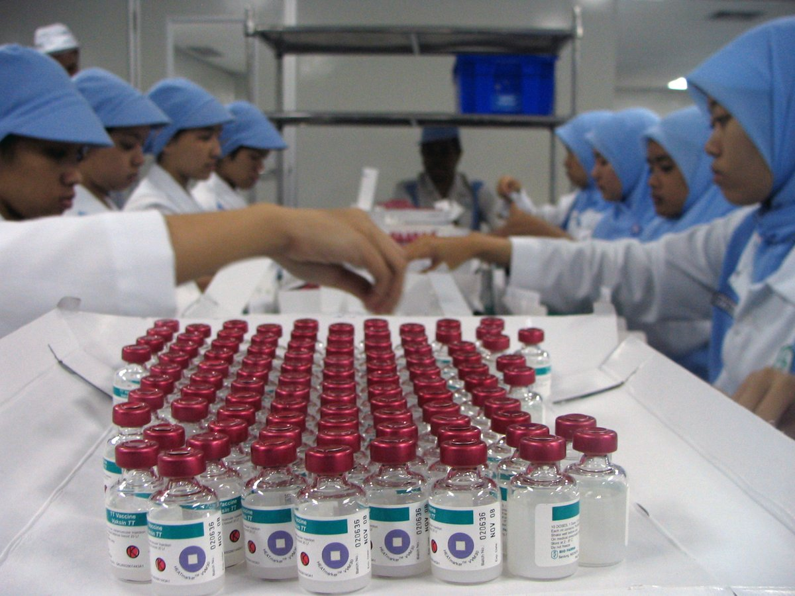
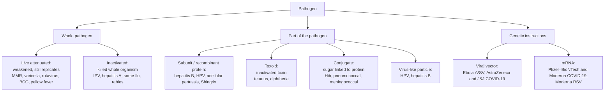

# Types of vaccines

**Prerequisites:** [How vaccines work](01-how-vaccines-work.md)

*Laboratory workers at the BioFarma vaccine facility in Bandung, Indonesia, inspecting vaccine vials. Credit: Ümit Kartoğlu for VOA. License: Public domain. Source: [File:BioFarma vaccine vials Bandung.jpg](https://commons.wikimedia.org/wiki/File:BioFarma_vaccine_vials_Bandung.jpg).*

## Ways to show the immune system a pathogen

Every vaccine has to present antigens from a pathogen without causing the disease. There are several ways to do that, called **platforms**. The main ones:

## Comparison

| Platform | How it works | Typical strengths | Typical limitations |
|---|---|---|---|
| [Live attenuated](03-live-attenuated-vaccines.md) | Weakened organism replicates briefly | Strong, broad, lasting immunity, often from 1–2 doses | Not for severely immunocompromised people or (mostly) pregnancy; rare reversion (oral polio); often needs cold storage |
| [Inactivated](04-inactivated-vaccines.md) | Killed whole organism | Cannot cause infection; stable | Weaker response; boosters; mostly antibody, little killer-T-cell response |
| [Subunit / recombinant](06-subunit-and-recombinant-vaccines.md) | Purified or lab-made proteins | Very defined; safe in immunocompromised | Usually needs adjuvant and several doses |
| [Toxoid](05-toxoid-vaccines.md) | Inactivated toxin | Prevents toxin-mediated disease | No effect on bacterial carriage; boosters needed |
| [Conjugate](07-conjugate-vaccines.md) | Capsule sugar chemically linked to a carrier protein | Works in infants; reduces carriage, giving herd effects | Covers only included serotypes; serotype replacement |
| [Viral vector](08-viral-vector-vaccines.md) | Harmless virus delivers a gene | Strong T-cell and antibody response, one dose possible | Pre-existing immunity to the vector; rare VITT with adenovirus vectors |
| [mRNA](09-mrna-vaccines.md) | Lipid nanoparticle delivers mRNA; cells make antigen | Fast to design and update; strong responses | Cold chain; reactogenicity; rare myocarditis, mainly in young males |

## Live vs non-live

The most important practical division is **live** versus **non-live**:

- **Live** vaccines contain organisms that can replicate. They are generally **contraindicated** in people with severely weakened immune systems and in pregnancy (with a few exceptions considered case by case). Two live injectable vaccines not given on the same day are usually spaced at least four weeks apart to avoid interference.
- **Non-live** vaccines (inactivated, subunit, toxoid, conjugate, mRNA and non-replicating vectors) cannot cause the infection they protect against. "The flu shot gave me the flu" is not possible with an inactivated flu vaccine; what people experience is either a short-lived immune reaction, a different virus caught at the same time, or coincidence.

## Same disease, several platforms

Many diseases have been targeted by several platforms over time, sometimes with very different trade-offs:

- **Polio**: inactivated injected vaccine (Salk, 1955) and live oral vaccine (Sabin, 1961). The oral vaccine is cheaper, easier to give and better at blocking gut transmission, but in rare cases it can cause paralysis or mutate into circulating vaccine-derived poliovirus. See [polio](../03-diseases/polio.md).
- **Pertussis**: whole-cell (killed bacteria) vs acellular (purified proteins). Acellular vaccines cause fewer reactions but protection wanes faster. See [[dtp-and-whole-cell-pertussis|DTP and whole-cell pertussis]].
- **Influenza**: inactivated (egg- or cell-grown), recombinant, and live attenuated nasal spray.
- **Shingles**: live attenuated (Zostavax, discontinued in the US in 2020) vs recombinant adjuvanted (Shingrix), which is markedly more effective.
- **COVID-19**: mRNA, viral vector, protein subunit (Novavax), and inactivated whole virus (Sinovac, Sinopharm) were all deployed.

## Key ideas

- Vaccine platforms present antigens as live weakened organisms, killed organisms, purified parts, inactivated toxins, sugar–protein conjugates, or genetic instructions.
- Live vaccines give strong, lasting immunity but have more contraindications.
- Non-live vaccines cannot cause the infection; they often need adjuvants and boosters.
- The same disease can be prevented by several platforms with different benefits and risks.

## Where this leads

- Next: [Live attenuated vaccines](03-live-attenuated-vaccines.md).
