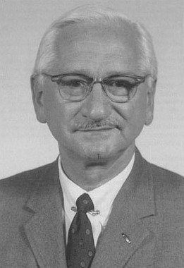
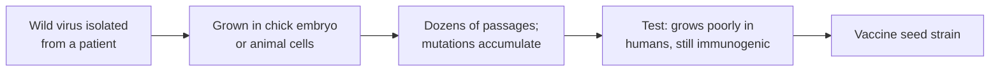

# Live attenuated vaccines

**Prerequisites:** [[types-of-vaccines|Types of vaccines]]; [[viruses|Viruses]]

*Albert Sabin, developer of the live attenuated oral polio vaccine. Credit: Original uploader was Bobak at the English Wikipedia. License: Public domain. Source: [File:Albert_Sabin.jpg](https://commons.wikimedia.org/wiki/File:Albert_Sabin.jpg).*

## Weakened, not killed

A **live attenuated** vaccine contains a living version of the pathogen that has been weakened (attenuated) so that it can still replicate in the body but rarely causes disease. Because it multiplies inside cells, it closely mimics natural infection: antigens are made inside cells (engaging killer T cells via MHC class I), the immune system sees the whole organism, and responses are usually strong, broad and long-lasting, often after one or two doses.

Examples: measles, mumps, rubella and varicella (MMR, MMRV), yellow fever, oral polio (OPV), rotavirus, the nasal live influenza vaccine, BCG (tuberculosis), oral typhoid (Ty21a), the oral cholera vaccine CVD 103-HgR, some Japanese encephalitis and dengue vaccines, and the original smallpox vaccine (vaccinia).

## How attenuation is done

The classical method is **serial passage**: growing the pathogen over and over in conditions unlike its natural home (in animal cells, in eggs, or at lower temperatures). Mutants that grow well in the lab but poorly in humans are selected, often without anyone knowing exactly which mutations matter.

- The **Edmonston** measles strain was isolated in 1954 from a boy named David Edmonston by John Enders and Thomas Peebles, and attenuated by passage in human and chick cells. Maurice Hilleman's further-attenuated Moraten ("more attenuated Enders") strain is used in the US MMR.
- The **Jeryl Lynn** mumps strain came from Hilleman's daughter Jeryl Lynn in 1963.
- The **17D** yellow fever strain was developed by Max Theiler in the 1930s, earning him the 1951 Nobel Prize.
- **BCG** was attenuated by Albert Calmette and Camille Guérin over 13 years (1908–1921) of passage of *Mycobacterium bovis* on bile-potato medium.
- Sabin's polio strains were attenuated in monkey cells and selected for low neurovirulence.

Modern methods can attenuate deliberately, for example by deleting genes or creating temperature-sensitive strains (the nasal influenza vaccine replicates in the cooler nose but not in the warmer lungs), or by **reassortment** (rotavirus RotaTeq combines human and bovine rotavirus genes).

## Benefits

- Strong, durable immunity, often lifelong after two doses for measles and rubella.
- Mucosal immunity when given by the natural route (oral polio, rotavirus, nasal flu), which can block transmission.
- Often cheap to produce and, for oral vaccines, easy to give without needles.

## Risks and limitations

- **Vaccine-strain illness.** A mild version of the disease can occur: a measles-like rash and fever in about 5% of children after MMR, or a few varicella-like spots after varicella vaccine.
- **Reversion.** Because the weakening depends on a few mutations, the virus can occasionally regain virulence while replicating. Oral polio vaccine causes **vaccine-associated paralytic polio** in roughly 2 to 4 cases per million births in countries using it, and in under-vaccinated communities it can circulate and evolve into **circulating vaccine-derived poliovirus (cVDPV)**. See [[vaccine-derived-polio|vaccine-derived polio]].
- **Immunocompromised people.** In people with severely weakened immunity, live vaccines can cause serious or fatal disease: disseminated BCG in children with severe immunodeficiency, chronic rotavirus infection in infants with SCID, and, rarely, death from yellow fever vaccine-associated disease. Live vaccines are therefore usually contraindicated in such people. See [[contraindications-and-precautions|contraindications and precautions]].
- **Pregnancy.** Most live vaccines are avoided in pregnancy because of theoretical risk to the fetus, although studies of inadvertent rubella vaccination in pregnancy have not found congenital rubella syndrome.
- **Shedding and spread.** Some live vaccine viruses are shed: oral polio and rotavirus in stool, varicella vaccine virus very rarely from a rash. Measles, mumps and rubella vaccine viruses are not known to spread between people in any meaningful way, a point relevant to claims that recently vaccinated children spread measles.
- **Cold chain and interference.** Live vaccines are sensitive to heat; maternal antibodies or a recent other live vaccine can interfere with them.

## Key ideas

- Live attenuated vaccines contain weakened organisms that replicate and mimic infection.
- Attenuation was historically achieved by serial passage, now sometimes by deliberate genetic changes.
- They give strong, lasting, sometimes mucosal immunity.
- Their risks include mild vaccine-strain illness, rare reversion (oral polio), and serious disease in severely immunocompromised people.

## Where this leads

- Next: [[inactivated-vaccines|Inactivated vaccines]].
- Related: [[measles|measles]], [[polio|polio]], [[maurice-hilleman|Maurice Hilleman]].
