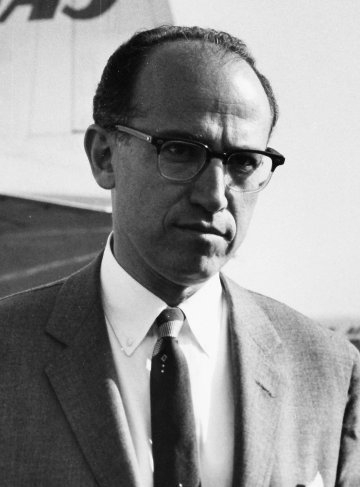

# Inactivated vaccines

**Prerequisites:** [Types of vaccines](02-types-of-vaccines.md)

*Jonas Salk, developer of the inactivated polio vaccine. Credit: SAS Scandinavian Airlines. License: Public domain. Source: [File:Jonas_Salk_candid.jpg](https://commons.wikimedia.org/wiki/File:Jonas_Salk_candid.jpg).*

## Killed, not weakened

An **inactivated** vaccine contains whole bacteria or viruses that have been grown in the laboratory and then killed, usually with chemicals such as **formaldehyde** or **beta-propiolactone**, or by heat. The organism cannot replicate, so it cannot cause infection, but its antigens remain recognisable.

Examples: inactivated polio vaccine (IPV), hepatitis A, rabies, most injectable influenza vaccines (split or subunit versions of inactivated virus), Japanese encephalitis (Ixiaro), tick-borne encephalitis, the old whole-cell pertussis vaccine, inactivated cholera (oral), and the inactivated COVID-19 vaccines from Sinovac and Sinopharm.

## The process

Getting inactivation exactly right is critical. Too little, and live organisms survive; too much, and the antigens are damaged so the vaccine does not protect.

## The Cutter incident: when inactivation failed

The danger of incomplete inactivation was shown catastrophically in April 1955, weeks after the Salk polio vaccine was licensed. Some lots made by **Cutter Laboratories** in California contained live poliovirus. According to the CDC's investigation, the contaminated vaccine caused about 40,000 cases of abortive (mild) polio, 200 children were left with varying degrees of paralysis, and 10 died; the virus also spread to family members and contacts ([Offit, *NEJM* 2005, "The Cutter incident, 50 years later"](https://doi.org/10.1056/NEJMp048180)). Inadequate filtration allowed virus clumps to survive formaldehyde treatment. The incident led to much stronger federal regulation of vaccine manufacture and testing, and to the legal precedent (*Gottsdanker v. Cutter Laboratories*, 1958) that a manufacturer could be held liable without negligence, which later shaped vaccine litigation. See [[salk-sabin-and-the-cutter-incident|Salk, Sabin and the Cutter incident]].

## Strengths

- **Cannot cause the disease** (if properly made), so suitable for immunocompromised people and generally in pregnancy.
- **More stable** than live vaccines.
- **No reversion**: unlike oral polio vaccine, IPV cannot produce vaccine-derived poliovirus, which is why countries switch to IPV as polio is eliminated.

## Limitations

- **Weaker immune response.** The organism does not replicate, so the dose of antigen is limited to what is injected. Several doses and periodic boosters are usually needed.
- **Mostly antibody.** Antigens are taken up from outside cells and presented on MHC class II, so killer-T-cell responses are limited.
- **Less mucosal immunity.** Injected IPV gives excellent protection against paralysis but less ability than OPV to prevent poliovirus multiplying in the gut and spreading.
- **Adjuvants** are often needed (aluminium salts in hepatitis A and some others).
- **Reactogenicity** can be high when whole bacteria are used. Whole-cell pertussis vaccine caused frequent fever, crying and local reactions, partly because of bacterial endotoxin, which motivated the move to acellular vaccines.

## Split and subunit influenza vaccines

Most injected influenza vaccines are not whole killed virus. They are **split** (the virus is broken apart with detergent) or **subunit** (purified surface proteins haemagglutinin and neuraminidase). This reduces reactions. Influenza vaccines must be reformulated every year because the virus changes; the WHO recommends strains twice a year based on global surveillance. See [[influenza|influenza]].

## Key ideas

- Inactivated vaccines contain killed whole organisms and cannot cause infection.
- Inactivation must be complete but gentle; the 1955 Cutter incident showed the cost of failure and reshaped regulation and liability.
- They are stable and safe in immunocompromised people but usually need several doses, boosters and often adjuvants.
- Many "inactivated" flu vaccines are split or subunit preparations.

## Where this leads

- Next: [Toxoid vaccines](05-toxoid-vaccines.md).
- Related: [[polio|polio]], [[jonas-salk|Jonas Salk]].
