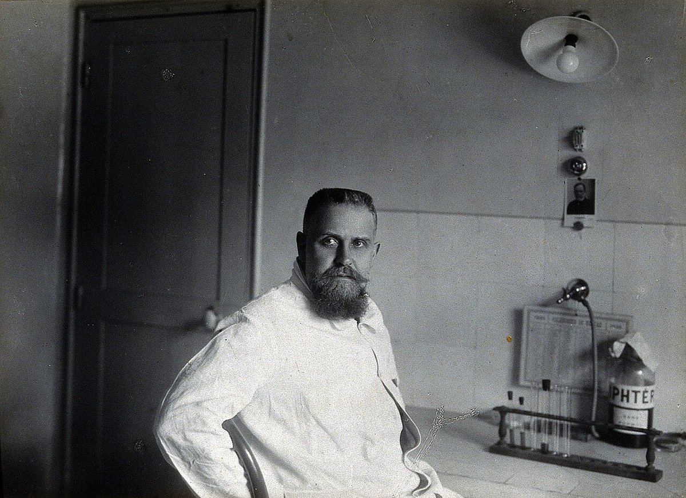
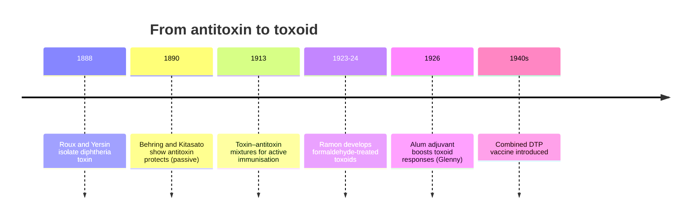

# Toxoid vaccines

**Prerequisites:** [Toxins and toxin-mediated disease](../../../microbiology/04-toxins-and-toxin-mediated-disease.md); [Types of vaccines](02-types-of-vaccines.md)

*Gaston Ramon, the French veterinarian who developed diphtheria and tetanus toxoids in the 1920s. Credit: https://wellcomeimages.org/indexplus/obf_images/08/d3/25b6f6602c030cd1da4a8178306f.jpg Gallery: https://wellcomeimages.org/indexplus/image/V. License: [CC BY 4.0](https://creativecommons.org/licenses/by/4.0). Source: [File:Gaston_Ramon._Photograph._Wellcome_V0027053.jpg](https://commons.wikimedia.org/wiki/File:Gaston_Ramon._Photograph._Wellcome_V0027053.jpg).*

## Neutralising the poison

For diseases where a bacterial toxin does the damage, the most direct protection is antibody that neutralises the toxin. A **toxoid** is a toxin that has been chemically inactivated, usually with formaldehyde, so that it is no longer poisonous but still has the same shape. Injected, it trains the immune system to make **antitoxin** antibodies.

The two classic toxoids are **tetanus** and **diphtheria**. They appear in many combinations:

- **DTaP** (diphtheria, tetanus, acellular pertussis) for young children, with full-strength diphtheria and pertussis components.
- **Tdap** for adolescents and adults, with reduced diphtheria and pertussis doses (lower-case letters indicate lower amounts).
- **Td** for adult boosters.
- Combination vaccines adding polio, Hib and hepatitis B, such as Canada's DTaP-IPV-Hib ("5-in-1") and the hexavalent DTaP-IPV-Hib-HepB ("6-in-1").

Inactivated **pertussis toxin** is one component of acellular pertussis vaccines, along with adhesion proteins.

## History in brief

The toxin–antitoxin mixtures used before toxoids could go badly wrong if improperly balanced. Ramon's **anatoxine** (toxoid) was a safer route to active immunity. In 1926, Alexander Glenny in London found that precipitating toxoid with alum (an aluminium salt) greatly increased the response, the origin of [aluminium adjuvants](../07-controversies/06-aluminium-adjuvants.md). Tetanus toxoid was widely used in the Second World War; the US military recorded only a handful of tetanus cases among millions of wounded and immunised soldiers, compared with much higher rates in earlier wars.

## Why boosters?

Toxoid-induced antibody levels wane over years. In the US and Canada, adults are advised to have a tetanus-diphtheria booster every 10 years, and after certain wounds if more than 5 years have passed. The UK takes a different approach: after five doses in childhood and adolescence, routine adult boosters are not recommended, with boosters only for certain wounds or travel. Both approaches are evidence-informed; they reflect differing judgements about how much protection five doses provide. A 2016 study by Hammarlund, Slifka and colleagues ([Hammarlund et al., *Clinical Infectious Diseases* 2016](https://doi.org/10.1093/cid/ciw066)) argued that adult boosters every 10 years could be extended to 20 or 30 years, and the WHO's 2017 position recommends six doses through adolescence.

## What toxoids do not do

- They prevent the **disease** caused by the toxin, but not necessarily **infection** or **carriage** of the bacterium. Diphtheria vaccination does, in practice, reduce circulation of toxin-producing strains, but tetanus toxoid has no effect on *C. tetani* in soil.
- Because tetanus is not contagious, there is no herd protection: each person is protected only by their own vaccination.
- Natural infection does not reliably give immunity to tetanus, because the amount of toxin is too small, so even survivors are vaccinated.

## Safety notes

Common reactions are local pain, redness and swelling, which become more frequent with repeated doses. Extensive limb swelling can follow the fourth or fifth DTaP dose. Too-frequent boosters can cause **Arthus reactions**. Guillain-Barré syndrome after tetanus toxoid has been reported; the 1994 IOM review accepted a causal relation on the basis of one well-documented patient who had GBS three times after three tetanus doses, but later large studies have not found a measurable population risk ([Institute of Medicine, *Adverse Events Associated with Childhood Vaccines* (1994)](https://doi.org/10.17226/2138); [Institute of Medicine, *Adverse Effects of Vaccines: Evidence and Causality* (2011)](https://doi.org/10.17226/13164)). Brachial neuritis is on the US [[the-vaccine-injury-table|Vaccine Injury Table]] for tetanus-containing vaccines.

## Key ideas

- Toxoids are inactivated toxins that teach the body to make antitoxin.
- Diphtheria and tetanus toxoids are the classic examples, combined with pertussis and other antigens in DTaP, Tdap and multi-valent vaccines.
- Boosters are needed because antitoxin wanes; countries differ on adult booster policy.
- Toxoids prevent toxin disease, not necessarily infection; tetanus vaccine gives no herd protection.

## Where this leads

- Next: [Subunit and recombinant vaccines](06-subunit-and-recombinant-vaccines.md).
- Related: [tetanus](../03-diseases/tetanus.md), [diphtheria](../03-diseases/diphtheria.md), [pertussis](../03-diseases/pertussis.md).
