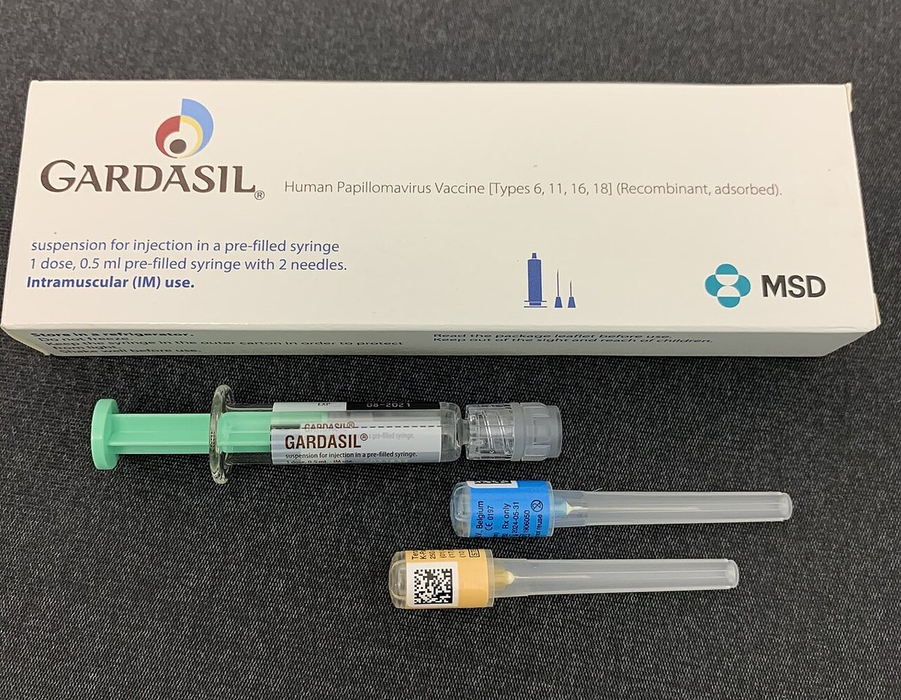
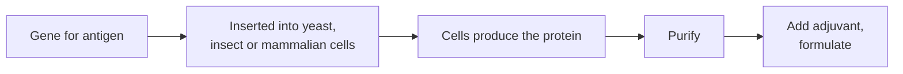

# Subunit and recombinant vaccines

**Prerequisites:** [[types-of-vaccines|Types of vaccines]]; [[antigens-and-antigen-presentation|Antigens and antigen presentation]]

*Gardasil, a recombinant virus-like-particle vaccine against human papillomavirus, in a prefilled syringe. Credit: Whispyhistory. License: [CC BY-SA 4.0](https://creativecommons.org/licenses/by-sa/4.0). Source: [File:Gardasil vaccine.jpg](https://commons.wikimedia.org/wiki/File:Gardasil_vaccine.jpg).*

## Just the part that matters

If the immune system only needs to recognise one or a few proteins to protect against a pathogen, why give it the whole organism? **Subunit vaccines** contain only selected antigens: purified proteins, protein fragments, or polysaccharides. They cannot cause infection and they produce fewer reactions than whole-cell vaccines. The trade-off is that purified proteins lack the danger signals of a real infection, so subunit vaccines usually need [[adjuvants|adjuvants]] and several doses.

## Ways of making subunits

1. **Purified from the pathogen.** Grow the organism and extract the protein. Acellular pertussis vaccines contain two to five purified *B. pertussis* proteins (inactivated pertussis toxin, filamentous haemagglutinin, pertactin, fimbriae). The first hepatitis B vaccine (Heptavax-B, licensed 1981) was made from surface-antigen particles purified from the blood plasma of chronically infected people, then heavily treated to kill any viruses; concerns about blood-borne infections, especially HIV in the early 1980s, hastened its replacement.
2. **Recombinant DNA.** Insert the gene for the antigen into yeast, bacteria, insect or mammalian cells, which then produce the protein. The recombinant **hepatitis B vaccine** (Recombivax HB, 1986) was the first human vaccine made this way. Others: HPV vaccines (Gardasil in yeast, Cervarix in insect cells), Shingrix (glycoprotein E in hamster ovary cells), Novavax COVID-19 vaccine (spike protein in moth cells), RSV vaccines for older adults (prefusion F protein), meningococcal B vaccines, and recombinant influenza vaccine (Flublok).
3. **Polysaccharide.** Purified capsule sugars, as in the old 23-valent pneumococcal polysaccharide vaccine (PPSV23) and typhoid Vi vaccine. These work poorly in young children unless conjugated; see [[conjugate-vaccines|conjugate vaccines]].

## Virus-like particles

Some viral surface proteins assemble on their own into empty shells that look like the virus but contain no genetic material: **virus-like particles (VLPs)**. Because they display antigens in a dense, repetitive array, VLPs provoke very strong antibody responses. HPV vaccines are VLPs of the L1 capsid protein; hepatitis B surface antigen also forms particles. The HPV VLP technology was developed in the early 1990s by several groups, including Ian Frazer and Jian Zhou in Australia and teams at the US National Cancer Institute (Douglas Lowy and John Schiller) and elsewhere.

## Structure-based design

A modern refinement is to engineer the antigen's shape. RSV's fusion (F) protein changes shape dramatically when it fuses with a cell. Antibodies against the "prefusion" form are far more protective, but the protein naturally flips into the "postfusion" form. In 2013 Barney Graham, Jason McLellan and colleagues at the US National Institutes of Health stabilised the prefusion form. This made possible the first RSV vaccines, licensed in 2023 after six decades of failure, including the disastrous 1960s formalin-inactivated vaccine that made disease worse; see [[rsv|RSV]]. The same stabilising approach ("2P" mutations) was applied to the SARS-CoV-2 spike protein in mRNA and protein COVID-19 vaccines.

## Strengths and limitations

**Strengths:** cannot cause infection; well-defined composition; suitable for immunocompromised people; fewer reactions than whole-cell products; recombinant production avoids handling dangerous pathogens.

**Limitations:** weaker immunogenicity without adjuvants; mainly antibody and helper-T-cell responses; boosters often needed; a few antigens may let pathogens escape by varying them. The acellular pertussis story is the prime example: the switch from whole-cell to acellular vaccines in many rich countries reduced reactions but produced faster waning and, possibly, selection of strains lacking pertactin.

## Key ideas

- Subunit vaccines contain only selected antigens, purified or made by recombinant DNA.
- Recombinant production began with hepatitis B (1986) and now includes HPV, shingles, RSV and some COVID-19 and flu vaccines.
- Virus-like particles are empty viral shells that provoke strong antibody responses.
- Structure-based design (stabilising the prefusion F protein) made RSV vaccines possible.

## Where this leads

- Next: [[conjugate-vaccines|Conjugate vaccines]].
- Related: [[hpv|HPV]], [[hepatitis-b|hepatitis B]].
