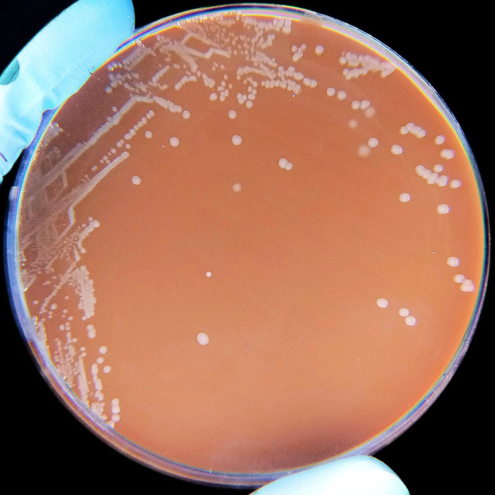
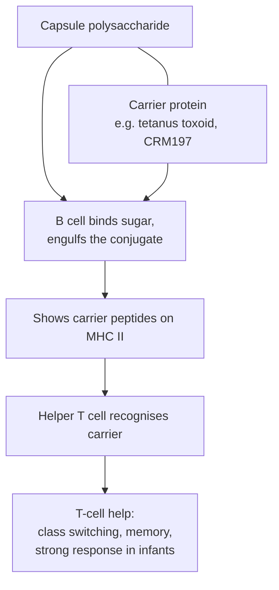

# Conjugate vaccines

**Prerequisites:** [Subunit and recombinant vaccines](06-subunit-and-recombinant-vaccines.md); [Antigens and antigen presentation](../../04-antigens-and-antigen-presentation.md)

*Haemophilus influenzae colonies growing on chocolate agar; the type b strain (Hib) was the leading cause of bacterial meningitis in young children before conjugate vaccines. Credit: Stefan Walkowski. License: [CC BY-SA 4.0](https://creativecommons.org/licenses/by-sa/4.0). Source: [File:Haemophilus_influenzae.jpg](https://commons.wikimedia.org/wiki/File:Haemophilus_influenzae.jpg).*

## The problem with sugars

Several of the most dangerous childhood bacteria (*Haemophilus influenzae* type b, *Streptococcus pneumoniae*, *Neisseria meningitidis*, *Salmonella* Typhi) wear a **polysaccharide capsule**, a coat of long sugar chains that helps them evade phagocytes. Antibodies against the capsule protect. So why not vaccinate with purified capsule sugar?

That was tried, and it works partly. Pure polysaccharide vaccines protect older children and adults. But as explained in [antigen presentation](../../04-antigens-and-antigen-presentation.md), sugars cannot be displayed on MHC molecules, so they cannot recruit helper T cells. They trigger **T-independent** B-cell responses, which:

- are weak or absent in children under about 2 years, exactly the age group at greatest risk;
- produce little immune memory, so boosters do not give a stronger second response (and repeated doses can even blunt responses, called hyporesponsiveness);
- do little to stop bacteria living in the nose and throat.

## The solution: link sugar to protein

In a **conjugate vaccine**, the polysaccharide is chemically bonded to a **carrier protein**. A B cell whose receptor binds the sugar swallows the whole complex, displays peptides from the protein on MHC II, and receives help from T cells that recognise the protein. The result is a **T-dependent** response to the sugar: strong in infants, with memory and boostability.

Common carrier proteins are tetanus toxoid, diphtheria toxoid, a non-toxic diphtheria toxin mutant called **CRM197**, and a protein from non-typeable *H. influenzae*.

The principle was shown in the 1920s and 1930s by Oswald Avery and Walter Goebel, who linked sugars to proteins in animal experiments. It was turned into human vaccines in the 1980s, first for Hib, by teams including John Robbins and Rachel Schneerson at the US NIH, and Porter Anderson and David Smith at Rochester.

## The impact

- **Hib**: before conjugate vaccines, Hib caused about 20,000 cases of invasive disease a year in US children under 5, according to the CDC, including meningitis that killed some and left others deaf or brain-damaged. After the conjugate vaccines (licensed for infants in 1990), invasive Hib disease in young children fell by more than 99%. See [[haemophilus-influenzae-type-b|Hib]].
- **Pneumococcus**: the 7-valent conjugate vaccine (2000 in the US) sharply reduced invasive disease in vaccinated children and, through reduced carriage, in unvaccinated adults ([Whitney et al., *NEJM* 2003](https://doi.org/10.1056/NEJMoa022823)). Later versions cover 10, 13, 15, 20 and 21 serotypes.
- **Meningococcus**: conjugate vaccines against group C (UK, 1999), groups A, C, W and Y, and the cheap MenAfriVac against group A, which nearly eliminated epidemic group A meningitis in Africa's "meningitis belt" after 2010.
- **Typhoid**: typhoid conjugate vaccines prevent disease in young children ([Shakya et al., *NEJM* 2019](https://doi.org/10.1056/NEJMoa1905047)).

## Herd effects and serotype replacement

Because conjugate vaccines reduce carriage, they protect unvaccinated people. But a vaccine targets only its included serotypes. *S. pneumoniae* has about 100 serotypes. As vaccine serotypes declined, non-vaccine serotypes partly filled the gap (**serotype replacement**), reducing the net benefit and driving the development of higher-valency vaccines. This is a genuine limitation, acknowledged in the literature, though net reductions in invasive disease have persisted.

## Key ideas

- Pure polysaccharide vaccines work poorly in infants because sugars cannot recruit T-cell help.
- Linking the sugar to a carrier protein recruits helper T cells, producing strong, boostable responses in infants.
- Conjugate vaccines nearly eliminated Hib disease and greatly reduced pneumococcal and meningococcal disease, partly through herd effects.
- Serotype replacement limits the net benefit of pneumococcal vaccines.

## Where this leads

- Next: [Viral vector vaccines](08-viral-vector-vaccines.md).
- Related: [[pneumococcal-disease|pneumococcal disease]], [[meningococcal-disease|meningococcal disease]].
