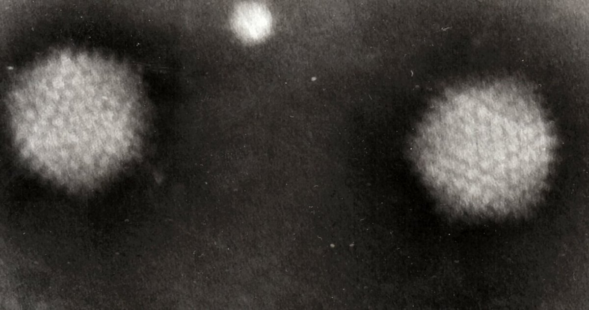
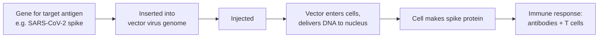

# Viral vector vaccines

**Prerequisites:** [Types of vaccines](02-types-of-vaccines.md); [Viruses](../../../microbiology/03-viruses.md)

*Electron micrograph of adenovirus particles; modified adenoviruses are used as vectors in several vaccines. Credit: GrahamColm. License: [CC BY 3.0](https://creativecommons.org/licenses/by/3.0). Source: [File:Adenovirus_4.jpg](https://commons.wikimedia.org/wiki/File:Adenovirus_4.jpg).*

## A harmless virus as a delivery truck

A **viral vector** vaccine uses a virus that does not cause significant disease (often modified so that it cannot replicate) to carry a gene from the target pathogen into human cells. The cells read the gene and make the target antigen, which the immune system then learns to recognise. Because the antigen is made *inside* cells, it is displayed on MHC class I as well as class II, so vector vaccines produce strong killer-T-cell responses as well as antibodies.

## Kinds of vectors

- **Non-replicating adenovirus vectors**: the vector enters cells but cannot make copies of itself. Examples: Oxford–AstraZeneca's ChAdOx1 (a chimpanzee adenovirus), Johnson & Johnson/Janssen's Ad26 COVID-19 vaccine, Russia's Sputnik V (Ad26 then Ad5), and CanSino's Ad5. Chimpanzee or rare human adenoviruses are chosen because most people lack pre-existing immunity to them.
- **Replicating vectors**: the vector can replicate to a limited extent. **Ervebo** (rVSV-ZEBOV), the Ebola vaccine, uses vesicular stomatitis virus with its own surface protein replaced by the Ebola glycoprotein. In the 2015 "Ebola ça suffit" ring-vaccination trial in Guinea, no Ebola cases occurred 10 days or more after vaccination among those vaccinated immediately ([Henao-Restrepo et al., *Lancet* 2017](https://doi.org/10.1016/S0140-6736(16)32621-6)). The trial design (ring vaccination with delayed comparison groups, later dropped) has been debated, but the vaccine was licensed and used successfully in later outbreaks. See [Ebola](../03-diseases/ebola.md).
- **Other vectors** include modified vaccinia Ankara (MVA), used as the smallpox and mpox vaccine (JYNNEOS/Imvamune) and as a vector in experimental vaccines, and the yellow fever 17D strain used as a backbone for the dengue vaccine Dengvaxia and a Japanese encephalitis vaccine.

## Advantages

- Strong T-cell and antibody responses, sometimes from one dose (the J&J COVID-19 vaccine was initially authorised as a single dose).
- No adjuvant needed: the vector itself supplies danger signals.
- AstraZeneca's vaccine could be stored in ordinary refrigerators and was sold at cost during the pandemic, making it the most widely distributed COVID-19 vaccine in many lower-income countries.

## Limitations and risks

- **Pre-existing immunity** to the vector can blunt responses, and immunity generated by the first dose can limit later boosts with the same vector.
- **Vaccine-induced immune thrombotic thrombocytopenia (VITT)**. In early 2021, unusual blood clots (especially in brain veins and abdominal veins) with low platelet counts were identified after the AstraZeneca and J&J vaccines, mainly in adults under 60. Three papers in the *NEJM* described the syndrome and found antibodies against platelet factor 4, similar to heparin-induced thrombocytopenia ([Greinacher et al., *NEJM* 2021](https://doi.org/10.1056/NEJMoa2104840); [Schultz et al., *NEJM* 2021](https://doi.org/10.1056/NEJMoa2104882); [Scully et al., *NEJM* 2021](https://doi.org/10.1056/NEJMoa2105385)). Estimated rates were in the order of 1 in 50,000 to 1 in 100,000 doses in younger adults, higher in some age groups, and roughly a fifth of those affected died in early series. Many countries restricted these vaccines to older adults or stopped using them. The US limited the J&J vaccine in May 2022, and its authorisation was revoked at Janssen's request in 2023; AstraZeneca withdrew its vaccine's marketing authorisation in 2024, citing commercial reasons. See [VITT and adenovirus vector vaccines](../06-adverse-events/09-vitt-and-adenovirus-vector-vaccines.md).
- **Guillain-Barré syndrome** was also found at a small increased rate after the adenovirus-vector COVID-19 vaccines.
- **Integration fears**: adenoviral DNA enters the nucleus but does not integrate into human DNA in any meaningful way; it stays as a separate piece and is diluted out.

## Key ideas

- Viral vector vaccines use a harmless virus to deliver a pathogen gene so the body makes the antigen.
- They produce strong antibody and killer-T-cell responses, often without adjuvants.
- Ervebo (Ebola) and several COVID-19 vaccines use this platform; MVA is used against smallpox and mpox.
- Adenovirus-vector COVID-19 vaccines carried a rare but serious risk of VITT, which led to their restriction and withdrawal.

## Where this leads

- Next: [mRNA vaccines](09-mrna-vaccines.md).
- Related: [COVID-19](../03-diseases/covid-19.md), [Ebola](../03-diseases/ebola.md).
