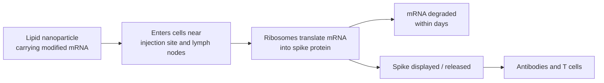

# mRNA vaccines

**Prerequisites:** [Cells and the chemistry of life](../../../microbiology/01-cells-and-the-chemistry-of-life.md); [Types of vaccines](02-types-of-vaccines.md)

*Katalin Karikó, whose work with Drew Weissman on modified nucleosides made mRNA vaccines practical; they shared the 2023 Nobel Prize in Physiology or Medicine. Credit: Cmichel67. License: [CC BY-SA 4.0](https://creativecommons.org/licenses/by-sa/4.0). Source: [File:Katalin_Karikó_by_Christopher_Michel_in_2024_02.jpg](https://commons.wikimedia.org/wiki/File:Katalin_Karikó_by_Christopher_Michel_in_2024_02.jpg).*

## Delivering the recipe, not the protein

An **mRNA vaccine** contains a strand of messenger RNA encoding a target antigen, wrapped in a tiny fat bubble called a **lipid nanoparticle (LNP)**. After injection into the arm muscle, the LNPs are taken up by cells (muscle cells and immune cells at the site and in nearby lymph nodes). The cells' ribosomes read the mRNA and make the antigen, for example the SARS-CoV-2 spike protein, which the immune system then responds to. The mRNA is broken down by normal cellular processes; it does not enter the cell nucleus and is not converted into DNA. (Claims that it alters the recipient's genes are not supported; cells lack the machinery to write this mRNA into chromosomes in normal circumstances, a point examined in [[covid-19-vaccines-mandates-and-mortality|the COVID-19 controversies lesson]].)

## Three problems that had to be solved

The idea is decades old; making it work required several advances:

1. **Inflammation.** Injected RNA set off strong innate alarms (via Toll-like receptors), causing inflammation and destroying the RNA. In 2005 Katalin Karikó and Drew Weissman at the University of Pennsylvania showed that replacing uridine with modified nucleosides (pseudouridine, later N1-methylpseudouridine) greatly reduced this reaction and increased protein production. They received the 2023 Nobel Prize in Physiology or Medicine.
2. **Delivery.** Naked RNA is fragile and does not enter cells well. Lipid nanoparticles, developed partly for gene-silencing drugs (Pieter Cullis and others in Canada), protect it and carry it in. The LNPs include a small amount of polyethylene glycol (PEG) lipid, which is suspected in rare allergic reactions.
3. **The antigen.** Using the stabilised **prefusion** spike (the "2P" mutations from NIH work on coronaviruses and RSV) improved responses.

## The COVID-19 vaccines

Moderna's mRNA-1273 and Pfizer–BioNTech's BNT162b2 were the first mRNA vaccines authorised, in December 2020, less than a year after the virus's genome was published. Their phase 3 trials reported about 94–95% efficacy against symptomatic COVID-19 over the first months ([Polack et al., *NEJM* 2020 (BNT162b2 trial)](https://doi.org/10.1056/NEJMoa2034577); [Baden et al., *NEJM* 2021 (mRNA-1273 trial)](https://doi.org/10.1056/NEJMoa2035389)). Effectiveness against infection later fell with waning and with the Omicron variants, while protection against severe disease was better maintained, particularly after boosters. Updated versions have targeted newer variants.

The speed raised understandable concerns. It was achieved by building on years of prior platform research, running trial phases in overlapping fashion, manufacturing at financial risk before results (see [Operation Warp Speed](../04-history/13-covid-19-vaccines-and-operation-warp-speed.md)), and having very high case rates during trials, which yielded results quickly. The trials enrolled tens of thousands, but rarer side effects emerged only with wider use.

## Known risks

- **Reactogenicity**: sore arm, fatigue, headache, fever and chills are common, especially after the second dose and with Moderna's higher dose.
- **Anaphylaxis**: early US data suggested about 2.5–5 cases per million doses ([Shimabukuro & Nair, *JAMA* 2021](https://doi.org/10.1001/jama.2021.0600)).
- **Myocarditis and pericarditis**: rare inflammation of the heart, concentrated in adolescent and young adult males within days of the second dose; highest estimates are in the order of 1 in several thousand to 1 in tens of thousands for young males after the second dose, depending on vaccine, interval and study ([Mevorach et al., *NEJM* 2021](https://doi.org/10.1056/NEJMoa2109730); [Oster et al., *JAMA* 2022](https://doi.org/10.1001/jama.2021.24110)). Most cases resolved, but long-term follow-up continues, and the size and seriousness of this risk in young, healthy people is central to debates about recommending boosters for them. See [myocarditis and mRNA vaccines](../06-adverse-events/08-myocarditis-and-mrna-vaccines.md).

## Beyond COVID-19

Moderna's mRNA RSV vaccine (mRESVIA) was licensed for older adults in 2024. mRNA influenza, cytomegalovirus and personalised cancer vaccines are in trials. The platform's speed makes it attractive for pandemic response. It has also become politically contested: in August 2025 the US Department of Health and Human Services wound down 22 BARDA-funded mRNA vaccine projects worth nearly US$500 million ([HHS press release, "HHS Winds Down mRNA Vaccine Development Under BARDA" (5 August 2025)](https://www.hhs.gov/press-room/hhs-winds-down-mrna-development-under-barda.html)), with Secretary Kennedy citing concerns about the platform's effectiveness against upper respiratory infections; many scientists criticised the decision.

## Key ideas

- mRNA vaccines deliver genetic instructions in lipid nanoparticles; cells make the antigen briefly; the mRNA does not enter the nucleus.
- Modified nucleosides (Karikó and Weissman), lipid nanoparticles and stabilised antigens made the platform practical.
- The COVID-19 mRNA vaccines showed high early efficacy against symptomatic disease that waned against infection.
- Known rare risks include anaphylaxis and myocarditis, especially in young males.

## Where this leads

- Next: [Adjuvants](10-adjuvants.md).
- Related: [COVID-19](../03-diseases/covid-19.md), [myocarditis](../06-adverse-events/08-myocarditis-and-mrna-vaccines.md).
