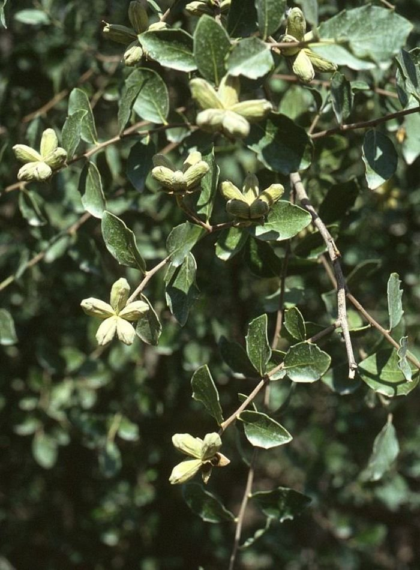
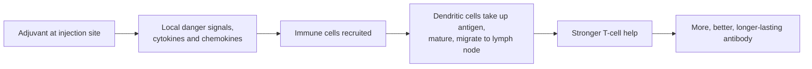

# Adjuvants

**Prerequisites:** [Barriers and innate immunity](../../02-barriers-and-innate-immunity.md); [Subunit and recombinant vaccines](06-subunit-and-recombinant-vaccines.md)

*The soapbark tree, Quillaja saponaria, source of the QS-21 saponin used in the AS01 adjuvant of the Shingrix and Arexvy vaccines. Credit: Franz Xaver. License: [CC BY-SA 3.0](http://creativecommons.org/licenses/by-sa/3.0/). Source: [File:Quillaja_saponaria.jpg](https://commons.wikimedia.org/wiki/File:Quillaja_saponaria.jpg).*

## "Helpers"

An **adjuvant** (from Latin *adiuvare*, to help) is a substance added to a vaccine to strengthen or shape the immune response. Purified antigens often provoke weak responses because they lack the danger signals that accompany real infections. Adjuvants supply those signals, mainly by activating innate immunity at the injection site and in nearby lymph nodes. They allow a smaller dose of antigen, fewer doses, stronger responses in people who respond poorly (infants, the elderly), or a different type of response.

Live vaccines, whole inactivated bacteria and viral vectors usually do not need adjuvants; purified protein, toxoid and some inactivated viral vaccines often do. mRNA vaccines have no separate adjuvant, but their lipid nanoparticles have adjuvant-like effects.

## The main adjuvants in use

| Adjuvant | Composition | Examples |
|---|---|---|
| **Aluminium salts** | Aluminium hydroxide, aluminium phosphate, alum, or amorphous aluminium hydroxyphosphate sulfate | DTaP/Tdap, hepatitis A and B, HPV, pneumococcal and Hib conjugates (some), MenB |
| **MF59** | Oil-in-water emulsion of squalene | Fluad (influenza for 65+) |
| **AS03** | Squalene, vitamin E (α-tocopherol), polysorbate 80 | Pandemrix (2009 H1N1), stockpiled H5N1 vaccine |
| **AS04** | Aluminium salt + MPL (a detoxified lipid from bacterial lipopolysaccharide) | Cervarix (HPV) |
| **AS01** | MPL + QS-21 (a saponin from soapbark tree) in liposomes | Shingrix, Arexvy (RSV), Mosquirix (malaria) |
| **CpG 1018** | Synthetic DNA sequence that stimulates TLR9 | Heplisav-B (hepatitis B, adults) |
| **Matrix-M** | Saponin-based nanoparticles | Novavax COVID-19, R21 malaria |

The [FDA, *Common Ingredients in FDA-Approved Vaccines*](https://www.fda.gov/vaccines-blood-biologics/safety-availability-biologics/common-ingredients-us-licensed-vaccines) page lists the adjuvants in US-licensed vaccines.

## How they work

Mechanisms differ. Aluminium salts were long thought to work by forming a "depot" that releases antigen slowly; research since the 2000s suggests that they also cause local cell damage and release of danger signals, activating an innate sensor called the NLRP3 inflammasome, although the details are still debated. Newer adjuvants stimulate specific receptors: MPL activates TLR4, CpG activates TLR9, and saponins disrupt membranes in ways that enhance antigen presentation.

## History

The phenomenon was noticed in the 1920s. Gaston Ramon observed that horses developing abscesses at the injection site produced more antitoxin. Alexander Glenny and colleagues reported in 1926 that diphtheria toxoid precipitated with alum gave a stronger response. Aluminium salts remained essentially the only adjuvants in licensed human vaccines in the US for about 70 years, until newer adjuvants were licensed (MF59 in Europe in 1997; AS04 in Cervarix in the EU in 2007 and the US in 2009).

## Safety

Adjuvants increase **reactogenicity**: sore arms, redness, swelling, fatigue. Shingrix, with AS01B, is known for causing a day or two of significant soreness, tiredness or fever in many recipients, while being much more effective than its unadjuvanted predecessor.

Specific concerns:

- **Aluminium**: whether injected aluminium accumulates or harms the developing brain, causes autoimmunity or allergies. This is the most contested adjuvant issue and has its own lesson: [[aluminium-adjuvants|aluminium adjuvants]].
- **Squalene**: squalene is a natural oil made in the human body (a precursor of cholesterol) and also extracted, historically from shark liver. Claims that squalene in an anthrax vaccine caused Gulf War illness were investigated; the Institute of Medicine found no convincing evidence, and the anthrax vaccine given to US troops did not contain added squalene adjuvant.
- **AS03 and narcolepsy**: the AS03-adjuvanted Pandemrix vaccine was associated with narcolepsy in some European countries in 2009–2010, while another AS03-adjuvanted H1N1 vaccine used in Canada (Arepanrix) showed a much smaller signal. Whether the adjuvant, the particular antigen preparation, the H1N1 virus itself, or a combination was responsible is still debated. See [narcolepsy and Pandemrix](../06-adverse-events/07-narcolepsy-and-pandemrix.md).

Regulators evaluate adjuvants as part of each vaccine, not as stand-alone products; there is no separate "adjuvant approval".

## Key ideas

- Adjuvants strengthen and shape immune responses by engaging innate immunity.
- Aluminium salts have been used since the 1920s; newer adjuvants include oil-in-water emulsions, TLR agonists and saponins.
- Adjuvants allow less antigen and fewer doses but increase short-term reactions.
- Aluminium and AS03 are the subject of real safety debates, examined in their own lessons.

## Where this leads

- Next: [Excipients and ingredients](11-excipients-and-ingredients.md).
- Related: [[aluminium-adjuvants|aluminium adjuvants]].
