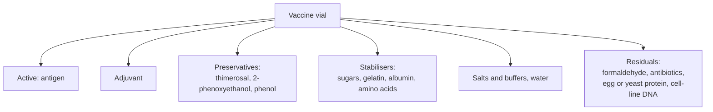

# Excipients and ingredients

**Prerequisites:** [Adjuvants](10-adjuvants.md); [How vaccines work](01-how-vaccines-work.md)

*Chemical structure of thiomersal (thimerosal), an ethylmercury-containing preservative once common in multi-dose vaccine vials. Credit: Vaccinationist. License: Public domain. Source: [File:Thiomersal.svg](https://commons.wikimedia.org/wiki/File:Thiomersal.svg).*

## What else is in the vial

Besides the antigen and any adjuvant, vaccines contain other substances, collectively called **excipients**. Some are added on purpose; others are traces left from manufacturing. Ingredient lists are public: in the US, every vaccine's package insert lists them, and the CDC publishes an excipient table (Pink Book appendix B). In Canada, the product monograph lists them. Ingredient lists often alarm people because the chemical names are unfamiliar and the amounts are not obvious. This lesson goes through the main categories, the amounts, and the real concerns.

## Preservatives

Multi-dose vials can be contaminated each time a needle is inserted. In 1928, in Bundaberg, Australia, 12 of 21 children died after receiving diphtheria toxin–antitoxin from a vial contaminated with *Staphylococcus aureus*, an event that drove the use of preservatives.

**Thimerosal** (thiomersal) is about 49.6% mercury by weight, in the form of ethylmercury. In the US, it was removed or reduced to trace amounts in all routinely recommended childhood vaccines by 2001, after a 1999 joint statement by the US Public Health Service and the American Academy of Pediatrics. That statement was precautionary: it was prompted by the realisation that cumulative infant exposure from the expanded schedule could exceed one federal guideline for *methyl*mercury, not by evidence of harm. Ethylmercury is cleared from the blood much faster than the methylmercury found in fish. Many large studies later found no link between thimerosal and autism ([Hviid et al., *JAMA* 2003 (thimerosal)](https://doi.org/10.1001/jama.290.13.1763); [Price et al., *Pediatrics* 2010](https://doi.org/10.1542/peds.2010-0309); [Institute of Medicine, *Immunization Safety Review: Vaccines and Autism* (2004)](https://doi.org/10.17226/10997)). Thimerosal remained in some multi-dose influenza vials until the US Department of Health and Human Services adopted an ACIP recommendation in July 2025 to use only thimerosal-free single-dose flu vaccines ([HHS press release on removing thimerosal from US influenza vaccines (23 July 2025)](https://www.hhs.gov/press-room/thimerosal-mercury-removed-from-us-flu-vaccines-acip.html)). It is still used in multi-dose vials in many lower-income countries, where the WHO considers it safe and important for affordable vaccine supply. The debate is covered in [[thimerosal-and-autism|thimerosal and autism]].

Other preservatives include **2-phenoxyethanol** and **phenol**.

## Residuals from manufacturing

- **Formaldehyde**, used to inactivate viruses and toxins, may remain in trace amounts. Formaldehyde is also a normal product of human metabolism. The FDA states that a newborn's body contains 50 to 70 times more formaldehyde than the upper amount they could receive from vaccines ([FDA, *Common Ingredients in FDA-Approved Vaccines*](https://www.fda.gov/vaccines-blood-biologics/safety-availability-biologics/common-ingredients-us-licensed-vaccines)).
- **Antibiotics** such as neomycin, polymyxin B, streptomycin and gentamicin prevent bacterial contamination during production. The antibiotics most likely to cause allergies (penicillins, cephalosporins, sulfa drugs) are not used.
- **Egg protein** from viruses grown in eggs (most flu vaccines, yellow fever). Current guidance in the US, Canada and UK is that people with egg allergy, even severe, can receive flu vaccines; the residual ovalbumin is tiny. Yellow fever vaccine has more egg protein and needs more caution.
- **Yeast protein** from recombinant hepatitis B and HPV vaccines.
- **Cell-line residues**, including fragments of DNA from the cells used to grow viruses.

## Stabilisers and other additives

Sugars (sucrose, lactose), amino acids, **gelatin** (from pigs, in some MMR, varicella and nasal flu vaccines, and the most common cause of vaccine anaphylaxis in the past), human serum albumin, polysorbate 80 (an emulsifier), salts and buffers. mRNA vaccines contain lipids including PEG-lipid, and sucrose as a cryoprotectant.

## Human fetal cell lines

Several vaccines are produced in cell lines descended from two elective abortions in the 1960s: **WI-38** (Sweden, developed by Leonard Hayflick in the US, 1962) and **MRC-5** (UK, 1966). These include rubella (RA 27/3 strain, Stanley Plotkin), varicella, shingles (Zostavax), hepatitis A and some rabies vaccines. No new fetal tissue is used; the cells have been grown in laboratories for decades. HEK293 (from 1973) and PER.C6 (from 1985) cells were used to produce the AstraZeneca and J&J COVID-19 vaccines, and HEK293 cells were used in laboratory testing of the mRNA vaccines. The history is told in Meredith Wadman's *The Vaccine Race*.

This raises genuine ethical questions for some people. The Catholic Church's Pontifical Academy for Life (2005, 2017) and the Congregation for the Doctrine of the Faith (2008, 2020) concluded that using these vaccines is morally acceptable when no alternative exists, while urging the development of alternatives. Other religious authorities differ, and the issue features in religious exemption requests. See [[religious-and-philosophical-exemptions|religious and philosophical exemptions]].

## Key ideas

- Vaccines contain antigens, sometimes adjuvants, and excipients: preservatives, stabilisers, salts and manufacturing residues.
- Thimerosal was removed from US childhood vaccines by 2001 as a precaution and from US flu vaccines in 2025; studies have not found it causes autism.
- Residual formaldehyde, antibiotics and egg protein are present in tiny amounts; egg allergy no longer bars flu vaccination.
- Some vaccines are grown in decades-old fetal cell lines, an ethical concern for some, addressed by religious authorities.

## Where this leads

- Next: [How vaccines are made](12-how-vaccines-are-made.md).
- Related: [[anaphylaxis|anaphylaxis]], [[thimerosal-and-autism|thimerosal and autism]].
