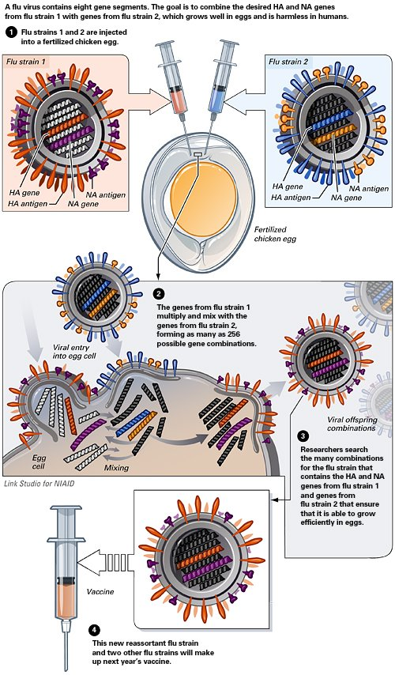
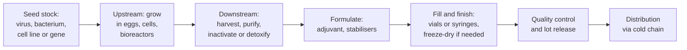

# How vaccines are made

**Prerequisites:** [Types of vaccines](02-types-of-vaccines.md); [Excipients and ingredients](11-excipients-and-ingredients.md)

*Illustration of reassortment, used to make influenza vaccine seed viruses that combine the surface antigens of a target strain with genes that grow well in eggs. Credit: NIAID. License: [CC BY 2.0](https://creativecommons.org/licenses/by/2.0). Source: [File:Flu Vaccine- Reassortment (5102830876).jpg](https://commons.wikimedia.org/wiki/File:Flu_Vaccine-_Reassortment_%285102830876%29.jpg).*

## From seed to syringe

Making a vaccine is a biological manufacturing process, harder to control than making a chemical drug. A small molecule like aspirin is defined by its formula; a vaccine is often defined by its process, because tiny changes in growth conditions can change the product. Regulators therefore inspect and license manufacturing facilities and processes, not just the final vial, and every batch ("lot") is tested before release.

## Growing the antigen

- **Eggs**: most seasonal influenza vaccine worldwide is still grown in fertilised chicken eggs, a method developed in the 1930s–40s. About one to two eggs are needed per dose. Egg-adapted changes in the virus can reduce how well the vaccine matches circulating strains, a problem particularly noted for H3N2 viruses.
- **Cell culture**: viruses grown in animal or human cell lines: monkey kidney (Vero) cells for polio and rabies, chick embryo fibroblasts for MMR's measles and mumps components, human diploid cells (WI-38, MRC-5) for rubella, varicella and hepatitis A, and dog kidney (MDCK) cells for cell-based flu vaccine.
- **Bacterial fermentation**: large tanks of bacteria for toxoids (tetanus, diphtheria), pertussis antigens and capsular polysaccharides.
- **Recombinant expression**: genes inserted into yeast (hepatitis B, Gardasil), insect cells (Cervarix, Flublok, Novavax) or Chinese hamster ovary cells (Shingrix).
- **Cell-free synthesis**: mRNA is made by an enzymatic reaction (in vitro transcription) from a DNA template, then packaged into lipid nanoparticles. This is the main reason mRNA vaccines can be redesigned in weeks.

## Purity and testing

Manufacturers must show the product is:

- **Pure**: free from contaminating organisms and with impurities within limits.
- **Potent**: contains the right amount of active antigen.
- **Safe**: for inactivated products, tests confirm no live organism remains (the lesson of the [[salk-sabin-and-the-cutter-incident|Cutter incident]]).
- **Consistent**: each lot comparable to those tested in clinical trials.

In the US, the FDA's Center for Biologics Evaluation and Research (CBER) reviews lot-release protocols; in Canada, Health Canada's Biologic and Radiopharmaceutical Drugs Directorate does this. See [licensing and regulators](../02-development-and-regulation/05-licensing-and-regulators.md).

## Contamination episodes

Testing standards have improved partly because of past contamination:

- **SV40.** Between 1955 and 1963, some polio vaccine (both Salk's and early Sabin's) was made in rhesus monkey kidney cells contaminated with simian virus 40, which was discovered in 1960. An estimated 10–30 million Americans may have received contaminated doses. SV40 causes tumours in some laboratory animals. Whether it caused human cancers was investigated for decades; the Institute of Medicine concluded in 2002 ([Institute of Medicine, *SV40 Contamination of Polio Vaccine and Cancer* (2002)](https://doi.org/10.17226/10534)) that the evidence was inadequate to accept or reject a causal relation with cancer, and large epidemiological studies did not find higher cancer rates in exposed birth cohorts. Critics continue to raise it; most researchers consider a large effect unlikely.
- **Porcine circovirus** DNA was found in Rotarix in 2010 using new sequencing techniques; it is not known to cause disease in humans. US use was briefly paused, then resumed.
- **Manufacturing failures**: contamination at a Chiron plant in Liverpool caused the loss of nearly half the US flu vaccine supply in 2004; a 2021 mix-up at an Emergent BioSolutions plant in Baltimore ruined about 15 million doses of J&J COVID-19 vaccine.

## Scale and economics

Only a handful of companies make most of the world's vaccines (GSK, Merck/MSD, Sanofi, Pfizer, CSL Seqirus, and the Serum Institute of India, which produces more doses than any other manufacturer). Production of a complex vaccine can take months to years and requires large up-front investment. Few manufacturers and thin margins have caused shortages. The economics also shape the conflict-of-interest debate: vaccines are a significant business for these companies, although usually a smaller share of revenue than drugs. See [[conflicts-of-interest-and-funding|conflicts of interest and funding]].

## Key ideas

- Vaccine manufacturing is biological: process defines product, so facilities and lots are regulated and tested.
- Antigens are grown in eggs, cell cultures, bacterial fermenters or recombinant systems; mRNA is made enzymatically.
- Purity, potency, safety and consistency are tested for every lot.
- Past contamination (SV40, circovirus) and manufacturing failures shaped today's standards.

## Where this leads

- Next: [The cold chain](13-the-cold-chain.md).
- Related: [the development pipeline](../02-development-and-regulation/01-development-pipeline.md).
