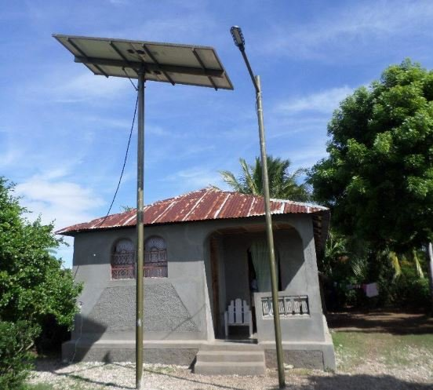
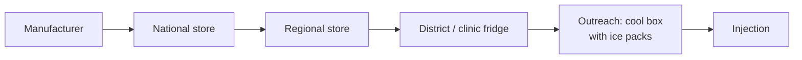

# The cold chain

**Prerequisites:** [How vaccines are made](12-how-vaccines-are-made.md)

*A solar-powered clinic in Haiti that uses the electricity to refrigerate rabies vaccine. Credit: Max F. Millien, Jocelyne B. Pierre-Louis, Ryan Wallace, Eduardo Caldas, Jean M. Rwangabgoba, Jean L. Poncelet, Ottorino Cosivi, Victor J. De. License: [CC0](http://creativecommons.org/publicdomain/zero/1.0/deed.en). Source: [File:Haitian clinic where solar power is used to refrigerate rabies vaccine.jpg](https://commons.wikimedia.org/wiki/File:Haitian_clinic_where_solar_power_is_used_to_refrigerate_rabies_vaccine.jpg).*

## Vaccines spoil

Most vaccines are biological products that lose potency if they get too warm, and some are damaged by freezing. A vaccine that has lost potency gives no warning: it looks the same and causes no harm in itself, but it may not protect. The **cold chain** is the system of refrigerated storage and transport that keeps vaccines within their required temperature range from the factory to the moment of injection.

## Temperature requirements

| Vaccine type | Typical storage |
|---|---|
| Most vaccines (DTaP, Hib, hepatitis, HPV, pneumococcal, inactivated flu) | Refrigerated, 2–8 °C; **must not freeze** |
| Varicella and shingles (Zostavax), MMRV in some formulations | Frozen in the US (−50 to −15 °C) |
| MMR (lyophilised) | Refrigerated or frozen; heat- and light-sensitive once reconstituted |
| Oral polio | Frozen for long-term storage |
| Pfizer–BioNTech COVID-19 (original) | −80 to −60 °C ultra-cold, later relaxed |
| Moderna COVID-19 | −50 to −15 °C, later relaxed |
| Ervebo (Ebola) | −80 to −60 °C |

Freezing is a common, underappreciated problem: aluminium-adjuvanted vaccines can be damaged if frozen, because the adjuvant particles clump. Studies in several countries have found vaccines exposed to freezing temperatures during transport or in domestic-style refrigerators.

## Tools

- **Vaccine vial monitors (VVMs)**: heat-sensitive labels on vials, introduced by WHO and UNICEF in 1996 for oral polio vaccine and now on many vaccines. A square inside a circle darkens with cumulative heat exposure; once the square matches or is darker than the circle, the vaccine should be discarded.
- **Data loggers** that record temperatures continuously.
- **Solar-powered refrigerators** and long-lasting passive cold boxes for areas without reliable electricity.
- **Controlled temperature chain** use: some vaccines (MenAfriVac, HPV, oral cholera) are approved for a single excursion of up to 40 °C for a few days, simplifying campaigns.

## Why it matters for the debate

The cold chain explains some apparent vaccine "failures" in outbreaks, particularly in places with unreliable electricity, and it is a major cost of immunisation programmes in low-income countries. Thermostable vaccines are therefore a research priority. It also explains differences between vaccines in practical use: during the COVID-19 pandemic the ultra-cold requirement of early mRNA vaccines made them hard to deploy in many countries, which is one reason the refrigerator-stable AstraZeneca vaccine was so widely used.

Cold chain lapses occasionally lead to recalls or revaccination campaigns in rich countries too, when a clinic fridge fails or is set wrongly. Health agencies treat such vaccines as invalid doses that need repeating, which is one source of "extra" doses in some children's records.

Freezing is as much a danger as heat. Vaccines containing aluminium adjuvants (such as DTaP, hepatitis B and many conjugate vaccines) can be damaged by freezing, which makes the adjuvant clump and reduces potency; health workers are taught a "shake test" to check for this. In domestic refrigerators the coldest spots near the freezer compartment can freeze vaccines, which is why clinics are told to use purpose-built vaccine fridges.

## Key ideas

- Most vaccines lose potency if too warm, and aluminium-adjuvanted ones are damaged by freezing.
- The cold chain keeps vaccines at 2–8 °C (or frozen, for some) from factory to injection.
- Vaccine vial monitors, data loggers and solar fridges help, especially in low-resource settings.
- Cold chain failures can cause unnoticed loss of protection; thermostable vaccines are a priority.

## Where this leads

- Next: [Routes, doses and combination vaccines](14-routes-doses-and-combination-vaccines.md).
- Related: [global immunisation programmes](../09-public-health-and-ethics/03-global-immunisation-programmes.md).
